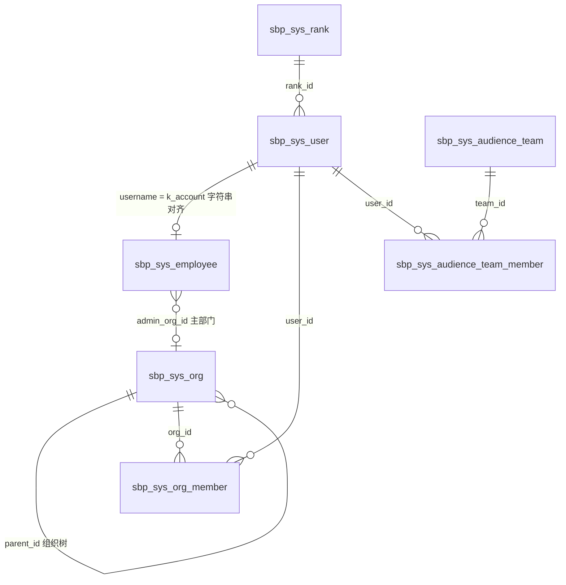

# 服务大脑 GSI 账号·组织关系与知识权限治理说明

> **依据来源**：同目录 `02-服务大脑GSI业务系统表结构.sql`（PostgreSQL `public` schema 全量 DDL，共 93 张表）。
> **文档定位**：主文档 [`02-服务大脑GSI业务系统表结构设计.md`](./02-服务大脑GSI业务系统表结构设计.md) 按域纵向展开，本文档做两处横向串联 —— §二（系统与权限域 M1）的「账号 / 组织 / 员工 / 受众团队」四表关系，以及 §七（知识平台域 M6）中 `sbp_km_doc_publication` 与 `sbp_km_doc_record` 构成的权限治理链路。
> **读者对象**：后端开发、前端联调、测试、架构与安全评审。
> **口径约定**：标「**可判定**」的结论直接由 DDL 字段/索引/注释得出；标「**待约定**」的说明 DDL 未做约束，必须由实现方定死后回写本文档。

## 修订记录

| 版本 | 日期 | 变更说明 |
|---|---|---|
| v1.0 | 2026-10-29 | 首次整理：sys 域四表关联关系 + km 域知识权限三层治理 |

---

## 一、sys 域：账号、组织、员工、受众团队

### 1.1 涉及表

| 表 | 主键 | 定位 |
|---|---|---|
| `sbp_sys_user` | `id int8` | 登录主体，全库用户外键的唯一锚点 |
| `sbp_sys_employee` | `id int8` | 人事档案（工号、身份证、上级、入离职） |
| `sbp_sys_org` | `id int8` | 组织树，`category` 分 admin（行政）/ business（业务）两棵 |
| `sbp_sys_org_member` | `(org_id, user_id)` | 组织 ↔ 用户多对多 |
| `sbp_sys_audience_team` | `id int8` | 受众团队（知识权限组），知识与 FAQ 的授权单位 |
| `sbp_sys_audience_team_member` | `(team_id, user_id)` | 团队 ↔ 用户多对多 |

### 1.2 关系全图（可判定）



另有两条一对多自关联（不在图中，见 1.3）：`sbp_sys_org.source_org_id` 指回行政节点；`sbp_sys_employee.supervisor_k` 指向上级 K 账号。

**关键结论**：`sbp_sys_audience_team` 与 `sbp_sys_org` 之间**不存在任何关联字段**，是两套平行体系。

### 1.3 关系逐条说明

| # | 关系 | 关联键 | 基数 | 实现方式 | 判定 |
|---|---|---|---|---|---|
| 1 | `user` ↔ `employee` | `user.username = employee.k_account` | 1 : 1 | **字符串对齐，无 ID 列** | 可判定 |
| 2 | `org` ↔ `user` | `org_member(org_id, user_id)` | M : N | 关联表，复合主键 | 可判定 |
| 3 | `employee` → `org` | `admin_org_id` | N : 1 | 单值冗余（主部门） | 可判定 |
| 4 | `org` → `org` | `parent_id` | 自关联 | 组织树，`0` 为顶级 | 可判定 |
| 5 | `org`(business) → `org`(admin) | `source_org_id` | N : 1 | 业务镜像指回行政节点，行政节点为空 | 可判定 |
| 6 | `employee` → `employee` | `supervisor_k` | 自关联 | 存**上级 K 账号**（字符串） | 可判定 |
| 7 | `audience_team` ↔ `user` | `audience_team_member(team_id, user_id)` | M : N | 关联表，复合主键 | 可判定 |
| 8 | `audience_team` ↔ `org` | **无** | — | DDL 中无 `org_id` 列 | 可判定 |

### 1.4 职责边界（不要混用）

| 表 | 回答什么问题 | 关键约束 |
|---|---|---|
| `sbp_sys_user` | **谁能登录**、登录名是什么 | `uk_sys_user_username(username) WHERE deleted=0`；`status` 在职/离职、`allow_login` 允许/禁止 |
| `sbp_sys_employee` | 这个人的**人事档案** | `uk_sys_employee_k_account` / `uk_sys_employee_emp_no` 均带 `WHERE deleted=0` |
| `sbp_sys_org` | 这个人**归属哪个部门/团队** | `uk_sys_org_category_code(category, code)` —— 编码只在同分类内唯一 |
| `sbp_sys_audience_team` | 这个人能**看哪些知识** | `uk_sys_audience_code(group_code)`；`status` 启停；`deleted` 逻辑删除 |

四个字段的语义要分清：

- `sbp_sys_user.position_name` 与 `sbp_sys_employee.position_name` 都是**快照值**，组织调整不会自动刷新；
- `sbp_sys_org.leader_name` 与 `sbp_sys_audience_team.leader_name` 都是**姓名字符串**，不是 `user_id`；
- `sbp_sys_audience_team` 有 `group_code`（唯一索引）和 `audience_team`（普通索引）**两个都像"团队标识"的列**，授权匹配只认 `group_code`（依据：`sbp_faq_publication.team` 注释明确写 `获授权受众团队(group_code)`，知识侧同构）；
- `sbp_sys_org.category` 默认值是 `business`，插入行政节点时必须显式传 `admin`，否则会静默落到业务树。

### 1.5 常用查询范式

**① 按 K 账号取登录主体 + 人事档案**（注意归一与 `deleted` 过滤）

```sql
SELECT u.id AS user_id, u.username, u.cn_name, u.status AS user_status,
       e.id AS employee_id, e.emp_no, e.admin_org_id, e.supervisor_k, e.status AS emp_status
  FROM sbp_sys_user u
  LEFT JOIN sbp_sys_employee e
    ON lower(trim(e.k_account)) = lower(trim(u.username))
   AND e.deleted = 0
 WHERE u.username = :account
   AND u.deleted = 0;
```

**② 我所在的受众团队**（知识可见性的唯一入口）

```sql
SELECT t.id, t.group_code, t.group_name
  FROM sbp_sys_audience_team_member m
  JOIN sbp_sys_audience_team t ON t.id = m.team_id
 WHERE m.user_id = :uid
   AND t.status = '1'
   AND t.deleted = 0;
```

**③ 我所在的组织**（必须按 `category` 分树取，不能混算）

```sql
SELECT o.id, o.name, o.category, o.type
  FROM sbp_sys_org_member m
  JOIN sbp_sys_org o ON o.id = m.org_id
 WHERE m.user_id = :uid
   AND o.status = '1'
   AND o.deleted = 0;
```

**④ 团队人数 / 某人在哪些团队**：`idx_sys_audience_member_user(user_id)` 支撑反向查询，无需全表扫。

### 1.6 六个风险点

| # | 风险 | 后果 | 应对 |
|---|---|---|---|
| 1 | `user.id` 与 `employee.id` 都是 `int8` 自增，且都可能恰好等于同一数字 | 代码里互换主键不会报错，但取到错误的人 | 变量命名区分 `user_id` / `employee_id`；关联一律走 `k_account` |
| 2 | `uk_sys_employee_k_account` 带 `WHERE deleted=0` | 同 K 账号逻辑删除后可再建一条 → `LEFT JOIN` 出多行 | 查询强制 `e.deleted = 0`；必要时按 `id DESC` 取最新一条 |
| 3 | `leader_name` / `owner` 是姓名快照 | 负责人换人后已发布知识的 `owner` 不联动 | 走 `sbp_km_transfer`（责任继承）显式转交，不靠自动刷新 |
| 4 | `org` 双树共用一张表 | 跨树 join 会得到"一个人挂着两个部门"的错觉 | admin 树由人事同步维护、business 树由业务维护，统计时明确用哪棵树 |
| 5 | 受众团队与组织树无关联 | 「某部门自动可见某知识」无法直接实现 | 见 1.7 |
| 6 | `sbp_km_doc_invisible_team.team` 注释为「编码**或名称**」 | 黑名单可能存名称，而 `publication.team` 存编码 → 匹配不上，黑名单失效 | **待约定**：黑名单统一按 `group_code` 存储，注释同步修正 |

### 1.7 组织与受众团队之间的映射（待约定）

当前 DDL 下，`audience_team` 只到「团队 → 用户」一级，没有「组织 → 团队」通道。若业务要求"部门整体授权"，只有两条路径：

| 路径 | 做法 | 代价 |
|---|---|---|
| A. 应用层展开 | 通过 `org_member` 取 `user_id` 集合，再落 `audience_team_member` | 需要同步/回收机制；人员调岗必须触发重算，否则权限残留 |
| B. 复用 `audience_team` 列 | 把 `varchar(128)` 的 `audience_team` 列约定为组织编码，与 `org.code` 对齐 | DDL 无唯一约束、无校验，语义完全靠约定；且该列已有 `idx_sys_audience_team` 索引暗示曾被使用 |

**建议**：优先 A（显式、可审计）；B 作为过渡方案必须在本文档登记并补数据校验脚本。

---

## 二、km 域：知识权限治理

### 2.1 一句话结论

知识的「可见性」**不由 `sbp_km_doc` 决定**，而由 `sbp_km_doc_publication` 的一行行（`doc_id` × `team`）决定；`sbp_km_doc_record` 负责把这些"行"背后到底对应哪一版内容冻结成不可变快照。

### 2.2 三层状态模型

```
              编辑态（实时改动，不对外生效）
   sbp_km_doc  +  sbp_km_doc_audience  +  sbp_km_doc_invisible_team
                          │
                          │ 提交送审
                          ▼
              审批态（内容冻结，逐阶段留痕）
   sbp_km_doc_record   stage   = save / owner / audience
                       snapshot_json = 整篇不可变快照
                       status  = saved / pending / approved / returned / cancelled
                          │
                          │ approved 后落生效指针
                          ▼
              生效态（对外可见的唯一依据）
   sbp_km_doc_publication (doc_id, team) → record_id → snapshot_json
                                          index_status = pending / succeeded / failed
```

### 2.3 参与表与职责

| 表 | 所属层 | 管什么 | 关键约束 |
|---|---|---|---|
| `sbp_km_doc` | 主体 | `status`（Draft/Pending Owner Review/Published/Unpublished）、`team`（**归属**业务团队，非授权）、`owner`/`author`、`trust`（A/B/C）、`expire_at` | `meta_json` 注释已声明「受众已拆至关联表」 |
| `sbp_km_doc_audience` | 编辑态 | 六维受众：`department / team / role / region / skill / scenario`，`value` 含「全部」哨兵 | `UNIQUE(doc_id, dim, value)`，`dim` 有 CHECK |
| `sbp_km_doc_invisible_team` | 编辑态 | 不可见团队黑名单 | `UNIQUE(doc_id, team)`；无快照、无审批，**改动即时生效** |
| `sbp_km_doc_record` | 审批态 | 三阶段记录 + 整篇冻结快照 + 审批意见 | `uk_km_doc_active_owner(doc_id) WHERE stage='owner' AND status='pending'`；`uk_km_doc_record_instance(instance_id)` |
| `sbp_km_doc_publication` | 生效态 | 授权矩阵（`doc_id` × `team`）→ 生效快照 | `UNIQUE(doc_id, team)`；**无 `deleted` 列**，撤销 = 删行 |
| `sbp_km_unpublish_job` | 治理 | 下架 / 反授权任务 | `uk_km_unpublish_pending_resource(resource_type, resource_id) WHERE status='PENDING'` |
| `sbp_km_trust_config` | 引用权限 | `allow_qa` / `allow_qc` 决定该级别能否被问答、质检引用 | 按 `level` 单行配置 |

### 2.4 判定链路

```sql
WITH my_teams AS (
  SELECT t.group_code
    FROM sbp_sys_audience_team_member m
    JOIN sbp_sys_audience_team t
      ON t.id = m.team_id
   WHERE m.user_id = :uid
     AND t.status = '1'
     AND t.deleted = 0
)
SELECT p.doc_id, p.record_id
  FROM sbp_km_doc_publication p
  JOIN my_teams t ON t.group_code = p.team          -- ① 有生效授权
 WHERE NOT EXISTS (                                 -- ② 未被拉黑（黑名单优先）
         SELECT 1 FROM sbp_km_doc_invisible_team i
          WHERE i.doc_id = p.doc_id AND i.team = p.team)
   AND EXISTS (                                     -- ③ 内容取自审批快照
         SELECT 1 FROM sbp_km_doc_record r
          WHERE r.id = p.record_id AND r.status = 'approved')
   AND EXISTS (                                     -- ④ 知识级别允许被问答引用
         SELECT 1 FROM sbp_km_trust_config c
           JOIN sbp_km_doc d ON d.id = p.doc_id
          WHERE c.level = d.trust AND c.allow_qa = true)
   AND p.index_status = 'succeeded';                -- ⑤ 检索索引已就绪
```

四条硬规则：

1. **判可见性只查 `publication`**，不查 `sbp_km_doc.status`；
2. **黑名单优先于白名单**：先排除，再授权；
3. **展示内容必须读 `record.snapshot_json`**，不能读 `sbp_km_doc.content`，否则会出现"改了没审就对外生效"；
4. **撤销授权 = 删 `publication` 行**（该表无 `deleted`、无 `status`）。

### 2.5 生命周期与落库位置

| 阶段 | 操作 | 落库 | 保障 |
|---|---|---|---|
| 保存草稿 | 暂存 | `record(stage='save', run_id=NULL)` | `run_id` 为空即区分保存与送审 |
| 提交内容审 | 送审 | `record(stage='owner', status='pending')` | `uk_km_doc_active_owner` 库层禁止重复送审 |
| 内容审通过 | 进入受众审 | `record(stage='owner', status='approved')` + 生成 audience 待审记录 | `run_id` 串联同一轮审批 |
| 受众分团队审 | 按团队分单 | `record(stage='audience', team=group_code, status='pending')` | `uk_km_doc_record_instance` 保证一实例一记录 |
| 发布生效 | 写授权矩阵 | 每个授权团队一行 `publication(doc_id, team, record_id)` | `UNIQUE(doc_id, team)`，重复发布覆盖 `record_id` |
| 同步检索索引 | 推 ES | `publication.index_status` → `succeeded/failed` | **缺口**：无 `attempts`/`next_attempt_at`，失败重试只能按 `index_status='failed' + updated_at` 扫表 |
| 下架 / 反授权 | 撤权 | 删 `publication` 行 + 建 `sbp_km_unpublish_job` | `publication_ids` 冻结计划时的生效集合，防误删新版本 |
| 到期复核 | 治理提醒 | `sbp_km_governance_action(action='REVIEW_DUE')` | `id` 用「对象 + 周期」固定标识，重复提醒冲突去重 |
| 座席反馈修订 | 反馈闭环 | `sbp_km_feedback_case` → `approval_record_id` 指回终审 | `requires_resubmit` 决定是否强制重新送审 |
| 责任交接 | 换 Owner | `sbp_km_transfer` + `transfer_item` + `transfer_job` | `uk_km_transfer_resource(...) WHERE reserved=true` |

### 2.6 与 FAQ 侧的差异（易混点）

| 维度 | 知识（km） | FAQ |
|---|---|---|
| 审批阶段 | `save / owner / audience` 三阶段 | `version / owner / audience / owner_final` **四阶段** |
| 防重复内容审 | 有 `uk_km_doc_active_owner` | **无**，需应用层保证 |
| 工作流实例唯一 | `uk_km_doc_record_instance` 唯一 | `idx_sbp_faq_record_instance` 普通索引，**不唯一** |
| 黑名单生效时机 | 编辑态即时生效（`doc_invisible_team`） | 随审批冻结进 `publication.access_rules_json` |
| 有效期粒度 | 文档级单值 `sbp_km_doc.expire_at` | 团队级规则集 `access_rules_json` |
| 生效记录主键 | `id varchar(64)` | `id varchar(64)`，另有 `access_rules_json` |

结论：知识侧是「白名单快照化 + 黑名单实时化」，FAQ 侧是「黑白名单与有效期全部快照化」。两侧治理语义**不一致**，联调时不能照抄。

### 2.7 DDL 未闭合的五个口径（待约定）

| # | 问题 | 风险 | 建议口径 |
|---|---|---|---|
| 1 | `doc_audience` 有 6 个 `dim`，而 `publication` 只有 `team` 一维 | department/role/region/skill/scenario 在生效态没有落点与判定依据 | 发布时把这些维度**展开**为 `group_code` 集合再写 `publication`，展开规则成文 |
| 2 | `doc_audience.value` 的「全部」哨兵如何落到 `publication` | 各团队改法不一，判定漏行 | 二选一并统一：写一行 `team='ALL'`（`team` 无 CHECK，允许），判定加 `OR p.team='ALL'` |
| 3 | 黑名单无快照，即时生效 | 与 FAQ「随审批生效」口径冲突；误拉黑立即影响线上 | 明确「知识黑名单即时生效」为有意设计（应急拉黑），并在操作日志留痕 |
| 4 | `doc.status='Unpublished'` 与 `publication` 行是否同步删 | 只改 status 不删行 → 已下架仍可见 | 下架必须「改 status + 删 publication 行 + 建 unpublish_job」同事务/同任务完成 |
| 5 | `publication.index_status` 失败无重试字段 | 索引同步失败后长期不一致 | 按 `index_status='failed'` + `updated_at` 扫描重推，或补 `attempts`/`next_attempt_at` |

---

## 三、待确认事项汇总

| # | 事项 | 影响面 | 建议责任方 |
|---|---|---|---|
| Q1 | 「部门整体授权」走应用层展开还是复用 `audience_team` 列 | 权限同步、调岗回收 | 后端 + 业务 |
| Q2 | `doc_audience` 六维在发布时如何折叠为 `team` | 权限判定正确性 | 后端 |
| Q3 | 「全部」哨兵在 `publication` 的表示法 | 权限判定正确性 | 后端 |
| Q4 | 知识侧黑名单是否改为一并快照化（对齐 FAQ） | 治理语义一致性 | 架构 + 安全 |
| Q5 | `index_status` 失败是否补重试字段（DDL 变更） | 检索一致性 | 后端 + DBA |
| Q6 | `sbp_km_doc_invisible_team.team` 注释「编码或名称」修正为仅编码 | 数据脏读 | 后端 |

---

**附**：字段级唯一事实源见同目录 `02-服务大脑GSI业务系统表结构.sql`；本文档与 DDL 不一致时以 DDL 为准，并应回写本文档。若 DDL 变更涉及上述任一「待约定」口径，须同步更新第二节。
