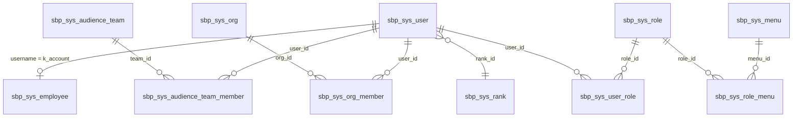
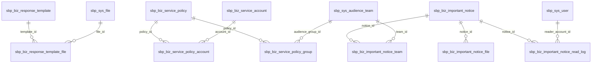

# 服务大脑 GSI 业务系统表结构设计

> **依据来源**：同目录 `服务大脑 GSI 业务系统表结构.sql`（PostgreSQL `public` schema 全量导出 DDL，共 **93 张表**）。
> **文档定位**：把 DDL 中分散的建表语句、列注释、索引与约束，整理成可评审、可开发的表结构设计说明；DDL 为字段级唯一事实源，本文档负责说明「为什么这么设计」以及「表与表如何咬合」。
> **读者对象**：后端开发、DBA、前端联调、测试、架构与安全评审。

## 修订记录

| 版本 | 日期 | 变更说明 |
|---|---|---|
| v1.0 | 2026-10-29 | 依据当前 DDL 初次整理：整体约定 + 8 个业务域逐表说明 + 索引与关联关系 |
| v1.1 | 2026-10-29 | §2.1、§7.1 新增指向专题文档《账号组织关系与知识权限治理说明》的交叉引用 |

---

## 一、整体说明

### 1.1 设计目标

| 目标 | 落地方式 |
|---|---|
| 一个库承载业务配置、主数据、知识资产、会话留痕 | 单库 `public` schema 平铺，不做多库拆分，跨域关联用 ID + 应用层校验 |
| 业务态与解析态解耦 | 知识/FAQ 主表只存业务状态（`status`），AI 解析过程单独用 `*_parse_job` / `*_parse_result` 承载 |
| 审批留痕不可变 | `sbp_km_doc_record` / `sbp_faq_record` 以 `snapshot_json` 存不可变快照，主表只存当前值 |
| 跨服务调用最终一致 | 回调与下架、责任继承统一走「收件箱 / 任务表 + 重试字段（attempts、next_attempt_at）」 |
| 可回溯 | 所有可编辑实体带 `created_by/updated_by/created_at/updated_at/version/deleted` 六件套 |

### 1.2 数据库与运行环境

| 项 | 口径 |
|---|---|
| 数据库 | PostgreSQL（`public` schema），支持 `jsonb`、部分索引、表达式索引、`vector` 类型扩展 |
| 时间类型 | 业务时间列统一 `timestamp(6)`（无时区），默认值 `CURRENT_TIMESTAMP`；纯日期用 `date` |
| 结构版本管理 | 库内存在 `flyway_schema_history`，说明结构由 Flyway 版本化脚本维护；应用侧不得手工改表 |
| 字符与文本 | 枚举值用 `varchar`/`text` 存中文或英文枚举字面量，不用数据库 `ENUM` 类型，便于扩枚举 |
| 状态位 | 启用/停用统一 `bpchar(1)`：`'1'` 启用、`'0'` 停用 |
| 逻辑删除 | 统一 `deleted` 列：`0` 有效、`1` 已删；类型混用 `int2`/`int4`（见 §11.3） |

### 1.3 命名规范

**表名**：`sbp_` + 域前缀 + `_` + 业务名，全小写下划线。

| 域前缀 | 含义 | 表数 |
|---|---|---|
| `sys_` | 系统与权限、组织人事、字典、文件、日志、调度、工作台 | 25 |
| `biz_` | 座席侧业务配置（模板、派单、策略、通告）与导入回执 | 16 |
| `km_` | 知识平台（文档、知识块、解析、审批、发布、会话、治理、责任继承） | 26 |
| `faq` | FAQ 问答独立资产线 | 7 |
| `data_` | 邮件/CSV 抽取落地的业务数据底座 | 12 |
| `agent_` | 座席辅助实时录入 | 2 |
| `mdm_` | 主数据映射 | 1 |
| `log_` | 抽取审计流水 | 1 |
| `wf_` | 工作流对接收件箱 | 1 |
| 无前缀 | 迁移历史、向量演示 | 2 |
| **合计** | — | **93** |

> 注：前缀统计与 §1.4 的模块统计口径不同 —— 模块按业务职责划分，因此部分 `sys_`/`biz_` 表（日志、调度、导入回执、同步配置）落在运维域（M2）。

**索引命名**：`idx_<表名或简称>_<列>`（普通索引）、`uk_<表名或简称>_<列>`（唯一索引）；少数表沿用 PostgreSQL 默认 `*_pkey`。
**约束命名**：`ck_`（CHECK）、`fk_`（外键）、`uk_`（唯一约束）与 `*_check` 混用并存，新建对象统一用 `ck_/uk_/fk_` 前缀。

**字段命名**：语义直接取自上游系统的业务字段保留英文原名（如 `assignment_group`、`short_description`），系统自建字段用中文直译英文（如 `audience_team`、`review_due`）。

### 1.4 模块总览

| 编号 | 模块 | 表数 | 职责一句话 |
|---|---|---|---|
| M1 | 系统与权限域（`sbp_sys_*`、`sbp_wf_*`） | 20 | 账号、角色、菜单、组织、受众团队、职级、区域、字典、文件、工作台待办/申请、工作流回调收件箱 |
| M2 | 运维与可观测域（`sbp_sys_oper_log`、`sbp_sys_*_log`、`sbp_log_*`、`sbp_biz_config_import_receipt`、`sbp_cdp_sync_config`） | 9 | 操作/登录/第三方调用/任务执行日志、数据导入回执、CDP 同步配置与 SMTP 配置 |
| M3 | 座席辅助域（`sbp_agent_*`） | 2 | 通话中快速录单与身份核验留痕 |
| M4 | 业务配置域（`sbp_biz_*`） | 15 | 开单话术模板、回复模板、派单组、开单信息、问题类型、快捷链接、身份策略、要事通告 |
| M5 | 数据抽取底座域（`sbp_data_*`、`sbp_mdm_*`） | 12 | 工单/资产/交互/待处理快照/资产台账/员工主数据/RHQ 映射 |
| M6 | 知识平台域（`sbp_km_*`） | 26 | 知识文档与知识块、AI 解析、审批发布、受众权限、责任继承、下架、治理、消费与问答 |
| M7 | FAQ 域（`sbp_faq*`） | 7 | FAQ 独立资产的解析、审批、发布与送审幂等 |
| M8 | 迁移与演示 | 2 | `flyway_schema_history`、`vector_demo` |

### 1.5 通用字段组

为压缩逐表说明，下文用三组代号引用重复字段：

| 代号 | 字段 | 出现场景 |
|---|---|---|
| **审计组 A** | `created_by`、`updated_by`、`created_at`、`updated_at`、`version`、`deleted` | 可在管理端编辑的配置类表（类型多为 `text`/`varchar(128)`，`version int4 DEFAULT 0`） |
| **审计组 B** | `created_at`、`updated_at`（部分含 `deleted`） | 单据、明细、流水类表 |
| **审计组 C** | 无 | 纯日志、纯映射、纯关联表 |

### 1.6 主键与 ID 策略

| 策略 | 使用场景 | 示例 |
|---|---|---|
| `bigserial` / `int8 GENERATED BY DEFAULT AS IDENTITY` | 数据库自增数值主键；适合高频写入、外部不暴露 ID 的表 | `sbp_sys_user.id`、`sbp_km_chat_retrieval.id`、`sbp_agent_assist_ticket.id` |
| `varchar(64)` UUID 字符串 | 需要业务侧先算 ID、跨服务传递、或作为幂等键的表 | `sbp_km_doc.id`、`sbp_faq.id`、`sbp_km_doc_record.id` |
| `varchar(36)` UUID | 责任继承、下架、回调收件箱等任务类表 | `sbp_km_transfer.id`、`sbp_km_unpublish_job.id`、`sbp_wf_callback_inbox.id` |
| 复合主键 | 纯多对多关联表 | `sbp_sys_user_role(user_id, role_id)`、`sbp_biz_important_notice_team(notice_id, team_id)` |
| 单行表 | 全局唯一配置 | `sbp_cdp_sync_config.id` 固定为 `1`、`sbp_km_trust_config.level` 固定 `A/B/C` |

另外两类「业务唯一键」独立于主键存在，且一律通过**部分唯一索引**实现：
- 业务单号：`ticket_id`、`faq_no`、`knowledge_no`、`case_no`、`transfer_no`；
- 幂等键：`request_id`、`payload_hash`、`idempotency_key`、`batch_id`。

### 1.7 数据完整性策略（为什么几乎没有外键）

| 现象 | 说明 |
|---|---|
| 绝大多数表之间**无物理外键** | 关联靠「ID 字段 + 应用层校验」，避免抽取数据（`sbp_data_*`）整表覆盖时被外键阻塞，也避免跨服务写入冲突 |
| 仅后期增量补建的关联表带外键 | `sbp_biz_important_notice*`、`sbp_biz_response_template_file`、`sbp_biz_service_policy_*`、`sbp_data_*_tickets_details`、`sbp_faq_audience`、`sbp_faq_invisible_team`、`sbp_km_chunk` 共 19 条 `FOREIGN KEY` |
| 结论 | 数据一致性责任前移到服务层；新增关联表建议与既有风格保持一致：**同一事务内必写关联表**可用外键，**批量覆盖/异步写入**一律不用外键 |

### 1.8 索引设计策略

| 策略 | 说明 | 代表 |
|---|---|---|
| 部分索引 `WHERE deleted = 0` | 逻辑删除表上的查询索引只覆盖有效行，索引更小更快 | `idx_sbp_km_doc_status`、`idx_policy_active` |
| 部分唯一索引表达业务唯一 | 删除后可复用同一业务键（`faq_no`、`ticket_id`、`username`） | `uk_sbp_faq_no`、`uk_data_tickets_ticket_id` |
| 表达式索引做大小写不敏感唯一 | 上游账号/调用号大小写不统一，用 `lower()` 归一 | `uk_sbp_agent_assist_ticket_call_id`、`uk_sbp_agent_identity_verify_prid_call` |
| 复合索引按「过滤列 + 排序列」 | 列表页典型查询：归属人 + 状态 + 时间倒序 | `idx_sbp_km_chat_session_user(user_id, updated_at DESC)`、`idx_km_change_doc_time(doc_id, created_at DESC, id DESC)` |
| 幂等/任务扫描索引 | 「待处理 + 下次执行时间」组合，供调度器批量取任务 | `idx_km_transfer_jobs(status, next_attempt_at)`、`idx_wf_callback_inbox_due` |
| 条件唯一防并发重复 | 「同一对象同时只能有一个未完成态」用部分唯一索引在库层兜底 | `uk_km_unpublish_pending_resource`、`uk_km_doc_active_owner`、`uk_km_transfer_resource` |

### 1.9 时间口径

- 数据库默认值 `CURRENT_TIMESTAMP` 落的是**数据库服务器本地时间**，与应用侧统一按本地时间（北京时间）解释，不做 UTC 转换。
- 上游抽取表（`sbp_data_*`）中的 `create_time`、`close_time`、`updated_time` 等**来自源系统**，语义是业务发生时间，不得直接与 `created_at`（落库时间）比较。
- 计划类字段有明确语义：`scheduled_at`（计划执行时间）、`effective_date`（生效日期，含当天）、`revision_since_at`（本轮修订起算时间）。

### 1.10 状态枚举汇总

| 语义 | 取值 | 出现在 |
|---|---|---|
| 启用状态 | `'1'` 启用 / `'0'` 停用（`bpchar(1)`） | 所有 `*_sys_*` 配置表、`sbp_biz_*` 模板 |
| 删除标记 | `0` 有效 / `1` 已删 | 绝大部分业务表 |
| 知识/FAQ 业务态 | `Draft` / `Pending Owner Review` / `Published` / `Unpublished` | `sbp_km_doc.status`、`sbp_faq.status` |
| AI 解析态 | `none/queued/running/succeeded/failed/cancelled` | `sbp_km_doc.ai_recognize_status`、`sbp_km_ai_parse_job.status` |
| 审批阶段 | `save`（保存）/`owner`（内容审）/`audience`（受众审）/`owner_final`（终审发布） | `sbp_km_doc_record.stage`、`sbp_faq_record.stage` |
| 审批结果 | `saved`/`pending`/`approved`/`returned`/`cancelled` | `sbp_km_doc_record.status`、`sbp_faq_record.status` |
| 索引同步 | `pending`/`succeeded`/`failed` | `sbp_km_doc_publication.index_status`、`sbp_faq_publication.index_status` |
| 下架任务 | `PENDING`/`SUCCEEDED`/`FAILED`/`CANCELLED`；索引清理 `NONE`/`PENDING`/`SUCCEEDED`/`FAILED` | `sbp_km_unpublish_job` |
| 会话角色 | `user` / `assistant` | `sbp_km_chat_message.role` |
| 赞踩 | `like` / `dislike` | `sbp_km_chat_message_reaction`、`sbp_km_consume_like` |
| 抽取入库模式 | `add` / `update` / `cover` | `sbp_log_main_data_upload.upload_type` |
| 逻辑文件删除 | 固定 `0`（禁止删除，停用走 `status`） | `sbp_biz_feedback_issue_type.deleted` |

---

## 二、系统与权限域（M1，20 张）

### 2.1 域概览

| 表 | 中文名 | 主键 | 职责 |
|---|---|---|---|
| `sbp_sys_user` | 系统用户 | `id int8` | 登录主体，账号体系根节点 |
| `sbp_sys_role` | 系统角色 | `id int8` | RBAC 角色 |
| `sbp_sys_user_role` | 用户角色关联 | 复合 | 用户 ↔ 角色多对多 |
| `sbp_sys_menu` | 系统菜单 | `id int8` | 菜单/权限资源树 |
| `sbp_sys_role_menu` | 角色菜单关联 | 复合 | 角色 ↔ 菜单多对多 |
| `sbp_sys_org` | 组织 | `id int8` | 行政（admin）/业务（business）两套组织树 |
| `sbp_sys_org_member` | 组织成员 | 复合 | 组织 ↔ 用户多对多 |
| `sbp_sys_audience_team` | 受众团队 | `id int8` | 知识权限组，知识与 FAQ 的授权单位 |
| `sbp_sys_audience_team_member` | 受众团队成员 | 复合 | 团队 ↔ 用户多对多 |
| `sbp_sys_rank` | 职级 | `id int8` | 职级主数据 |
| `sbp_sys_region` | 区域 | `id int8` | 国家/省/市/县四级 |
| `sbp_sys_customer` | 客户 | `id int8` | 公司/部门树 |
| `sbp_sys_dict_type` | 字典类型 | `id int8` | 字典分组 |
| `sbp_sys_dict_data` | 字典数据项 | `id int8` | 字典键值 |
| `sbp_sys_employee` | 员工主数据 | `id int8` | K 账号人事档案 |
| `sbp_sys_file` | 系统文件 | `id int8` | 上传文件元数据与存储路径 |
| `sbp_sys_tenant_appearance` | 租户外观 | `id int8` | 主题/Logo 等外观 JSON |
| `sbp_sys_workbench_task` | 工作台待办 | `id bigserial` | 跨业务待办投影 |
| `sbp_sys_workbench_apply` | 工作台申请 | `id bigserial` | 跨业务申请投影 |
| `sbp_wf_callback_inbox` | 工作流回调收件箱 | `id varchar(36)` | 外部工作流取消回调的可靠落地 |



> **延伸阅读**：`sbp_sys_user` / `sbp_sys_org` / `sbp_sys_employee` / `sbp_sys_audience_team` 四表的逐条关联、查询范式与六个风险点，见专题文档 [`服务大脑 GSI 账号组织关系与知识权限治理说明.md`](./服务大脑%20GSI%20账号组织关系与知识权限治理说明.md) 第一节。

### 2.2 逐表说明

#### 2.2.1 `sbp_sys_user` 系统用户

| 字段 | 类型 | 说明 |
|---|---|---|
| `id` | `int8` 自增 | 主键，全库用户外键的唯一锚点 |
| `username` | `varchar(64) NOT NULL` | 登录账号；K 账号，与 `sbp_sys_employee.k_account` 对齐 |
| `password_hash` | `varchar(128) NOT NULL` | 密码哈希，默认空串 |
| `cn_name` / `en_name` | `varchar(64)` | 中文名 / 英文名 |
| `email` / `phone` | `varchar(128)` / `varchar(32)` | 邮箱、手机号 |
| `rank_id` | `int8` | 职级 ID → `sbp_sys_rank.id` |
| `position_name` | `varchar(128)` | 职位名称（快照，不随组织变动自动刷新） |
| `status` | `bpchar(1) NOT NULL` | 在职状态：`1` 在职 / `0` 离职 |
| `allow_login` | `bpchar(1) NOT NULL` | 是否允许登录：`1` 允许 / `0` 禁止 |

另含审计组 A。

**索引**：`uk_sys_user_username(username) WHERE deleted = 0`（账号可复用）；`idx_sys_user_status(status)`
**关联**：被 `sbp_sys_user_role`、`sbp_sys_org_member`、`sbp_sys_audience_team_member`、`sbp_biz_important_notice.creator_id`、`sbp_biz_important_notice_read_log.reader_account_id` 引用；业务表的 `created_by` 存的是**账号字符串**而非本表 ID。

#### 2.2.2 `sbp_sys_role` 系统角色

| 字段 | 类型 | 说明 |
|---|---|---|
| `id` | `int8` 自增 | 主键 |
| `role_code` | `varchar(64) NOT NULL` | 角色编码（程序判定用） |
| `role_name` | `varchar(128) NOT NULL` | 角色名称（展示用） |
| `status` | `bpchar(1) NOT NULL` | `1` 启用 / `0` 停用 |
| `remark` | `varchar(512) NOT NULL` | 备注 |

另含审计组 A。
**索引**：`uk_sys_role_code(role_code)`（真唯一，不含 `deleted` 条件）

#### 2.2.3 `sbp_sys_user_role` 用户角色关联

纯关联表，审计组 C，`PRIMARY KEY (user_id, role_id)`，`idx_sys_user_role_role(role_id)` 支持「按角色反查人」。

#### 2.2.4 `sbp_sys_menu` 系统菜单

| 字段 | 类型 | 说明 |
|---|---|---|
| `id` | `int8` 自增 | 主键 |
| `parent_id` | `int8 NOT NULL` | 父菜单 ID，`0` 为顶级 |
| `title` | `varchar(128) NOT NULL` | 菜单标题 |
| `path` | `varchar(256) NOT NULL` | 路由路径或外链 |
| `icon` | `varchar(64) NOT NULL` | 图标名 |
| `order_no` / `level_no` | `int4 NOT NULL` | 同级排序号 / 层级（从 1 开始） |
| `group_name` | `varchar(64) NOT NULL` | 分组名称 |
| `resource` | `varchar(128) NOT NULL` | 权限资源标识，与后端权限点对应 |
| `is_default` / `is_enabled` | `bool NOT NULL` | 是否默认菜单 / 是否启用 |

另含审计组 A。**索引**：`idx_sys_menu_parent(parent_id)`、`idx_sys_menu_resource(resource)`

#### 2.2.5 `sbp_sys_role_menu` 角色菜单关联

纯关联表，`PRIMARY KEY (role_id, menu_id)`，`idx_sys_role_menu_menu(menu_id)`。

#### 2.2.6 `sbp_sys_org` 组织

| 字段 | 类型 | 说明 |
|---|---|---|
| `id` | `int8` 自增 | 主键 |
| `parent_id` | `int8 NOT NULL` | 上级组织 ID，`0` 顶级 |
| `name` / `code` | `varchar(128)` / `varchar(64) NOT NULL` | 组织名称 / 编码 |
| `type` | `varchar(16) NOT NULL` | 节点类型：`dept` / `team` 等 |
| `category` | `varchar(16) NOT NULL` | 组织分类：`admin` 行政 / `business` 业务，**两棵树同表共存** |
| `source_org_id` | `int8` | 业务镜像节点对应的行政组织 ID；行政节点为空 |
| `order_no` / `status` / `leader_name` / `remark` | — | 排序、启停、负责人、备注 |

另含审计组 A。
**索引**：`uk_sys_org_category_code(category, code)`（同分类内编码唯一）；`idx_sys_org_parent`、`idx_sys_org_type`、`idx_sys_org_category`、`idx_sys_org_source`
**设计要点**：行政树（`admin`）由人事同步，业务树（`business`）由业务侧维护并用 `source_org_id` 指回行政节点，避免改组织机构时污染业务归属。

#### 2.2.7 `sbp_sys_org_member` 组织成员关联

`PRIMARY KEY (org_id, user_id)`，`idx_sys_org_member_user(user_id)`。

#### 2.2.8 `sbp_sys_audience_team` 受众团队

| 字段 | 类型 | 说明 |
|---|---|---|
| `id` | `int8` 自增 | 主键，被知识/FAQ 发布表引用的 `team` 数值形态 |
| `group_code` | `varchar(64) NOT NULL` | 团队编码，**知识与 FAQ 的 `team` 字段存的就是它** |
| `group_name` | `varchar(128) NOT NULL` | 团队名称 |
| `audience_team` | `varchar(128)` | 受众团队标识，另有索引支持按标识反查 |
| `leader_name` | `varchar(64) NOT NULL` | 负责人姓名（FAQ/知识 Owner 默认来源） |
| `status` / `remark` | — | `1` 启用 / `0` 停用 |

另含审计组 A。**索引**：`uk_sys_audience_code(group_code)`、`idx_sys_audience_team(audience_team)`

#### 2.2.9 `sbp_sys_audience_team_member` 受众团队成员

`PRIMARY KEY (team_id, user_id)`，`idx_sys_audience_member_user(user_id)`。这是「人 → 可见知识」权限判定的基础：当前用户所属 `team_id` 集合 → 查 `group_code` → 与发布表 `team` 匹配。

#### 2.2.10 `sbp_sys_rank` 职级

`rank_code`（唯一）、`rank_name`、`sort_no`、`status`、`remark` + 审计组 A。`uk_sys_rank_code`。

#### 2.2.11 `sbp_sys_region` 区域

`parent_id`、`level_no int2`（`1` 国家 `2` 省 `3` 市 `4` 县）、`name`、`code`、`order_no`、`status`、`remark` + 审计组 A。
**索引**：`uk_sys_region_code(code)`、`idx_sys_region_parent`、`idx_sys_region_level`

#### 2.2.12 `sbp_sys_customer` 客户（公司/部门树）

`parent_id`（`0` 为公司根）、`type`（`company`/`dept`）、`name`、`code`、`contact_name`、`contact_phone`、`order_no`、`status`、`remark` + 审计组 A。
**索引**：`uk_sys_customer_code(code)`、`idx_sys_customer_parent`。
**注意**：本表是系统侧客户档案树，与 `sbp_data_customer`（CDP 员工主数据）是两条独立线，不可混用。

#### 2.2.13 `sbp_sys_dict_type` 字典类型

`dict_name`、`dict_type`（唯一）、`status`、`remark` + 审计组 A。`uk_sys_dict_type(dict_type)`。

#### 2.2.14 `sbp_sys_dict_data` 字典数据项

`dict_type`（**按编码字符串关联字典类型，非 ID**）、`label`、`value`、`sort_no`、`status`、`css_class`、`remark` + `created_at`。
**索引**：`idx_sys_dict_data_type(dict_type)`；无 `deleted`，删除即物理删。

#### 2.2.15 `sbp_sys_employee` 员工主数据

| 字段 | 类型 | 说明 |
|---|---|---|
| `k_account` | `varchar(64) NOT NULL` | K 账号，**等于 `sbp_sys_user.username`** |
| `emp_no` | `varchar(64) NOT NULL` | 员工编号 |
| `name` | `varchar(64) NOT NULL` | 姓名 |
| `admin_org_id` | `int8` | 行政团队/部门组织 ID → `sbp_sys_org.id` |
| `yida_email` / `customer_email` | `varchar(128)` | 亿达邮箱 / 客户邮箱 |
| `position_name` | `varchar(128)` | 岗位名称 |
| `supervisor_k` | `varchar(64)` | 直属领导 K 账号（自关联） |
| `id_card` / `home_address` / `phone` | `varchar` | **敏感人事信息，接口侧须脱敏** |
| `entry_date` / `leave_date` | `date` | 入职 / 离职日期 |
| `status` | `bpchar(1) NOT NULL` | `1` 在职 / `0` 离职 |

另含审计组 A。**索引**：`uk_sys_employee_k_account(k_account) WHERE deleted=0`、`uk_sys_employee_emp_no(emp_no) WHERE deleted=0`、`idx_sys_employee_admin_org`、`idx_sys_employee_status`

#### 2.2.16 `sbp_sys_file` 系统文件

| 字段 | 类型 | 说明 |
|---|---|---|
| `file_uuid` | `varchar(64) NOT NULL` | 对外唯一标识，接口只暴露它 |
| `original_name` / `stored_name` / `ext` | `varchar` | 原始名、存储名、扩展名（小写不含点） |
| `content_type` / `size_bytes` | — | MIME、字节数 |
| `storage_type` | `varchar(16) NOT NULL` | `local` 本地 / `obs` 华为云 OBS |
| `storage_path` | `varchar(512) NOT NULL` | 本地相对路径或 OBS 对象键 |
| `public_url` | `varchar(1024) NOT NULL` | 对外访问 URL（相对或绝对） |
| `biz_type` / `biz_id` | `varchar(64) NOT NULL` | 业务类型（`logo`/`attach` 等）与业务关联 ID |
| `tenant_id` | `varchar(64) NOT NULL` | 租户，默认 `default` |
| `status` | `bpchar(1) NOT NULL` | `1` 有效 / `0` 作废 |

另含 `created_by` + `created_at/updated_at/deleted`。
**索引**：`uk_sys_file_uuid(file_uuid)`、`idx_sys_file_biz(biz_type, biz_id)`、`idx_sys_file_tenant`、`idx_sys_file_created`
**关联**：被 `sbp_biz_important_notice_file.file_id`、`sbp_biz_response_template_file.file_id` 以外键引用；`sbp_km_doc`/`sbp_faq` 通过 `source_file_id`/`file_id` 逻辑引用。

#### 2.2.17 `sbp_sys_tenant_appearance` 租户外观

`tenant_id`（唯一）、`config text NOT NULL`（外观 JSON）、`updated_by`、`updated_at`。审计组仅 `updated_*`，无 `deleted`。`uk_sys_tenant_appearance(tenant_id)`。

#### 2.2.18 `sbp_sys_workbench_task` 工作台我的待办

| 字段 | 类型 | 说明 |
|---|---|---|
| `id` | `bigserial` | 主键 |
| `task_type` | `varchar(48) NOT NULL` | 待办类型 |
| `title` / `summary` / `category` | `varchar` | 展示三件套 |
| `status` | `varchar(16) NOT NULL` | `pending` / `done` 等 |
| `assignee_user_id` / `assignee_key` | `int8` / `varchar(128)` | 处理人（ID + 业务键双写，便于跨系统投影） |
| `submitter` / `submitter_user_id` | — | 提交人展示名与 ID |
| `app_scope` | `varchar(16) NOT NULL` | `mgmt` 管理端 / `agent` 座席端 |
| `biz_type` / `biz_id` / `ref_no` | `varchar` | 回指真实业务对象 |
| `wf_instance_id` / `wf_task_id` | `varchar` | 工作流实例与任务标识（`wf_task_id` 同时作业务待办幂等键） |
| `payload_json` | `jsonb NOT NULL` | 扩展载荷，默认 `{}` |
| `reviewed_at` / `reviewer` | — | 处理完成时间与实际处理人 |

另含审计组 B + `deleted`。
**索引**：`idx_sbp_wb_task_assignee(assignee_user_id, status)`、`idx_sbp_wb_task_assignee_key(assignee_key, status)`、`idx_sbp_wb_task_scope(app_scope, status, created_at DESC)`、`idx_sbp_wb_task_biz(biz_type, biz_id)`、`idx_sbp_wb_task_instance(wf_instance_id)`、`idx_sbp_wb_task_wf(wf_task_id)`（后三者均带 `<> ''` 与 `deleted = 0` 条件）
**定位**：本表是「投影/读模型」，业务真值仍在各自业务表，删除与状态以业务表为准，本表可重建。

#### 2.2.19 `sbp_sys_workbench_apply` 工作台我的申请

字段与 `sbp_sys_workbench_task` 基本对称，差异：`applicant_user_id`/`applicant_key`/`submitter`（申请人侧）、无 `wf_task_id`。
**索引**：`idx_sbp_wb_apply_key(applicant_key, status)`、`idx_sbp_wb_apply_user(applicant_user_id, status)`、`idx_sbp_wb_apply_scope`、`idx_sbp_wb_apply_biz`、`idx_sbp_wb_apply_wf`

#### 2.2.20 `sbp_wf_callback_inbox` 工作流回调收件箱

| 字段 | 类型 | 说明 |
|---|---|---|
| `id` | `varchar(36)` | 「事件类型 + 流程实例」生成的幂等标识 |
| `instance_id` | `varchar(128) NOT NULL` | 工作流实例标识 |
| `payload_json` | `text NOT NULL` | 经过服务鉴权的原始回调内容 |
| `status` | `varchar(16) NOT NULL` | `PENDING` 待处理 / `COMPLETED` 已完成 |
| `attempts` / `next_attempt_at` / `last_error` | — | 重试三件套 |
| `created_at` / `completed_at` | `timestamp` | 接收时间 / 完成时间 |

**索引**：`idx_wf_callback_inbox_due(next_attempt_at) WHERE status = 'PENDING'`
**设计要点**：回调先落库再应答，**不在回调线程里等业务行锁**；由后台任务按 `next_attempt_at` 消费并重试，避免跨服务互相等待造成超时与重复取消。

---

## 三、运维与可观测域（M2，9 张）

### 3.1 域概览

| 表 | 中文名 | 主键 | 职责 |
|---|---|---|---|
| `sbp_sys_oper_log` | 统一操作日志 | `id int8` | 管理端与 `@OpLog` 审计共用 |
| `sbp_sys_login_log` | 登录日志 | `id int8` | 登录成功/失败留痕 |
| `sbp_sys_third_party_log` | 第三方接口调用日志 | `id int8` | 外部系统调用出站留痕 |
| `sbp_sys_job` | 定时任务配置 | `id int8` | 调度定义 |
| `sbp_sys_job_log` | 定时任务执行日志 | `id int8` | 调度结果 |
| `sbp_log_main_data_upload` | 主数据上传审计 | `id int8` | CSV/扫盘入库审计 |
| `sbp_biz_config_import_receipt` | 配置导入幂等回执 | 复合 | 配置文件批量导入的幂等凭证 |
| `sbp_cdp_sync_config` | CDP 员工同步配置 | `id` 固定 1 | 定时从 S3 拉全量员工 CSV |
| `sbp_sys_email_config` | 邮箱/SMTP 配置 | `id int8` | 邮件发送通道 |

### 3.2 逐表说明

#### 3.2.1 `sbp_sys_oper_log` 统一操作日志

| 字段 | 类型 | 说明 |
|---|---|---|
| `id` | `int8` 自增 | 主键 |
| `trace_id` | `varchar(64)` | 链路追踪 ID，串联同一次请求的第三方日志 |
| `module` / `business_type` | `varchar` | 系统模块 / 业务类型（新增、修改、删除、授权等） |
| `operator` / `operator_name` / `user_id` | — | 操作人账号、姓名、ID（三者冗余，账号改名不影响历史） |
| `dept_name` / `ip` / `location` | `varchar` | 部门、客户端 IP、归属地 |
| `status` | `bpchar(1)` | `0` 成功 / `1` 失败 |
| `method` / `request_url` / `request_param` / `response_result` / `error_msg` | — | 请求与响应摘要（均限长，超长截断） |
| `cost_ms` / `operate_time` | — | 耗时毫秒 / 操作时间 |
| `action` / `resource_type` / `resource_id` / `result_code` / `result_msg` | — | 结构化审计维度，支持「某资源的全部操作」检索 |

审计组 C（无 `deleted`，日志不可删改）。**索引**：`idx_sys_oper_log_time(operate_time)`、`idx_sys_oper_log_operator(operator)`、`idx_sys_oper_log_module(module)`
**写入注意**：日志写库必须与主请求事务隔离（独立会话/后台任务），否则在行锁竞争下会与业务事务互等。

#### 3.2.2 `sbp_sys_login_log` 登录日志

`username`、`browser`、`os`、`status`（`0` 成功/`1` 失败）、`ip`、`message`、`login_time`。审计组 C。
**索引**：`idx_sys_login_log_time(login_time)`、`idx_sys_login_log_user(username)`

#### 3.2.3 `sbp_sys_third_party_log` 第三方接口调用日志

`system_name`、`api_name`、`http_method`、`request_url`、`status_code`、`success bool`、`request_body`、`response_body`、`error_msg`、`cost_ms`、`trace_id`、`caller`、`call_time`。审计组 C。
**索引**：`idx_sys_tp_log_time(call_time)`、`idx_sys_tp_log_system(system_name)`、`idx_sys_tp_log_trace(trace_id)`（可与 `sbp_sys_oper_log.trace_id` 对齐排障）

#### 3.2.4 `sbp_sys_job` 定时任务配置

`job_name`、`job_group`（默认 `DEFAULT`）、`invoke_target`（调用目标字符串）、`cron_expression`、`status`（**`0` 正常 / `1` 暂停，与其它表相反，注意别写反**）、`remark` + 审计组 A。
**索引**：`idx_sys_job_status(status)`、`idx_sys_job_group(job_group)`

#### 3.2.5 `sbp_sys_job_log` 定时任务执行日志

`job_id`、`status`、`message`、`start_time`、`end_time`、`cost_ms`。审计组 C。`idx_sys_job_log_job(job_id)`。

#### 3.2.6 `sbp_log_main_data_upload` 主数据上传审计

`file_name`、`upload_type`（`add`/`update`/`cover`）、`table_name`、`state`（`succeed`/`error`）、`info`（成功行数或错误摘要）、`user`（Job 写 `system`）、`create_time`。审计组 C。
**索引**：`idx_log_main_data_upload_create_time(create_time)`

#### 3.2.7 `sbp_biz_config_import_receipt` 配置导入幂等回执

| 字段 | 类型 | 说明 |
|---|---|---|
| `actor` | `text NOT NULL` | 导入操作人 |
| `resource` | `text NOT NULL` | 配置资源类型 |
| `request_id` | `varchar(80) NOT NULL` | 客户端幂等请求标识 |
| `file_hash` | `varchar(64) NOT NULL` | 文件内容 SHA256 |
| `row_count` | `int4` | 成功导入行数，**NULL 表示事务仍在处理中** |
| `created_at` | `timestamp(6) NOT NULL` | 创建时间 |

**主键**：`(actor, resource, request_id)`——天然幂等。审计组 C。
**使用约定**：先插回执（`row_count` 为 NULL）再导入，导入成功后回填 `row_count`；重放同一 `request_id` 直接返回已有结果，`file_hash` 不一致则拒绝。

#### 3.2.8 `sbp_cdp_sync_config` CDP 员工同步配置（单行）

| 字段 | 类型 | 说明 |
|---|---|---|
| `id` | `int8 NOT NULL` | 固定为 `1` |
| `enabled` | `bpchar(1) NOT NULL` | `1` 启用定时 / `0` 停用 |
| `cron_expression` | `varchar(64) NOT NULL` | 默认 `0 10 2 * * ?`（每天 02:10，**Quartz 六位格式**） |
| `s3_prefix` | `varchar(256) NOT NULL` | 对象前缀，默认 `cdp/sbrain/employee_info/` |
| `s3_filename` | `varchar(128) NOT NULL` | 文件名后缀，默认 `/full_sbrain_employee_info.csv` |
| `local_temp_dir` | `varchar(512) NOT NULL` | 本地临时目录，默认 `./data/cdp` |
| `last_run_at` / `last_run_status` / `last_run_message` | — | 最近执行时间、状态（`SUCCESS`/`FAILED`/`SKIPPED`）、摘要 |
| `last_insert_count` / `last_update_count` | `int4 NOT NULL` | 最近新增/更新条数 |
| `updated_at` / `updated_by` | — | 配置更新人与时间 |

**关联**：本表是「拉取入口」，落库目标是 `sbp_data_customer`；`s3_prefix + s3_filename` 拼接后的对象即全量 CSV。

#### 3.2.9 `sbp_sys_email_config` 邮箱/SMTP 配置

`config_name`、`smtp_host`、`smtp_port`、`auth_enabled`、`username`、`password_cipher`（**密文存储，不允许明文**）、`encryption`（`none`/`ssl`/`starttls`）、`from_address`、`from_name`、`default_recipients`（逗号分隔）、`timeout_sec`（默认 30）、`status`、`remark`、`updated_by` + 审计组 A。
**索引**：`idx_sys_email_status(status)`

---

## 四、座席辅助域（M3，2 张）

### 4.1 域概览

| 表 | 中文名 | 主键 | 职责 |
|---|---|---|---|
| `sbp_agent_assist_ticket` | Ticket Builder 录入工单 | `id bigserial` | 通话中由座席辅助面板直接生成的工单草稿/成品 |
| `sbp_agent_identity_verify` | 身份认证记录 | `id bigserial` | 验证码发送与核验结果的流水留痕 |

两表共同点：**只追加、不修改、不逻辑删除**（无 `deleted`），因为它们记录的是「当时发生了什么」。

### 4.2 逐表说明

#### 4.2.1 `sbp_agent_assist_ticket` 座席辅助录入工单

| 字段 | 类型 | 说明 |
|---|---|---|
| `id` | `bigserial` | 主键 |
| `caller_prid` | `varchar(64) NOT NULL` | 来电人 PRID，**可重复**（同一人可多次开单） |
| `call_id` | `varchar(128)` | 通话 Call ID / `#ID`（UUID），**全局唯一，已存在则拒绝保存** |
| `ticket_type` / `channel` / `handling` / `verify_method` | `varchar(64)` | 工单类型、渠道、处理方式、核验方式（取值来自 `sbp_biz_*` 配置与字典） |
| `location` / `phone_no` | `varchar(255)` / `varchar(64)` | 地点、联系电话 |
| `problem` / `description` | `text` | 问题摘要、详细描述（由开单模板渲染后的正文） |
| `cti_json` / `device_json` / `output_json` | `text` | CTI 来电信息、设备信息、最终渲染输出快照（JSON 文本） |
| `created_by` | `varchar(128) NOT NULL` | 录单人账号 |
| `created_at` / `updated_at` | `timestamp(6) NOT NULL` | 创建/更新时间 |

**索引**：`uk_sbp_agent_assist_ticket_call_id(lower(call_id))`（大小写归一后唯一，防同一通话重复录单）、`idx_sbp_agent_assist_ticket_call_id(call_id)`
**业务约束**：`call_id` 唯一性由库层兜底，接口层先查后插只是优化，不能替代该索引。

#### 4.2.2 `sbp_agent_identity_verify` 座席辅助身份认证记录

| 字段 | 类型 | 说明 |
|---|---|---|
| `id` | `bigserial` | 主键 |
| `prid` | `varchar(64)` | 来电人 PRID |
| `call_id` | `varchar(128)` | 通话 Call ID |
| `code` | `varchar(32)` | 本次发送/核验的验证码 |
| `channel` | `varchar(32)` | 通道：`email` / `teams` / `asset` / `manager` |
| `action` | `varchar(64) NOT NULL` | 动作：`send_code` / `verify_success` / `verify_failed` / `manager_teams` |
| `detail` | `text NOT NULL` | 明细（本期邮件/Teams 为**假发送**，仅记录不真发） |
| `created_by` / `created_at` | — | 操作人与时间 |

**索引**：`idx_sbp_agent_identity_verify_prid(prid)`、`idx_sbp_agent_identity_verify_created(created_at DESC)`
**条件唯一索引**：`uk_sbp_agent_identity_verify_prid_call(lower(prid), lower(call_id)) WHERE action IN ('verify_success','verify_failed') AND prid/call_id 非空非空白` —— 保证「同一来电同一人，核验结果只落一次」，但发送动作可以多次。

---

## 五、业务配置域（M4，15 张）

### 5.1 域概览

| 表 | 中文名 | 主键 | 职责 |
|---|---|---|---|
| `sbp_biz_channel_ticket_template` | 渠道开单描述模板 | `id int8` | 按渠道维护开单话术与正文模板 |
| `sbp_biz_response_template` | 回复富文本模板 | `id int8` | 快捷回复内容 |
| `sbp_biz_response_template_file` | 模板附件关联 | 复合 | 回复模板 ↔ 附件 |
| `sbp_biz_ticket_create_info` | 开单信息配置 | `id int8` | 应用名/分类/配置项等开单字段字典 |
| `sbp_biz_ticket_assignment` | 派单组配置 | `id int8` | 支持团队/范围/组 → 指派组映射 |
| `sbp_biz_feedback_issue_type` | 问题类型 | `id int8` | 反馈问题分类标签 |
| `sbp_biz_work_link` | 业务快捷链接 | `id int8` | 座席侧常用业务系统入口 |
| `sbp_biz_service_account` | 独立业务账号 | `id int8` | 策略匹配用的账号池 |
| `sbp_biz_service_policy` | 用户身份策略 | `id int8` | 按有效期授权账号/团队 |
| `sbp_biz_service_policy_account` | 策略-账号关联 | 复合 | 策略 ↔ 账号多对多 |
| `sbp_biz_service_policy_group` | 策略-受众团队关联 | 复合 | 策略 ↔ 受众团队多对多 |
| `sbp_biz_important_notice` | 要事通告 | `id int8` | 面向座席的通告正文 |
| `sbp_biz_important_notice_file` | 通告附件关联 | 复合 | 通告 ↔ 附件 |
| `sbp_biz_important_notice_team` | 通告受众团队关联 | 复合 | 通告 ↔ 受众团队 |
| `sbp_biz_important_notice_read_log` | 通告已读日志 | `id int8` | 首次打开详情时间 |



### 5.2 逐表说明

#### 5.2.1 `sbp_biz_channel_ticket_template` 渠道开单描述模板

| 字段 | 类型 | 说明 |
|---|---|---|
| `id` | `int8` 自增 | 主键 |
| `channel` | `text NOT NULL` | 渠道：`Phone` / `Email` / `WeCom Chat` / `Snow Chat` |
| `name` | `text NOT NULL` | 模板名称 |
| `status` | `bpchar(1) NOT NULL` | `1` 启用 / `0` 停用（CHECK 约束限定取值） |
| `mail_header` | `text NOT NULL` | 邮件头话术 |
| `identity_line` | `text NOT NULL` | 身份核验话术 |
| `verify_templates` | `jsonb NOT NULL` | 核验话术映射：`Teams` / `Email` / `iPad SN` / `LM`，默认 `{}` |
| `handling_self_line` / `handling_assign_line` | `text NOT NULL` | 自行处理话术 / 派单处理话术 |
| `body_template` | `text NOT NULL` | 含变量占位符的正文模板（占位符由前端渲染，如 `#ID:{{callId}}`） |
| `require_verify_select` | `bool NOT NULL` | 是否强制选择核验方式 |
| `remark` | `text NOT NULL` | 备注 |

另含审计组 A。
**索引**：`uk_channel_enabled(channel) WHERE deleted = 0 AND status = '1'` —— **同一渠道同时只能有一条启用模板**，这是本表最关键的业务约束。
**关联**：`body_template` 渲染结果写入 `sbp_agent_assist_ticket.description`，其中 `#ID:{{callId}}` 会被抽取到 `sbp_data_tickets_details.call_id`。

#### 5.2.2 `sbp_biz_response_template` 回复富文本模板

`short_name`（简称）、`content`（富文本正文）+ 审计组 A。
**索引**：无显式索引（数据量小，按简称模糊查即可）。
**关联**：附件经 `sbp_biz_response_template_file` 关联 `sbp_sys_file`。

#### 5.2.3 `sbp_biz_response_template_file` 模板信息附件关联

`PRIMARY KEY (template_id, file_id)`；外键 `template_id → sbp_biz_response_template(id)`、`file_id → sbp_sys_file(id)`；`idx_sbp_biz_response_template_file_file(file_id)`。

#### 5.2.4 `sbp_biz_ticket_create_info` 开单信息配置

`app_name`（应用名称）、`description`、`cti`（工单分类标识）、`category`（分类）、`configuration_item`（配置项）、`sub_category`（子分类）+ 审计组 A。
**定位**：座席开单时「应用/分类/配置项/子分类」下拉项的来源，与上游 ServiceNow 的 category 体系对应。

#### 5.2.5 `sbp_biz_ticket_assignment` 派单组配置

`support_team`（支持团队）、`scope`（支持范围）、`support_group`（支持组）、`assignment_group`（指派组）、`description` + 审计组 A。
**定位**：把「谁在什么范围支持什么」映射到最终指派组；与 `sbp_data_customer`/`sbp_mdm_rhq_onsite` 组合后可推算出应派给哪个组。

#### 5.2.6 `sbp_biz_feedback_issue_type` 问题类型

| 字段 | 类型 | 说明 |
|---|---|---|
| `code` | `text NOT NULL` | 唯一编码，**停用后仍保留**，不可复用 |
| `name` | `text NOT NULL` | 名称 |
| `color` | `text NOT NULL` | 标签色：`red/orange/gold/blue/green/purple/cyan/default` |
| `sort` | `int4 NOT NULL` | 排序值，CHECK `sort >= 0` |
| `status` | `bpchar(1) NOT NULL` | `1` 启用 / `0` 停用 |
| `remark` | `text NOT NULL` | 备注 |
| `deleted` | `int2 NOT NULL` | **固定为 0，CHECK 强制**；禁止删除，只能停用 |

另含 `created_by/updated_by/created_at/updated_at/version`。
**索引**：`uk_feedback_issue_code(code)`（真唯一，不含 `deleted` 条件 —— 与「禁止删除」设计自洽）
**注意**：唯一一处「逻辑删除字段存在但被钉死」的表，新增数据时不要试图写 `deleted = 1`。

#### 5.2.7 `sbp_biz_work_link` 业务快捷链接

`short_name`、`description`、`link_url`、`business`（业务归属：`BAU`/`MCR`/`SD`/`CDC`）、`icon_url` + 审计组 A。
**索引**：`idx_work_link_business(business) WHERE deleted = 0`

#### 5.2.8 `sbp_biz_service_account` 独立业务账号

`account_key varchar(256) NOT NULL`（**去空格转小写后的唯一账号**）+ `created_at`。
**索引**：`UNIQUE (account_key)`（表级约束 `biz_service_account_account_key_key`）
**口径**：账号归一化在**写入前**完成（trim + lower），否则大小写/空格差异会造成重复账号。

#### 5.2.9 `sbp_biz_service_policy` 用户身份策略

| 字段 | 类型 | 说明 |
|---|---|---|
| `policy_name` / `description` | `text NOT NULL` | 策略名称、描述 |
| `effective_date` / `expiry_date` | `date NOT NULL` | 生效/过期日期，**均含当天**；CHECK `expiry_date >= effective_date` |
| `category` | `text NOT NULL` | 分类 |
| `status` | `bpchar(1) NOT NULL` | `1` 启用 / `0` 停用 |
| `account_file_name` | `text NOT NULL` | 最近一次导入的账号文件名（仅记录） |

另含审计组 A。
**索引**：`idx_policy_active(status, effective_date, expiry_date) WHERE deleted = 0` —— 专门服务「某账号当前是否处于有效策略内」的日期区间判断。
**关联**：账号清单在 `sbp_biz_service_account`，团队授权在 `sbp_sys_audience_team`，分别经两张关联表挂接。

#### 5.2.10 `sbp_biz_service_policy_account` 身份策略与账号关联

`PRIMARY KEY (policy_id, account_id)`；外键指向 `sbp_biz_service_policy(id)` 与 `sbp_biz_service_account(id)`；`idx_policy_account_account(account_id)`。
**批量重建语义**：账号导入通常整策略覆盖，需在同一事务内 `DELETE ... WHERE policy_id = ?` 后批量插入。

#### 5.2.11 `sbp_biz_service_policy_group` 身份策略与受众团队关联

`PRIMARY KEY (policy_id, audience_group_id)`；外键指向 `sbp_biz_service_policy(id)` 与 `sbp_sys_audience_team(id)`；`idx_policy_group_audience(audience_group_id)`。

#### 5.2.12 `sbp_biz_important_notice` 要事通告

| 字段 | 类型 | 说明 |
|---|---|---|
| `title` | `varchar(256) NOT NULL` | 标题 |
| `content` | `text NOT NULL` | 富文本正文 |
| `category` | `varchar(128) NOT NULL` | 自由输入类别 |
| `audience_type` | `varchar(8) NOT NULL` | `ALL` 全部座席 / `TEAM` 指定受众团队（CHECK 限定） |
| `status` | `varchar(16) NOT NULL` | 发布状态，CHECK **只允许 `ACTIVE`**（当前设计无草稿态） |
| `creator_id` | `int8 NOT NULL` | 创建用户主键，外键 → `sbp_sys_user(id)` |
| `created_by` | `varchar(64) NOT NULL` | 创建账号（冗余，便于展示） |

另含 `created_at/updated_at/version/deleted`。
**索引**：`idx_notice_active_time(created_at DESC, id DESC) WHERE deleted = 0`（列表页按发布时间倒序 + id 兜底排序稳定）
**关联**：`audience_type = TEAM` 时，具体受众在 `sbp_biz_important_notice_team`。

#### 5.2.13 `sbp_biz_important_notice_file` 通告附件关联

`PRIMARY KEY (notice_id, file_id)`；外键 → `sbp_biz_important_notice(id)`、`sbp_sys_file(id)`。无额外索引（主键前缀已覆盖按通告查）。

#### 5.2.14 `sbp_biz_important_notice_team` 通告受众团队关联

`PRIMARY KEY (notice_id, team_id)`；外键 → `sbp_biz_important_notice(id)`、`sbp_sys_audience_team(id)`；`idx_notice_team_audience(team_id, notice_id)` 支持「按我所在团队查通告」的反向查询。

#### 5.2.15 `sbp_biz_important_notice_read_log` 通告首次已读日志

`id`（自增）、`notice_id`、`reader_account_id`（= `sbp_sys_user.id`）、`read_at`（首次打开详情时间）。
**约束**：`UNIQUE (notice_id, reader_account_id)` —— 一人一通告只有一条，重复打开不新增。
**索引**：`idx_notice_read_time(read_at DESC, id DESC)`、`idx_notice_read_user(reader_account_id, notice_id)`
**关联**：外键 → `sbp_biz_important_notice(id)`、`sbp_sys_user(id)`。
**实现提示**：写已读用 `INSERT ... ON CONFLICT DO NOTHING`，避免并发重复插入报错。

---

## 六、数据抽取底座域（M5，12 张）

### 6.1 域概览

| 表 | 中文名 | 主键 | 写入模式 |
|---|---|---|---|
| `sbp_data_tickets` | 通用工单主表（incident/request/enquiry/newcall） | `id int8` | 增量 upsert by `ticket_id` |
| `sbp_data_tickets_details` | 通用工单详情 | `id int8` | 与主表 1:1 |
| `sbp_data_asset_tickets` | 资产工单主表（`assetIncident`/`assetRequest`） | `id int8` | 增量 upsert |
| `sbp_data_asset_tickets_details` | 资产工单详情 | `id int8` | 与主表 1:1 |
| `sbp_data_cdc_tickets` | CDC 工单主表（`cdcIncident`/`cdcRequest`） | `id int8` | 增量 upsert |
| `sbp_data_cdc_tickets_details` | CDC 工单详情 | `id int8` | 与主表 1:1 |
| `sbp_data_interation` | Interaction 工单 | `id int8` | 增量 upsert |
| `sbp_data_interaction_related` | Interaction 与工单关联 | `id int8` | 增量 upsert |
| `sbp_data_pending_tickets` | 待处理工单快照 | `id int8` | **整表覆盖（cover）** |
| `sbp_data_asset` | 资产台账 | `id int8` | **整表覆盖（cover）** |
| `sbp_data_customer` | CDP 员工/客户主数据 | `id int8` | 全量 CSV 增量合并 |
| `sbp_mdm_rhq_onsite` | 地点 → RHQ/Onsite 映射 | `id int8`（随上游） | 整表覆盖 |

**共同设计要点**
1. 全部业务唯一键 `ticket_id` 用 `UNIQUE INDEX`（非部分索引，因为本域不做逻辑删除）；
2. `assigned_id` 一律为 `varchar(100)` 且**入库前 `lower()` 归一**，是关联 `sbp_data_customer.customer_id` 的关键列，每张工单表都有独立索引；
3. `short_description`、`description`、`work_notes` 等长文本用 `text` 承载，主要用于报表、检索与知识沉淀；
4. 本域表是「数据底座」，只读对外，任何人工修改都会被下一次抽取覆盖。

### 6.2 工单主表通用字段组（四张工单主表共用）

| 字段 | 类型 | 说明 |
|---|---|---|
| `id` | `int8` 自增 | 主键（内部） |
| `ticket_id` | `varchar(50) NOT NULL` | 工单号，**业务唯一键** |
| `short_description` | `text` | 短描述（工单标题） |
| `category_1` ~ `category_4` | `varchar(255)` | 四级分类，`category_1` 为 business service / service，`category_3` 常为 configuration item |
| `location` | `varchar(255)` | 位置（可与 `sbp_mdm_rhq_onsite.location` 对齐） |
| `priority` | `varchar(20)` | 优先级 |
| `contact_type` | `varchar(20)` | 联系渠道/类型 |
| `state` | `varchar(255)` | 工单状态（上游原文，非枚举化） |
| `assignment_group` | `varchar(100)` | 分配组 |
| `reopen_count` / `reassign_count` | `int4` | 重开次数 / 再分配次数 |
| `first_contact_resolution` | `bool` | 是否一次解决（FCR） |
| `parent_incident` | `varchar(100)` | 父 Incident 号（自关联） |
| `ticket_type` | `varchar(255)` | 工单类型 |
| `is_overdue` / `overdue_by` / `overdue_time` | — | 是否逾期、逾期责任人、逾期时间 |
| `requestor_id` / `requestor_name` | `varchar(100)` | 请求人 ID 与姓名 |
| `assigned_to` / `assigned_id` | `varchar(100)` | 经办人显示名 / 经办人账号（**小写**，关联客户主数据） |
| `resolved_by` / `resolved_time` / `resolved_duration` | — | 解决人、解决时间、解决耗时 |
| `owned_by` / `creator_id` / `creator_name` | `varchar(100)` | 责任人、创建人 |
| `create_time` / `close_time` / `updated_time` | `timestamp(6)` | 上游业务时间（**非落库时间**） |
| `closed_by` / `updated_by` | `varchar(100)` | 关闭人、更新人 |

### 6.3 逐表说明

#### 6.3.1 `sbp_data_tickets` 通用工单主表

字段 = §6.2 全部通用列（无额外列）。
**索引**：`uk_data_tickets_ticket_id(ticket_id)`、`idx_sbp_data_tickets_assigned_id(assigned_id)`、`idx_data_tickets_requestor_id(requestor_id)`
**采集范围**：`incident` / `newcall` / `request` / `enquiry`，其中 `request`、`enquiry` 的 `ticket_type` 可由配置写死。

#### 6.3.2 `sbp_data_tickets_details` 通用工单详情（1:1）

| 字段 | 类型 | 说明 |
|---|---|---|
| `tickets_detail_id` | `int8` 自增 | 主键 |
| `tickets_id` | `int8 NOT NULL` | → `sbp_data_tickets.id`（**物理外键**） |
| `solution_kb_id` | `varchar(50)` | 解决方案知识库 ID |
| `work_notes` / `description` / `solution` | `text` | 工作备注 / 详细描述 / 解决方案（关闭说明，request 常来自 work notes） |
| `conversation` | `varchar(255)` | 会话标识 |
| `ext_prop` | `text` | 扩展属性 JSON |
| `call_id` | `varchar(100)` | 从 `description` 中 `#ID:` 后正则提取，与开单模板 `#ID:{{callId}}` 呼应 |

**索引**：`uk_data_tickets_details_tickets(tickets_id)`（**单列唯一 = 严格 1:1**）、`idx_sbp_data_tickets_details_call_id(call_id)`
**关联**：`call_id` 是 `sbp_data_*` 工单与 `sbp_agent_assist_ticket.call_id`、`sbp_agent_identity_verify.call_id` 的唯一桥梁。

#### 6.3.3 `sbp_data_asset_tickets` 资产工单主表

字段 = §6.2 全部通用列；`ticket_type` 注释明确为 `incident`/`request`（配置写死）。
**索引**：`uk_data_asset_tickets_ticket_id(ticket_id)`、`idx_sbp_data_asset_tickets_assigned_id(assigned_id)`

#### 6.3.4 `sbp_data_asset_tickets_details` 资产工单详情（1:1）

字段同 §6.3.2，但**无 `call_id`**。`tickets_id` 外键 → `sbp_data_asset_tickets(id)`；`uk_data_asset_tickets_details_tickets(tickets_id)`。

#### 6.3.5 `sbp_data_cdc_tickets` CDC 工单主表

字段 = §6.2 全部通用列；`category_3` 注释为 configuration item。
**索引**：`uk_data_cdc_tickets_ticket_id(ticket_id)`、`idx_sbp_data_cdc_tickets_assigned_id(assigned_id)`

#### 6.3.6 `sbp_data_cdc_tickets_details` CDC 工单详情（1:1）

字段同 §6.3.4；外键 → `sbp_data_cdc_tickets(id)`；`uk_data_cdc_tickets_details_tickets(tickets_id)`。

#### 6.3.7 `sbp_data_interation` Interaction 工单

> 表名故意拼写为 `interation`，**与老库保持一致，不要"修正"成 `interaction`**。

| 字段 | 类型 | 说明 |
|---|---|---|
| `ticket_id` | `varchar(50) NOT NULL` | 工单号，业务唯一键 |
| `creator_id` / `creator_name` | `varchar(100)` | 创建人 |
| `state` / `contact_type` | `varchar` | 状态 / 联系类型（映射上游 `Type`） |
| `create_time` | `timestamp(6)` | 创建/打开时间 |
| `short_description` | `text` | 短描述 |
| `requestor_id` | `varchar(100)` | 请求人 ID |
| `location` | `varchar(255)` | 位置 |
| `solution` | `text` | 解决方案/工作备注（映射 work notes） |
| `owned_by` | `varchar(100)` | 责任人 |
| `assigned_id` | `varchar(100)` | 经办人账号（小写） |

**索引**：`uk_data_interation_ticket_id(ticket_id)`、`idx_data_interation_requestor_id`、`idx_sbp_data_interation_assigned_id`

#### 6.3.8 `sbp_data_interaction_related` Interaction 与工单关联

| 字段 | 类型 | 说明 |
|---|---|---|
| `id` | `int8` 自增 | 主键 |
| `interaction_id` | `varchar(50) NOT NULL` | → `sbp_data_interation.ticket_id` |
| `task_id` | `varchar(50) NOT NULL` | → `sbp_data_tickets.ticket_id` |
| `created_at` / `updated_at` | `timestamp` | 审计 |

**索引**：`uk_sbp_data_interaction_related_pair(interaction_id, task_id)`（幂等对）、`idx_..._interaction`、`idx_..._task`
**来源**：公邮抽取的 `009_interaction_related_record`。这是「一次交互关联到哪些工单」的多对多桥。

#### 6.3.9 `sbp_data_pending_tickets` 待处理工单快照

| 字段 | 类型 | 说明 |
|---|---|---|
| `ticket_id` | `varchar(50) NOT NULL` | 工单号 |
| `state` / `assignment_group` / `priority` | — | 状态、分配组、优先级 |
| `assigned_to` / `assigned_user_name` / `assigned_id` | — | 经办人显示名 / 由 User ID 映射出的显示名 / 账号（小写） |
| `created_time` / `updated_time` | `timestamp(6)` | 创建与更新时间 |

**索引**：`uk_data_pending_tickets_ticket_id`、`idx_sbp_data_pending_tickets_assigned_id`
**写入**：`cover` 整表覆盖 —— 每次抽取先清空再写入，**本表只代表"当前时刻"的待处理快照，无历史**。

#### 6.3.10 `sbp_data_asset` 资产台账

| 字段 | 类型 | 说明 |
|---|---|---|
| `asset_tag` / `serial_number` | `varchar(50/150)` | 资产标签 / 序列号 |
| `device_category` / `device` / `device_display_name` | `varchar(50/100/150)` | 型号分类、型号、设备显示名 |
| `last_login_time` | `timestamp` | 更新/最近登录时间 |
| `assign_user_id` | `varchar(50)` | 领用人 ID（**入库前转小写**） |
| `login_user_id` | `varchar(50)` | 登录人 ID |
| `state` / `location` | `varchar(20/50)` | 状态 / 地点 |
| `buy_time` / `expire_day` | `timestamp` | 购买时间 / 过期日期 |
| `supplier` / `system_version` / `cost_attribution` | `varchar(50)` | 供应商、系统版本、成本归属 |

**索引**：`idx_sbp_data_asset_asset_tag`、`idx_sbp_data_asset_serial_number`、`idx_sbp_data_asset_assign_user_id`
**来源与边界**：来自 SQL AZ Asset（`data_type=asset`），**cover 整表覆盖**；与 `sbp_data_asset_tickets`（资产工单）是两回事，不要互相 join 当成主从。

#### 6.3.11 `sbp_data_customer` CDP 客户/员工主数据

| 字段 | 类型 | 说明 |
|---|---|---|
| `customer_id` | `varchar(64) NOT NULL` | **K 账号（小写）**，业务唯一键 |
| `customer_name_cn` / `customer_name_en` | `varchar(128)` | 中英文名 |
| `birthday` / `gender` | `date` / `bool` | 生日、性别 |
| `title_cn` / `title_en` | `varchar(256)` | 中英文职位 |
| `entry_date` / `last_work_day` / `on_job` | `date` / `date` / `bool NOT NULL` | 入职、最后工作日、是否在职（默认 `true`） |
| `grade` | `varchar(64)` | 级别 |
| `dept_1` ~ `dept_4` | `varchar(256)` | 四级部门（扁平存储，非树） |
| `email` / `cell_phone` | `varchar(256/64)` | 邮箱、电话 |
| `location` / `location_city` / `location_province` / `location_country` | `varchar` | 办公地点与行政区划（`location` 与 `sbp_mdm_rhq_onsite.location` 对齐） |
| `company_name` / `business` | `varchar(256)` | 公司、业务线 |
| `manager_id` | `varchar(64)` | 上级 K 账号（自关联） |
| `key_words` | `varchar(512)` | 关键字 |

审计组仅 `created_at/updated_at`（**无 `deleted`**，离职靠 `on_job = false`）。
**索引**：`uk_sbp_data_customer_customer_id(customer_id)`、`idx_sbp_data_customer_email`、`idx_sbp_data_customer_on_job`
**关联**：所有工单表的 `assigned_id` / `requestor_id` 通过 `customer_id` 关联本表取姓名与部门；这是「人员负载/派单分析」的主线。

#### 6.3.12 `sbp_mdm_rhq_onsite` 地点与 RHQ/Onsite 派单组映射

`id int8 NOT NULL`（**与上游 CSV 的 id 一致，非自增**）、`location varchar(255) NOT NULL`（对齐 `sbp_data_customer.location`）、`rhq varchar(128)`、`onsite varchar(255)`。
**索引**：`idx_sbp_mdm_rhq_onsite_location(location)`
**用途**：`sbp_data_customer.location` → RHQ 区域 → Onsite 派单组，补齐 `sbp_biz_ticket_assignment` 无法覆盖的地域派单规则。

---

## 七、知识平台域（M6，26 张）

### 7.1 域概览

| 分组 | 表 | 中文名 | 主键 |
|---|---|---|---|
| 知识主体 | `sbp_km_doc` | 知识文档 | `varchar(64)` |
| | `sbp_km_chunk` | 知识块 | `varchar(64)` |
| | `sbp_km_doc_audience` | 受众维度关联 | `varchar(64)` |
| | `sbp_km_doc_invisible_team` | 不可见团队黑名单 | `varchar(64)` |
| AI 解析 | `sbp_km_ai_parse_job` | 解析任务 | `varchar(64)` |
| | `sbp_km_ai_parse_result` | 解析结果原文（不可变） | `varchar(64)` |
| | `sbp_km_prompt_template` | 提示词模板 | `varchar(64)` |
| | `sbp_km_model_config` | 解析模型配置 | `varchar(64)` |
| 审批发布 | `sbp_km_doc_record` | 整篇快照与审批记录 | `varchar(64)` |
| | `sbp_km_doc_publication` | 按团队生效内容 | `varchar(64)` |
| | `sbp_km_unpublish_job` | 下架计划与索引清理 | `varchar(36)` |
| 变更治理 | `sbp_km_doc_change_event` | 变更事件 | `varchar(64)` |
| | `sbp_km_doc_change_detail` | 变更明细 | `varchar(64)` |
| | `sbp_km_governance_action` | 治理处理记录/到期提醒 | `varchar(64)` |
| | `sbp_km_trust_config` | 知识级别配置 A/B/C | `varchar(8)` |
| | `sbp_km_feedback_case` | Feedback Case | `varchar(64)` |
| 责任继承 | `sbp_km_transfer` | 继承主单/预览 | `varchar(36)` |
| | `sbp_km_transfer_item` | 逐项执行明细 | `varchar(36)` |
| | `sbp_km_transfer_job` | 可靠执行任务 | `varchar(36)` |
| 消费问答 | `sbp_km_consume_ref` | 知识数字 ID 映射 | `bigserial` |
| | `sbp_km_consume_collect` | 收藏 | `bigserial` |
| | `sbp_km_consume_like` | 点赞/踩 | `bigserial` |
| | `sbp_km_chat_session` | 问答会话 | `varchar(64)` |
| | `sbp_km_chat_message` | 会话消息 | `varchar(64)` |
| | `sbp_km_chat_retrieval` | 召回明细 | `bigserial` |
| | `sbp_km_chat_message_reaction` | 消息赞踩 | `bigserial` |

```mermaid
erDiagram
    sbp_km_doc ||--o{ sbp_km_chunk : "doc_id"
    sbp_km_doc ||--o{ sbp_km_doc_audience : "doc_id"
    sbp_km_doc ||--o{ sbp_km_doc_invisible_team : "doc_id"
    sbp_km_doc ||--o{ sbp_km_ai_parse_job : "doc_id"
    sbp_km_ai_parse_job ||--|| sbp_km_ai_parse_result : "job_id"
    sbp_km_doc ||--o{ sbp_km_doc_record : "doc_id"
    sbp_km_doc ||--o{ sbp_km_doc_publication : "doc_id"
    sbp_km_doc_record ||--o{ sbp_km_doc_publication : "record_id"
    sbp_km_doc ||--o{ sbp_km_doc_change_event : "doc_id"
    sbp_km_doc_change_event ||--o{ sbp_km_doc_change_detail : "event_id"
    sbp_km_doc ||--o{ sbp_km_feedback_case : "asset_id"
    sbp_km_transfer ||--o{ sbp_km_transfer_item : "transfer_id"
    sbp_km_transfer_item ||--o| sbp_km_transfer_job : "id"
    sbp_km_consume_ref ||--o{ sbp_km_consume_collect : "knowledge_id"
    sbp_km_consume_ref ||--o{ sbp_km_consume_like : "knowledge_id"
    sbp_km_consume_ref ||--o{ sbp_km_chat_retrieval : "knowledge_id"
    sbp_km_chat_session ||--o{ sbp_km_chat_message : "session_id"
    sbp_km_chat_message ||--o{ sbp_km_chat_retrieval : "message_id"
    sbp_km_chat_message ||--o{ sbp_km_chat_message_reaction : "message_id"
```



> **延伸阅读**：`sbp_km_doc_record` → `sbp_km_doc_publication` 构成的知识权限三层治理（编辑态 / 审批态 / 生效态）、可见性判定 SQL 与 DDL 未闭合口径清单，见专题文档 [`服务大脑 GSI 账号组织关系与知识权限治理说明.md`](./服务大脑%20GSI%20账号组织关系与知识权限治理说明.md) 第二节。

### 7.2 知识主体与内容

#### 7.2.1 `sbp_km_doc` 知识文档（核心主表）

| 字段 | 类型 | 说明 |
|---|---|---|
| `id` | `varchar(64)` | 主键（UUID） |
| `title` | `varchar(512) NOT NULL` | 知识标题 |
| `status` | `varchar(64) NOT NULL` | 业务态：`Draft`/`Pending Owner Review`/`Published`/`Unpublished`，**与解析态解耦** |
| `domain` | `varchar(128)` | 业务域/分类 |
| `doc_type` | `varchar(64) NOT NULL` | 知识类型：`Document`/`FAQ`/`SOP`/`API`/`Handover` |
| `version_no` | `int4 NOT NULL` | 版本序号，升版递增 |
| `summary` / `content` | `text` | 摘要 / 正文全文（可由知识块拼接） |
| `source_file_name` | `varchar(512)` | 来源上传文件名 |
| `entry_mode` | `varchar(32) NOT NULL` | `ai` AI 识别录入 / `manual` 人工录入 |
| `ai_entry_shell` | `bool NOT NULL` | 是否 AI 录入壳草稿（未确认保存前取消可直接删） |
| `ai_recognize_status` | `varchar(32) NOT NULL` | `none/queued/running/succeeded/failed/cancelled` |
| `ai_recognize_progress` | `int4 NOT NULL` | 0–100 |
| `ai_recognize_error` | `text` | 仅 `failed` 时有值 |
| `ai_job_id` / `ai_prompt_id` / `ai_model_id` | `varchar(64)` | 解析任务、提示词模板、模型 |
| `ai_result_json` | `text` | 解析结果 JSON，供回填与轮询 |
| `workflow_instance_id` | `varchar(128)` | 审批流程实例 |
| `owner` / `author` / `team` | `varchar(128)` | 知识 Owner（团队 Leader）/ 录入 Author / 归属业务团队 |
| `trust` / `language` | `varchar(8/64)` | 知识级别 A/B/C（→ `sbp_km_trust_config`）/ 语言 |
| `expire_at` | `date` | 有效期截止日期（治理到期提醒来源） |
| `approval_no` | `varchar(128)` | 外部审批编号 |
| `meta_json` | `text` | 扩展元数据（标签/封面/关联文档/变更影响级别）；**受众已拆至关联表** |
| `knowledge_no` | `varchar(32)` | 知识编号 `KB-0000001`，创建时自增分配、不可改 |

另含审计组 A（`created_by/updated_by/created_at/updated_at/version/deleted`）。
**索引**：`uk_sbp_km_doc_knowledge_no(knowledge_no) WHERE deleted=0 AND knowledge_no IS NOT NULL`、`idx_sbp_km_doc_status(status) WHERE deleted=0`、`idx_sbp_km_doc_ai_job(ai_job_id) WHERE deleted=0 AND ai_job_id IS NOT NULL`
**设计要点**：`status`（业务）与 `ai_recognize_status`（解析）是两个正交状态机，任何一方的变更都不得写另一方的字段。

#### 7.2.2 `sbp_km_chunk` 知识块

| 字段 | 类型 | 说明 |
|---|---|---|
| `id` | `varchar(64)` | 主键 |
| `doc_id` | `varchar(64) NOT NULL` | → `sbp_km_doc.id`（**物理外键**） |
| `seq` | `int4 NOT NULL` | 块序号，文档内唯一顺序 |
| `heading` | `varchar(512)` | 块标题/章节名 |
| `content` | `text NOT NULL` | 块正文 |
| `page_from` / `page_to` | `int4` | 来源页码起止（含） |
| `source_type` | `varchar(64)` | `page`/`slide`/`section`/`sheet`/`image`/`file` |
| `embedding_dim` | `int4` | 向量维度 |
| `embedding_json` | `text` | 向量 float 数组 JSON；**仅发布前暂存，检索走 ES** |

另含 `created_at/updated_at/version/deleted`。
**索引**：`uk_sbp_km_chunk_doc_seq(doc_id, seq) WHERE deleted=0`、`idx_sbp_km_chunk_doc(doc_id) WHERE deleted=0`
**要点**：本表**没有 `vector` 列**，检索向量落在外部 ES 索引；`embedding_json` 只是发布前的中间态，重算余弦相似度不走本表。

#### 7.2.3 `sbp_km_doc_audience` 知识文档受众维度

| 字段 | 类型 | 说明 |
|---|---|---|
| `id` | `varchar(64)` | 主键 |
| `doc_id` | `varchar(64) NOT NULL` | 知识主键 |
| `dim` | `varchar(32) NOT NULL` | 维度：`department`/`team`/`role`/`region`/`skill`/`scenario`（CHECK 限定） |
| `value` | `varchar(128) NOT NULL` | 维度取值，**含「全部」哨兵表示不限制** |

**约束与索引**：`UNIQUE (doc_id, dim, value)`；`idx_km_doc_audience_doc(doc_id)`、`idx_km_doc_audience_dim_value(dim, value)`
**用途**：编辑态受众配置；生效态的团队级授权在 `sbp_km_doc_publication`，二者不要混用。

#### 7.2.4 `sbp_km_doc_invisible_team` 知识不可见团队黑名单

`id`、`doc_id`、`team`；`UNIQUE (doc_id, team)`；`idx_km_doc_invisible_team_doc(doc_id)`、`idx_km_doc_invisible_team_team(team)`。
**语义**：在黑名单命中时**优先于**受众配置的可见授权（先排除后授权）。

### 7.3 AI 解析与模型配置

#### 7.3.1 `sbp_km_ai_parse_job` 知识 AI 解析任务

| 字段 | 类型 | 说明 |
|---|---|---|
| `id` | `varchar(64)` | 任务 ID，**与 `sbp_km_doc.ai_job_id` 一致** |
| `doc_id` | `varchar(64) NOT NULL` | 知识文档 ID |
| `version_no` | `int4` | 启动瞬间的文档版本号（防结果错贴到新版本） |
| `file_id` / `file_name` | `int8` / `varchar(512)` | 源文件（`file_id` → `sbp_sys_file.id`） |
| `prompt_id` / `model_id` | `varchar(64)` | → `sbp_km_prompt_template.id` / `sbp_km_model_config.id` |
| `status` | `varchar(32) NOT NULL` | `queued/running/succeeded/failed/cancelled` |
| `progress` | `int4 NOT NULL` | 0–100 |
| `error_message` | `text` | 失败/取消原因 |
| `triggered_by` | `varchar(128)` | 触发人账号 |
| `started_at` / `finished_at` | `timestamp(6)` | 启动时间 / 终态时间 |

另含 `created_at/updated_at`。
**索引**：`idx_km_ai_parse_job_doc(doc_id, started_at DESC)`

#### 7.3.2 `sbp_km_ai_parse_result` 知识 AI 解析结果

| 字段 | 类型 | 说明 |
|---|---|---|
| `id` | `varchar(64)` | 主键 |
| `job_id` | `varchar(64) NOT NULL` | → 解析任务，**单列唯一 → 任务与结果 1:1** |
| `doc_id` | `varchar(64) NOT NULL` | 冗余，便于按文档查历史 |
| `status` | `varchar(32) NOT NULL` | `succeeded/failed/cancelled` |
| `raw_result_json` | `text` | AI 返回原文 JSON（含 `suggested/pages/chunks` 正文，**不含 embedding**） |
| `ui_result_json` | `text` | 回填前端的 UI 快照（与 `sbp_km_doc.ai_result_json` 同结构） |
| `embedding_dim` / `chunk_count` | `int4` | 向量维度 / 块数量 |
| `warning_json` | `text` | 警告列表 |

**索引**：`UNIQUE (job_id)`、`idx_km_ai_parse_result_doc(doc_id, created_at DESC)`
**设计要点**：每次终态落一份、**不可变**，用于追溯「这份知识当初是怎么被解析出来的」。

#### 7.3.3 `sbp_km_prompt_template` 提示词模板

`name`、`description`、`content`（提示词正文）、`enabled`、`is_default`、`is_system`（系统内置不可删）、`created_by` + 审计组 A。
**索引**：`idx_km_prompt_enabled(enabled) WHERE deleted=0`

#### 7.3.4 `sbp_km_model_config` 解析模型配置

`name`（展示名）、`model_key`（**调用标识，启用态唯一**）、`provider`、`description`、`enabled`、`is_default`、`is_system`、`created_by` + 审计组 A。
**索引**：`uk_km_model_key_active(model_key) WHERE deleted=0`、`idx_km_model_enabled(enabled) WHERE deleted=0`
**要点**：`is_system` 的行禁止物理/逻辑删除，只允许停用；`model_key` 才是真正传给 AI 侧的标识，`name` 只是展示。

### 7.4 审批、发布与下架

#### 7.4.1 `sbp_km_doc_record` 知识整篇快照与审批记录

| 字段 | 类型 | 说明 |
|---|---|---|
| `id` | `varchar(64)` | 主键 |
| `doc_id` | `varchar(64) NOT NULL` | 知识主键 |
| `run_id` | `varchar(64)` | 审批批次标识，**保存记录为空** |
| `stage` | `varchar(32) NOT NULL` | `save` 保存 / `owner` 内容审 / `audience` 受众审 |
| `team` | `varchar(128)` | 受众团队（仅 audience 阶段有值） |
| `assignee` / `instance_id` | `varchar` | 审批人账号 / 工作流实例标识 |
| `status` | `varchar(32) NOT NULL` | `saved`/`pending`/`approved`/`returned`/`cancelled` |
| `snapshot_json` | `text NOT NULL` | **整篇知识不可变快照**（含正文与知识块） |
| `comment` | `text` | 保存说明或审批意见 |
| `created_by` / `created_at` / `updated_at` | — | 审计 |

**索引**：
- `idx_km_doc_record_doc(doc_id, created_at DESC)` —— 变更历史/审批时间线
- `uk_km_doc_active_owner(doc_id) WHERE stage='owner' AND status='pending'` —— **同一文档同时只能有一个待处理内容审**
- `uk_km_doc_record_instance(instance_id) WHERE instance_id IS NOT NULL` —— 一个工作流实例只能对应一条记录
**关联**：`sbp_km_doc_publication.record_id` 指向本表某条 `approved` 快照，是"当前对外生效内容"的唯一指针。

#### 7.4.2 `sbp_km_doc_publication` 知识按受众团队生效内容

| 字段 | 类型 | 说明 |
|---|---|---|
| `id` | `varchar(64)` | 生效记录主键 |
| `doc_id` | `varchar(64) NOT NULL` | 知识主键 |
| `team` | `varchar(128) NOT NULL` | 获授权受众团队（= `sbp_sys_audience_team.group_code`） |
| `record_id` | `varchar(64) NOT NULL` | 当前生效的整篇送审快照 → `sbp_km_doc_record.id` |
| `index_status` | `varchar(32) NOT NULL` | `pending`/`succeeded`/`failed`（检索索引同步状态） |
| `updated_at` | `timestamp(6) NOT NULL` | 生效更新时间 |

**索引**：`uk_km_doc_publication_team(doc_id, team)` —— 一文一团队一条生效记录
**扩展点**：FAQ 侧对应表另有 `access_rules_json`，知识侧目前把有效期放在 `sbp_km_doc.expire_at`；若需按团队差异化有效期，应在两侧对齐后再加列。

#### 7.4.3 `sbp_km_unpublish_job` 下架计划与索引清理

| 字段 | 类型 | 说明 |
|---|---|---|
| `id` | `varchar(36)` | 任务主键 |
| `batch_id` | `varchar(64) NOT NULL` | 批次 + 幂等请求标识 |
| `request_hash` | `varchar(64) NOT NULL` | 提交参数摘要，防幂等编号被复用 |
| `resource_type` / `resource_id` | `varchar(16/64) NOT NULL` | `KNOWLEDGE`/`FAQ` + 主键 |
| `resource_no` / `title` | `text` | 提交时的编号与标题快照 |
| `mode` | `varchar(16) NOT NULL` | `IMMEDIATE` 立即 / `SCHEDULED` 定时 |
| `scheduled_at` | `timestamp NOT NULL` | 计划执行时间（北京时间） |
| `status` | `varchar(16) NOT NULL` | `PENDING`/`SUCCEEDED`/`FAILED`/`CANCELLED` |
| `publication_ids` | `text` | 计划创建时的生效记录集合 JSON，**防止误下架后续新版本** |
| `index_ids` / `index_status` | `text` / `varchar(16)` | 需移除的检索索引记录 / `NONE`-`PENDING`-`SUCCEEDED`-`FAILED` |
| `reason` / `result_message` | `text` | 下架原因 / 执行结果 |
| `creator_id` / `created_by` / `updated_by` | — | 提交人与最近操作人 |
| `created_at` / `updated_at` / `completed_at` / `version` | — | 时间与乐观锁 |

**索引**：
- `uk_km_unpublish_request_item(batch_id, resource_type, resource_id)` —— 同批次同对象只允许一条
- `uk_km_unpublish_pending_resource(resource_type, resource_id) WHERE status='PENDING'` —— **同一对象同时只能有一个待执行下架**
- `idx_km_unpublish_due(status, scheduled_at)` —— 调度器扫描到期任务
- `idx_km_unpublish_creator(creator_id, created_at DESC)` —— 我的下架记录

### 7.5 变更留痕与治理

#### 7.5.1 `sbp_km_doc_change_event` 知识字段变更事件

| 字段 | 类型 | 说明 |
|---|---|---|
| `id` | `varchar(64)` | 主键 |
| `doc_id` | `varchar(64) NOT NULL` | 知识主键 |
| `action` | `text` | 操作名称（如"编辑知识""发布""下架"） |
| `source` | `text` | 来源：`user`/`ai`/`workflow`/`legacy` |
| `actor` / `actor_name` / `triggered_by` | `text` | 操作人账号、当时姓名、触发人 |
| `snapshot_id` | `varchar(64)` | 关联内容快照 → `sbp_km_doc_record.id` |
| `idempotency_key` | `text` | 操作幂等键（唯一） |
| `summary` / `kind` / `legacy` | `text` / `text` / `bool` | 操作摘要 / 无明细事件的分类 / 是否历史摘要 |

另含 `created_at`（**NOT NULL，由业务侧显式写入，无默认值**）。
**索引**：`idx_km_change_doc_time(doc_id, created_at DESC, id DESC)`、`uk_km_change_idempotency(idempotency_key)`（唯一索引，`idempotency_key` 为空的行不受限，依赖 PostgreSQL 多 NULL 特性）

#### 7.5.2 `sbp_km_doc_change_detail` 知识字段变更明细

`id`、`event_id`（→ 事件主键）、`field`（字段路径）、`label`（中文名）、`kind`（`field`/`expire`/`chunk`/`flow`/`file`）、`value_type`、`before_json`/`after_json`（完整值）、`before_text`/`after_text`（展示值）、`chunk_id`（知识块稳定标识）、`sort_order`（显示顺序）。
**索引**：`idx_km_change_detail_event(event_id, kind, sort_order)`
**设计要点**：`before_json/after_json` 存完整值以便还原，`before_text/after_text` 存展示值以免前端二次格式化；两者都存是刻意的权衡（体积换可读性）。

#### 7.5.3 `sbp_km_governance_action` 治理处理记录与到期提醒凭证

`id`（到期提醒用「对象 + 周期」的固定标识，天然幂等）、`issue_key`、`resource_type`（`KNOWLEDGE`/`FAQ`）、`resource_id`、`action`（`RESOLVE` 处理记录 / `REVIEW_DUE` 到期提醒）、`detail`、`actor`、`created_at`。
**索引**：`idx_km_governance_resource(resource_type, resource_id, created_at DESC)`
**要点**：`id` 用固定标识而非 UUID，是为了让「同一对象的同一提醒周期」重复投递时自动冲突、不再重复提醒。

#### 7.5.4 `sbp_km_trust_config` 知识级别配置

| 字段 | 类型 | 说明 |
|---|---|---|
| `level` | `varchar(8)` | **主键**：`A`/`B`/`C` |
| `type` | `varchar(128) NOT NULL` | 类型名称 |
| `description` | `text NOT NULL` | 说明 |
| `qc_advice` | `text NOT NULL` | AI 质检引用建议 |
| `allow_qa` / `allow_qc` | `bool NOT NULL` | 是否允许 AI 问答引用（默认 `true`）/ 是否允许 AI 质检引用（默认 `false`） |
| `updated_at` / `version` / `deleted` | — | 审计 |

**要点**：全库唯一以业务枚举值作主键的表（仅 A/B/C 三行），`sbp_km_doc.trust` / `sbp_faq.trust` 直接关联 `level`。

#### 7.5.5 `sbp_km_feedback_case` 座席知识 Feedback Case

| 字段 | 类型 | 说明 |
|---|---|---|
| `id` | `varchar(64)` | 主键 |
| `case_no` | `varchar(64) NOT NULL` | 反馈单号（启用态唯一） |
| `knowledge_id` / `asset_id` / `knowledge_no` | — | 反馈对象：数字 ID（→ `sbp_km_consume_ref`）、平台资产 ID、知识编号 |
| `resource_type` | `varchar(16)` | `KNOWLEDGE` 知识 / `FAQ` 问答；历史无法确定时留空 |
| `doc_title` / `doc_version` | — | 提交时的标题与版本快照 |
| `feedback_type` / `severity` / `description` / `evidence` | — | 反馈类型（→ `sbp_biz_feedback_issue_type.code`）、严重级别、问题描述、证据 |
| `audience_team` / `context_text` | — | 相关受众团队、上下文文本 |
| `reporter` / `reporter_user_id` | — | 反馈人展示名与用户 ID |
| `status` | `varchar(32) NOT NULL` | 案例状态，默认 `Submitted` |
| `workflow_instance_id` | `varchar(128)` | 工作流实例 |
| `assignee` / `resolution` / `reject_reason` / `closed_at` | — | 当前处理人、处理结论、驳回原因、关闭时间 |
| `timeline_json` | `text` | 时间线 JSON 数组 |
| `workbench_stage` | `varchar(32)` | `triage`/`process`/`confirm`（工作台阶段） |
| `requires_resubmit` | `int4 NOT NULL` | 是否需重入知识审批（0/1） |
| `suggested_change_impact` | `varchar(32)` | `minor`/`substantial` |
| `governance_observer` | `int4 NOT NULL` | 治理观察员标记 |
| `revision_since_at` | `timestamp` | 本轮修订起算时间（重开或重派后重置） |
| `approval_record_id` | `varchar(64)` | 确认解决时对应的整篇终审记录 → `sbp_km_doc_record.id` |

另含 `created_at/updated_at/deleted`。
**索引**：`uk_sbp_km_feedback_case_no(case_no) WHERE deleted=0`、`idx_sbp_km_feedback_case_asset(asset_id) WHERE deleted=0`

### 7.6 责任继承（Author/Owner 交接）

#### 7.6.1 `sbp_km_transfer` 责任继承主单及预览

| 字段 | 类型 | 说明 |
|---|---|---|
| `id` | `varchar(36)` | 主键 |
| `transfer_no` | `text` | 继承单编号 |
| `transfer_type` | `text` | 责任类型：`Author` / `Owner` |
| `transfer_reason` | `text` | 继承原因 |
| `previous_person` / `previous_name` / `previous_team` | `text` | 原责任账号、当时姓名、原团队编码 |
| `new_person` / `new_name` | `text` | 接任账号与姓名 |
| `status` | `text` | `Preview`/`Scheduled`/`Processing`/`Completed`/`Partial Failed`/`Failed`/`Cancelled` |
| `effective_date` | `date` | 生效日期（北京时间） |
| `handover_notes` | `text` | 交接说明 |
| `related_ticket_id` | `text` | 关联工单号 |
| `request_key` / `initiator_id` / `initiated_by` | — | 提交幂等编号 / 提交人 ID / 账号 |
| `affected_count` | `int4` | 固定影响数量（提交时快照） |
| `created_at` / `started_at` / `completed_at` | `timestamp` | 创建、开始执行、完成时间 |

**索引**：`uk_km_transfer_request(initiator_id, request_key) WHERE request_key IS NOT NULL` —— 同一提交人同一请求编号只允许一单。

#### 7.6.2 `sbp_km_transfer_item` 责任继承逐项执行明细

`id`（varchar(36)）、`transfer_id`、`resource_type`（`KNOWLEDGE`/`FAQ`）、`resource_id`、`resource_no`、`title`、`transfer_type`、`previous_value`（执行前责任字段原值）、`status`（`Preview`/`Pending`/`Running`/`Completed`/`Failed`/`Cancelled`）、`reserved`（是否占用该对象的继承名额）、`failure_reason`、`task_results`（工作流转交结果 JSON）、`completed_at`。
**索引**：`idx_km_transfer_items(transfer_id, id)`、`uk_km_transfer_resource(resource_type, resource_id, transfer_type) WHERE reserved = true`
**要点**：`reserved = true` 的部分唯一索引保证「同一对象的同一责任类型，同时只能有一笔继承在途」，避免两个人同时被指定为 Owner。

#### 7.6.3 `sbp_km_transfer_job` 责任继承可靠执行任务

`id`（**与明细 ID 相同**）、`transfer_id`、`status`（`Pending`/`Running`/`Completed`/`Failed`/`Cancelled`）、`attempts`（尝试次数）、`next_attempt_at`（下次执行时间）、`last_error`。
**索引**：`idx_km_transfer_jobs(status, next_attempt_at)` —— 调度器批量捞取可执行任务
**要点**：`id = 明细 id` 让「明细」与「任务」1:1 对齐，查询待执行任务时无需回连主单。

### 7.7 消费与问答

#### 7.7.1 `sbp_km_consume_ref` 座席知识数字 ID 映射

| 字段 | 类型 | 说明 |
|---|---|---|
| `knowledge_id` | `bigserial` | 座席侧数字主键（对外暴露的稳定 ID） |
| `asset_kind` | `varchar(16) NOT NULL` | 资产类型：`doc` / `faq` |
| `asset_id` | `varchar(64) NOT NULL` | 平台资产 ID → `sbp_km_doc.id` / `sbp_faq.id` |
| `publication_id` | `varchar(64)` | 生效发布指针 |
| `knowledge_no` / `title` | `varchar` | 冗余编号与标题，便于列表展示免二次查询 |

**索引**：`UNIQUE (asset_kind, asset_id)`、`idx_sbp_km_consume_ref_no(knowledge_no)`
**设计要点**：把「字符串 UUID 资产」映射为「数字 ID」，供前端埋点、收藏、点赞、召回明细等高频引用场景使用，避免在业务表里散落 UUID 字符串。

#### 7.7.2 `sbp_km_consume_collect` 座席知识收藏

`id bigserial`、`knowledge_id int8 NOT NULL`、`user_id int8 NOT NULL`、`created_at`。
**索引**：`UNIQUE (knowledge_id, user_id)`、`idx_sbp_km_consume_collect_user(user_id)`

#### 7.7.3 `sbp_km_consume_like` 座席知识点赞/点踩

`id bigserial`、`knowledge_id`、`user_id`、`like_type`（`like`/`dislike`）、`created_at`。
**索引**：`UNIQUE (knowledge_id, user_id, like_type)`、`idx_sbp_km_consume_like_kid(knowledge_id)`
**注意**：唯一键含 `like_type`，意味着同一用户可同时存在 `like` 与 `dislike` 两条记录；业务层切换态度时需先删除旧记录，不能只插入。

#### 7.7.4 `sbp_km_chat_session` 座席知识 AI 问答会话

`id varchar(64)`、`user_id int8 NOT NULL`（会话归属，**权限边界**）、`title varchar(256) NOT NULL`（默认「新对话」）、`audience varchar(64) NOT NULL`（受众区域，默认 `CN`）、`created_at/updated_at/deleted`。
**索引**：`idx_sbp_km_chat_session_user(user_id, updated_at DESC) WHERE deleted=0` —— 「我的会话列表」按最近活跃倒序。

#### 7.7.5 `sbp_km_chat_message` 问答消息

`id varchar(64)`、`session_id varchar(64) NOT NULL`、`role varchar(16) NOT NULL`（`user`/`assistant`）、`content text NOT NULL`、`no_evidence bool`（是否无证据回答）、`created_at`。
**索引**：`idx_sbp_km_chat_message_session(session_id, created_at)` —— 按会话顺序回放
**要点**：`no_evidence = true` 是「检索未命中仍作答」的显式标记，用于事后评估幻觉率，**不要用内容判空来替代**。

#### 7.7.6 `sbp_km_chat_retrieval` 座席问答召回明细

| 字段 | 类型 | 说明 |
|---|---|---|
| `id` | `bigserial` | 主键 |
| `message_id` | `varchar(64) NOT NULL` | **挂在本轮 `user` 消息上**（不是 assistant） |
| `rank_no` | `int4 NOT NULL` | 召回排序号 |
| `knowledge_id` / `knowledge_no` / `title` | — | 命中的知识（→ `sbp_km_consume_ref`） |
| `snippet` | `text` | 召回片段 |
| `score` | `float8` | 相关性得分 |
| `used_in_answer` | `bool NOT NULL` | 是否写入回答角标 |
| `cite_index` | `int4` | 回答中的引用序号 |
| `file_name` / `category` / `file_ext` | — | 源文件名、分类、扩展名（冗余，便于展示） |
| `created_at` | `timestamp(6)` | 创建时间 |

**索引**：`idx_sbp_km_chat_retrieval_msg(message_id, rank_no)`
**要点**：召回明细按「用户提问」挂载，因此一次问答的完整证据链是 `user message → retrieval[] → assistant message`，而不是挂在回答上。

#### 7.7.7 `sbp_km_chat_message_reaction` 消息赞踩

`id bigserial`、`message_id varchar(64) NOT NULL`、`user_id int8 NOT NULL`、`reaction varchar(16) NOT NULL`（`like`/`dislike`）、`created_at/updated_at`。
**索引**：`UNIQUE (message_id, user_id)`（一人一消息一个态度，切换即更新）、`idx_sbp_km_chat_msg_reaction_msg(message_id)`

---

## 八、FAQ 域（M7，7 张）

### 8.1 域概览

FAQ 是一条**与知识文档平行的独立资产线**：结构对称但不共用表，`faq_id` 与 `doc_id` 各自独立，只在「消费映射」`sbp_km_consume_ref` 处汇合。

| 表 | 中文名 | 主键 | 对应知识侧同构表 |
|---|---|---|---|
| `sbp_faq` | FAQ 问答 | `varchar(64)` | `sbp_km_doc` |
| `sbp_faq_audience` | FAQ 受众维度 | `varchar(64)` | `sbp_km_doc_audience` |
| `sbp_faq_invisible_team` | FAQ 不可见团队 | `varchar(64)` | `sbp_km_doc_invisible_team` |
| `sbp_faq_record` | FAQ 审批记录 | `varchar(64)` | `sbp_km_doc_record` |
| `sbp_faq_publication` | FAQ 按团队生效内容 | `varchar(64)` | `sbp_km_doc_publication` |
| `sbp_faq_parse_job` | FAQ 文档解析任务 | `varchar(64)` | `sbp_km_ai_parse_job` |
| `sbp_faq_submit_request` | 整篇送审幂等请求 | `varchar(64)` | 无（知识侧用 workbench + record 实现） |

### 8.2 逐表说明

#### 8.2.1 `sbp_faq` FAQ 问答

| 字段 | 类型 | 说明 |
|---|---|---|
| `id` | `varchar(64)` | 主键 |
| `faq_no` | `varchar(32)` | FAQ 编号 `FAQ-0000001`（启用态唯一） |
| `question` | `varchar(512) NOT NULL` | 问题 |
| `answer` | `text` | 答案（富文本） |
| `summary` | `text` | FAQ 摘要 |
| `status` | `varchar(64) NOT NULL` | 业务态：`Draft`/`Pending Owner Review`/`Published`/`Unpublished`，默认 `Draft` |
| `trust` / `language` | `varchar(8/64)` | 知识级别 A/B/C / 语言 |
| `owner` / `author` / `team` | `varchar(128)` | Owner（团队 Leader）/ 录入 Author / 归属业务团队 |
| `expire_at` | `date` | 有效期截止日期 |
| `approval_no` | `varchar(128)` | 外部审批编号（如 NS 审核编号） |
| `entry_mode` | `varchar(32) NOT NULL` | `manual` / `ai` |
| `source_file_name` / `source_file_id` / `source_doc_id` | — | 来源文件名、解析源文件 ID（→ `sbp_sys_file.id`）、来源知识文档 ID |
| `linked_doc_id` / `linked_section` | `varchar` | 关联知识文档 ID 与章节（FAQ 挂靠正文时使用） |
| `workflow_instance_id` | `varchar(128)` | 审批流程实例 |
| `meta_json` | `text` | 扩展：`faqImages`/`faqTables`/`attachments`/`cover` |
| `parse_job_id` | `varchar(64)` | 来源解析批次 → `sbp_faq_parse_job.id` |

另含审计组 A。
**索引**：`uk_sbp_faq_no(faq_no) WHERE deleted=0 AND faq_no IS NOT NULL`、`idx_sbp_faq_status(status) WHERE deleted=0`、`idx_sbp_faq_updated(updated_at DESC) WHERE deleted=0`、`idx_sbp_faq_parse_job(parse_job_id) WHERE deleted=0`、`idx_sbp_faq_source_file(source_file_id) WHERE deleted=0`

#### 8.2.2 `sbp_faq_audience` FAQ 受众维度

`id`、`faq_id`、`dim`（同知识侧六维度，CHECK 限定）、`value`（含「全部」哨兵）。
**约束**：`UNIQUE (faq_id, dim, value)`；**外键** `fk_sbp_faq_audience_faq(faq_id) → sbp_faq(id)`
**索引**：`idx_sbp_faq_audience_faq(faq_id)`、`idx_sbp_faq_audience_dim(dim, value)`

#### 8.2.3 `sbp_faq_invisible_team` FAQ 不可见团队黑名单

`id`、`faq_id`、`team`；`UNIQUE (faq_id, team)`；**外键** `fk_sbp_faq_invisible_faq(faq_id) → sbp_faq(id)`；`idx_sbp_faq_invisible_faq`、`idx_sbp_faq_invisible_team`。

#### 8.2.4 `sbp_faq_record` FAQ 审批记录

| 字段 | 类型 | 说明 |
|---|---|---|
| `id` | `varchar(64)` | 主键 |
| `faq_id` | `varchar(64) NOT NULL` | FAQ 主键 |
| `run_id` | `varchar(64)` | 审批轮次 ID |
| `stage` | `varchar(32) NOT NULL` | `version` 保存内容 / `owner` 内容审 / `audience` 受众审 / `owner_final` 终审发布 |
| `team` | `varchar(128)` | 受众团队（**仅 audience 阶段**） |
| `assignee` / `instance_id` | `varchar` | 审批处理人 / 工作流实例 |
| `status` | `varchar(32) NOT NULL` | `saved`/`pending`/`approved`/`returned`/`cancelled` |
| `snapshot_json` | `text` | 审批快照 |
| `comment` | `text` | 审批意见 |
| `created_by` / `created_at` / `updated_at` | — | 审计 |

**索引**：`idx_faq_record_version_time(faq_id, stage, created_at DESC)`、`idx_sbp_faq_record_run(run_id, stage, status)`、`idx_sbp_faq_record_faq(faq_id)`、`idx_sbp_faq_record_instance(instance_id)`
**与知识侧差异**：FAQ 审批是**四阶段**（多 `owner_final` 终审发布），且**没有**「同一 FAQ 只能有一个待处理 owner 审」的部分唯一索引 —— 说明 FAQs 侧允许同一阶段存在多条历史记录，但并发控制需在应用层保证。

#### 8.2.5 `sbp_faq_publication` FAQ 按受众团队生效内容

| 字段 | 类型 | 说明 |
|---|---|---|
| `id` | `varchar(64)` | 主键 |
| `faq_id` | `varchar(64) NOT NULL` | FAQ 主键 |
| `team` | `varchar(128) NOT NULL` | 获授权受众团队（`group_code`） |
| `record_id` | `varchar(64) NOT NULL` | 当前生效的 FAQ 审批快照 → `sbp_faq_record.id` |
| `index_status` | `varchar(32) NOT NULL` | 索引同步状态，默认 `pending` |
| `updated_at` | `timestamp(6) NOT NULL` | 更新时间 |
| `access_rules_json` | `text` | **当前生效的有效期及不可见团队规则**；与编辑态内容隔离 |

**索引**：`uk_faq_publication_team(faq_id, team)`、`idx_faq_publication_record(record_id)`、`idx_faq_publication_index_retry(index_status, updated_at)`
**设计要点**：`access_rules_json` 是「已生效规则的冻结副本」，编辑态改受众/有效期只动 `sbp_faq_audience` / `expire_at`，审批通过后才覆盖本列 —— 这保证「编辑中的规则」不会立刻影响线上可见性。

#### 8.2.6 `sbp_faq_parse_job` FAQ 文档解析异步任务

`id`、`file_id`（→ `sbp_sys_file.id`）、`file_name`、`prompt_id`、`model_id`、`status`（`queued/running/succeeded/failed/cancelled/committed`，默认 `queued`）、`progress`（0–100）、`error_message`、`drafts_json`（确认前 FAQ 草稿 JSON）、`created_by/created_at/updated_at/deleted`、`committed_at`（`status=committed` 时有值）、`faq_ids_json`（本批次落库的 FAQ id 数组）。
**索引**：`idx_sbp_faq_parse_job_status(status) WHERE deleted=0`、`idx_sbp_faq_parse_job_committed(committed_at DESC) WHERE deleted=0 AND status='committed'`
**设计要点**：状态机比知识侧多一个终态 `committed` —— 表示「草稿已被人工确认并落成正式 FAQ」，此前的 `succeeded` 只代表解析完成、尚未入库。

#### 8.2.7 `sbp_faq_submit_request` FAQ 整篇送审幂等请求

| 字段 | 类型 | 说明 |
|---|---|---|
| `id` | `varchar(64)` | 「用户 + 请求编号」生成的唯一标识 |
| `user_id` | `int8 NOT NULL` | 提交人账号 ID |
| `request_id` | `varchar(64) NOT NULL` | 客户端幂等请求编号 |
| `payload_hash` | `varchar(64) NOT NULL` | 请求业务内容摘要（防同一 `request_id` 换了内容） |
| `status` | `varchar(20) NOT NULL` | `PROCESSING`/`SUCCEEDED`/`FAILED`/`UNKNOWN`（待核实） |
| `response_json` | `text` | 成功时的完整响应快照 |
| `error_code` / `error_message` | `int4` / `varchar(500)` | 失败业务码与原因 |
| `created_at` / `updated_at` | `timestamp` | 审计 |

**约束与索引**：`UNIQUE (user_id, request_id)`；`idx_faq_submit_request_status(status, updated_at)`
**设计要点**：`UNKNOWN` 是必需的第四态 —— 送审跨服务调用超时无法确定结果时留在 `UNKNOWN`，由后台对账转为 `SUCCEEDED`/`FAILED`，绝不直接判失败让用户重提（会造成重复审批单）。

---

## 九、迁移与演示表（M8，2 张）

### 9.1 `flyway_schema_history` 结构版本历史

标准 Flyway 元数据表：`installed_rank`（PK）、`version`、`description`、`type`、`script`、`checksum`、`installed_by`、`installed_on`（默认 `now()`）、`execution_time`、`success`；`idx flyway_schema_history_s_idx(success)`。
**使用约束**：**禁止手工修改本表**；`checksum` 与脚本内容不一致会导致后续迁移直接失败。排查「某张表是哪次脚本引入的」时按 `installed_rank` 顺序回溯。

### 9.2 `vector_demo` 向量演示表

`id bigserial`、`content text`、`embedding public.vector`。
**定位**：早期 pgvector 连通性验证遗留表，**不属于任何业务链路**。当前检索走外部 ES（见 `sbp_km_chunk.embedding_json` 注释），本表可作为后续若要回归 pgvector 的可行性示例，但不应写入业务数据。

---

## 十、跨模块关联关系

> 说明：除 §10.6 列出的 19 条物理外键外，其余关联均为**逻辑关联**（应用层维护）。下表是数据流视角的完整关联地图。

### 10.1 身份与权限链路

| 主表 | 从表 | 关联键 | 基数 | 物理外键 |
|---|---|---|---|---|
| `sbp_sys_user` | `sbp_sys_user_role` | `id = user_id` | 1:N | 否 |
| `sbp_sys_role` | `sbp_sys_user_role` | `id = role_id` | 1:N | 否 |
| `sbp_sys_role` | `sbp_sys_role_menu` | `id = role_id` | 1:N | 否 |
| `sbp_sys_menu` | `sbp_sys_role_menu` | `id = menu_id` | 1:N | 否 |
| `sbp_sys_org` | `sbp_sys_org_member` | `id = org_id` | 1:N | 否 |
| `sbp_sys_user` | `sbp_sys_org_member` | `id = user_id` | 1:N | 否 |
| `sbp_sys_audience_team` | `sbp_sys_audience_team_member` | `id = team_id` | 1:N | 否 |
| `sbp_sys_rank` | `sbp_sys_user` | `id = rank_id` | 1:N | 否 |
| `sbp_sys_org` | `sbp_sys_employee` | `id = admin_org_id` | 1:N | 否 |
| `sbp_sys_user` | `sbp_sys_employee` | `username = k_account` | 1:1 | 否（**字符串对齐，非 ID**） |
| `sbp_sys_user` | 各业务表 | `created_by` / `updated_by` | 1:N | 否（存账号字符串） |

**权限判定链**：`sbp_sys_audience_team_member.user_id` → `team_id` → `sbp_sys_audience_team.group_code` → 匹配 `sbp_km_doc_publication.team` / `sbp_faq_publication.team`。

### 10.2 工单与抽取链路

| 主表 | 从表 | 关联键 | 基数 | 物理外键 |
|---|---|---|---|---|
| `sbp_data_tickets` | `sbp_data_tickets_details` | `id = tickets_id` | 1:1 | **是** |
| `sbp_data_asset_tickets` | `sbp_data_asset_tickets_details` | `id = tickets_id` | 1:1 | **是** |
| `sbp_data_cdc_tickets` | `sbp_data_cdc_tickets_details` | `id = tickets_id` | 1:1 | **是** |
| `sbp_data_interation` | `sbp_data_interaction_related` | `ticket_id = interaction_id` | 1:N | 否 |
| `sbp_data_tickets` | `sbp_data_interaction_related` | `ticket_id = task_id` | 1:N | 否 |
| `sbp_data_customer` | 各工单表 | `customer_id = assigned_id` | 1:N | 否（**需 `lower()` 对齐**） |
| `sbp_data_customer` | 各工单表 | `customer_id = requestor_id` | 1:N | 否 |
| `sbp_data_customer` | `sbp_data_asset` | `customer_id = assign_user_id` | 1:N | 否 |
| `sbp_mdm_rhq_onsite` | `sbp_data_customer` | `location = location` | 1:N | 否 |
| `sbp_agent_assist_ticket` | `sbp_data_tickets_details` | `call_id = call_id` | 1:1 | 否 |
| `sbp_agent_identity_verify` | `sbp_agent_assist_ticket` | `call_id` + `prid` | N:1 | 否 |
| `sbp_cdp_sync_config` | `sbp_data_customer` | 配置驱动写入 | 1:N | 否 |
| `sbp_log_main_data_upload` | 本域各表 | `table_name` 记录目标表 | 1:N | 否 |

**注意**：`sbp_data_pending_tickets`、`sbp_data_asset`、`sbp_mdm_rhq_onsite` 为整表覆盖，与其它表的关联**不具备引用完整性**，读取时以当前快照为准。

### 10.3 知识平台链路

| 主表 | 从表 | 关联键 | 基数 | 物理外键 |
|---|---|---|---|---|
| `sbp_km_doc` | `sbp_km_chunk` | `id = doc_id` | 1:N | **是** |
| `sbp_km_doc` | `sbp_km_doc_audience` | `id = doc_id` | 1:N | 否 |
| `sbp_km_doc` | `sbp_km_doc_invisible_team` | `id = doc_id` | 1:N | 否 |
| `sbp_km_doc` | `sbp_km_ai_parse_job` | `id = doc_id`（或 `ai_job_id = job.id`） | 1:N | 否 |
| `sbp_km_ai_parse_job` | `sbp_km_ai_parse_result` | `id = job_id` | 1:1 | 否（唯一索引） |
| `sbp_km_doc` | `sbp_km_doc_record` | `id = doc_id` | 1:N | 否 |
| `sbp_km_doc_record` | `sbp_km_doc_publication` | `id = record_id` | 1:N | 否 |
| `sbp_km_doc` | `sbp_km_doc_publication` | `id = doc_id` | 1:N | 否 |
| `sbp_km_doc` | `sbp_km_doc_change_event` | `id = doc_id` | 1:N | 否 |
| `sbp_km_doc_change_event` | `sbp_km_doc_change_detail` | `id = event_id` | 1:N | 否 |
| `sbp_km_doc_record` | `sbp_km_doc_change_event` | `id = snapshot_id` | 1:N | 否 |
| `sbp_km_doc` / `sbp_faq` | `sbp_km_feedback_case` | `id = asset_id`（配合 `resource_type`） | 1:N | 否 |
| `sbp_km_doc` / `sbp_faq` | `sbp_km_governance_action` | `id = resource_id`（配合 `resource_type`） | 1:N | 否 |
| `sbp_km_doc` / `sbp_faq` | `sbp_km_unpublish_job` | `id = resource_id`（配合 `resource_type`） | 1:N | 否 |
| `sbp_km_trust_config` | `sbp_km_doc` / `sbp_faq` | `level = trust` | 1:N | 否 |
| `sbp_km_prompt_template` / `sbp_km_model_config` | `sbp_km_ai_parse_job` / `sbp_faq_parse_job` | `id = prompt_id` / `model_id` | 1:N | 否 |
| `sbp_sys_file` | `sbp_km_ai_parse_job` / `sbp_faq_parse_job` | `id = file_id` | 1:N | 否 |

**「编辑态 → 生效态」关键路径**：
`sbp_km_doc`（当前值）+ `sbp_km_doc_audience`（编辑态受众）→ 提交 → `sbp_km_doc_record(stage=owner/audience, snapshot_json)` → 终审通过 → 为每个 `team` 写 `sbp_km_doc_publication(record_id, index_status=pending)` → 索引同步任务改 `index_status`。

### 10.4 责任继承与问答链路

| 主表 | 从表 | 关联键 | 基数 | 物理外键 |
|---|---|---|---|---|
| `sbp_km_transfer` | `sbp_km_transfer_item` | `id = transfer_id` | 1:N | 否 |
| `sbp_km_transfer_item` | `sbp_km_transfer_job` | `id = id` | 1:1 | 否 |
| `sbp_km_transfer_item` | `sbp_km_doc` / `sbp_faq` | `resource_id`（配合 `resource_type`） | N:1 | 否 |
| `sbp_km_doc` / `sbp_faq` | `sbp_km_consume_ref` | `id = asset_id`（配合 `asset_kind`） | 1:1 | 否 |
| `sbp_km_consume_ref` | `sbp_km_consume_collect` | `knowledge_id` | 1:N | 否 |
| `sbp_km_consume_ref` | `sbp_km_consume_like` | `knowledge_id` | 1:N | 否 |
| `sbp_km_consume_ref` | `sbp_km_chat_retrieval` | `knowledge_id` | 1:N | 否 |
| `sbp_km_consume_ref` | `sbp_km_feedback_case` | `knowledge_id` | 1:N | 否 |
| `sbp_km_chat_session` | `sbp_km_chat_message` | `id = session_id` | 1:N | 否 |
| `sbp_km_chat_message` | `sbp_km_chat_retrieval` | `id = message_id` | 1:N | 否 |
| `sbp_km_chat_message` | `sbp_km_chat_message_reaction` | `id = message_id` | 1:N | 否 |
| `sbp_sys_user` | `sbp_km_chat_session` | `id = user_id` | 1:N | 否 |

### 10.5 配置、通告与工作流链路

| 主表 | 从表 | 关联键 | 基数 | 物理外键 |
|---|---|---|---|---|
| `sbp_biz_service_policy` | `sbp_biz_service_policy_account` | `id = policy_id` | 1:N | **是** |
| `sbp_biz_service_account` | `sbp_biz_service_policy_account` | `id = account_id` | 1:N | **是** |
| `sbp_biz_service_policy` | `sbp_biz_service_policy_group` | `id = policy_id` | 1:N | **是** |
| `sbp_sys_audience_team` | `sbp_biz_service_policy_group` | `id = audience_group_id` | 1:N | **是** |
| `sbp_biz_response_template` | `sbp_biz_response_template_file` | `id = template_id` | 1:N | **是** |
| `sbp_sys_file` | `sbp_biz_response_template_file` | `id = file_id` | 1:N | **是** |
| `sbp_biz_important_notice` | `sbp_biz_important_notice_file` | `id = notice_id` | 1:N | **是** |
| `sbp_biz_important_notice` | `sbp_biz_important_notice_team` | `id = notice_id` | 1:N | **是** |
| `sbp_biz_important_notice` | `sbp_biz_important_notice_read_log` | `id = notice_id` | 1:N | **是** |
| `sbp_sys_audience_team` | `sbp_biz_important_notice_team` | `id = team_id` | 1:N | **是** |
| `sbp_sys_user` | `sbp_biz_important_notice_read_log` | `id = reader_account_id` | 1:N | **是** |
| `sbp_sys_user` | `sbp_biz_important_notice` | `id = creator_id` | 1:N | **是** |
| `sbp_sys_file` | `sbp_biz_important_notice_file` | `id = file_id` | 1:N | **是** |
| `sbp_sys_workbench_task` / `_apply` | 各业务表 | `(biz_type, biz_id)` | N:1 | 否（**投影/读模型**） |
| `sbp_wf_callback_inbox` | `sbp_km_doc` / `sbp_faq` / `sbp_sys_workbench_*` | `instance_id = workflow_instance_id` / `wf_instance_id` | N:1 | 否 |

### 10.6 物理外键清单（全库 19 条）

| # | 从表.列 | 目标表.列 |
|---|---|---|
| 1 | `sbp_biz_important_notice.creator_id` | `sbp_sys_user.id` |
| 2-3 | `sbp_biz_important_notice_file.notice_id / file_id` | `sbp_biz_important_notice.id` / `sbp_sys_file.id` |
| 4-5 | `sbp_biz_important_notice_read_log.notice_id / reader_account_id` | `sbp_biz_important_notice.id` / `sbp_sys_user.id` |
| 6-7 | `sbp_biz_important_notice_team.notice_id / team_id` | `sbp_biz_important_notice.id` / `sbp_sys_audience_team.id` |
| 8-9 | `sbp_biz_response_template_file.template_id / file_id` | `sbp_biz_response_template.id` / `sbp_sys_file.id` |
| 10-11 | `sbp_biz_service_policy_account.policy_id / account_id` | `sbp_biz_service_policy.id` / `sbp_biz_service_account.id` |
| 12-13 | `sbp_biz_service_policy_group.policy_id / audience_group_id` | `sbp_biz_service_policy.id` / `sbp_sys_audience_team.id` |
| 14 | `sbp_data_asset_tickets_details.tickets_id` | `sbp_data_asset_tickets.id` |
| 15 | `sbp_data_cdc_tickets_details.tickets_id` | `sbp_data_cdc_tickets.id` |
| 16 | `sbp_data_tickets_details.tickets_id` | `sbp_data_tickets.id` |
| 17 | `sbp_faq_audience.faq_id` | `sbp_faq.id` |
| 18 | `sbp_faq_invisible_team.faq_id` | `sbp_faq.id` |
| 19 | `sbp_km_chunk.doc_id` | `sbp_km_doc.id` |

---

## 十一、ID 语义与数据流约定

### 11.1 三类「人」的标识不能混用

| 形态 | 字段示例 | 语义 | 使用场景 |
|---|---|---|---|
| 数值 ID | `user_id`、`assignee_user_id`、`reader_account_id` | `sbp_sys_user.id` | 需要外键/索引的连接、权限判定 |
| 账号字符串 | `created_by`、`updated_by`、`actor`、`reporter` | 登录账号（K 账号），可能是快照 | 审计留痕（账号改名后仍保留当时值） |
| 业务键 | `assignee_key`、`applicant_key`、`k_account`、`customer_id` | 账号/工号，用于跨系统对齐 | 与 `sbp_data_customer.customer_id` 打通 |

**常见坑**：业务表 `created_by` 是字符串，无法直接 join `sbp_sys_user`，必须先 `lower()` 再与 `username` 比较；而 `sbp_sys_employee.k_account` 与 `sbp_sys_user.username` 才是设计上的 1:1 对齐。

### 11.2 四类「知识资产」的标识链路

```
sbp_km_doc.id (UUID)  ─┐
sbp_faq.id (UUID)     ─┴─→ sbp_km_consume_ref(asset_kind + asset_id) → knowledge_id (int8)
                                  │
                                  ├─→ sbp_km_consume_collect / consume_like
                                  ├─→ sbp_km_chat_retrieval.knowledge_id
                                  └─→ sbp_km_feedback_case.knowledge_id
```

- `knowledge_no`（`KB-0000001` / `FAQ-0000001`）是**给人看的编号**，可空且不保证连续；
- `knowledge_id`（int8）是**给系统用的数字 ID**，前端埋点、收藏、点赞一律用它；
- 任何表同时出现 `asset_id`/`resource_id` 时，必须配合 `asset_kind`/`resource_type` 才能定位目标表，**单独一个 ID 无法判断指向知识还是 FAQ**。

### 11.3 多态引用字段一览

| 字段 | 判别字段 | 可选值 |
|---|---|---|
| `sbp_km_consume_ref.asset_id` | `asset_kind` | `doc` / `faq` |
| `sbp_km_feedback_case.asset_id` | `resource_type` | `KNOWLEDGE` / `FAQ`（历史空值） |
| `sbp_km_governance_action.resource_id` | `resource_type` | `KNOWLEDGE` / `FAQ` |
| `sbp_km_unpublish_job.resource_id` | `resource_type` | `KNOWLEDGE` / `FAQ` |
| `sbp_km_transfer_item.resource_id` | `resource_type` | `KNOWLEDGE` / `FAQ` |
| `sbp_sys_workbench_task.biz_id` | `biz_type` | 由业务侧约定（知识/FAQ/反馈等） |
| `sbp_sys_file.biz_id` | `biz_type` | `logo` / `attach` 等 |

### 11.4 `call_id` 是座席侧的唯一串联键

```
sbp_agent_assist_ticket.call_id
        ├─→ sbp_agent_identity_verify.call_id（核验记录）
        └─→ sbp_data_tickets_details.call_id（抽取回流的工单详情）
```

三者大小写不统一，比对前统一 `lower()`；`sbp_agent_assist_ticket` 侧已有 `lower(call_id)` 唯一索引兜底。

---

## 十二、设计约束与演进建议

### 12.1 现有约束（开发必须遵守）

1. **`deleted` 类型不统一**：绝大多数为 `int2`，而 `sbp_km_doc`、`sbp_km_chunk`、`sbp_faq`、`sbp_faq_parse_job` 为 `int4`；另有部分表根本没有该列（见下条）。ORM 模型与 SQL 手工写入时不要假设固定类型。
2. **部分表没有逻辑删除列**：`sbp_data_customer`、`sbp_data_asset`、`sbp_mdm_rhq_onsite`、`sbp_sys_dict_data`、`sbp_sys_tenant_appearance`、`sbp_agent_*` 以及全部日志表都没有 `deleted`；这些表的「删除」只能物理删除或改状态位（如 `on_job`、`status`、`storage` 作废）。
3. **`sbp_biz_feedback_issue_type.deleted` 被 CHECK 钉死为 0**：该表只能停用不能删除。
4. **`sbp_sys_job.status` 语义与全库相反**：`0` 正常、`1` 暂停。
5. **`sbp_data_interation` 表名拼写固定**：不得"修正"为 `interation` → `interaction`，否则存量数据与代码全断。
6. **`sbp_km_chunk` 无 `vector` 列**：向量检索走外部 ES，不要在库内写 `<=>` 相似度查询。
7. **`sbp_km_doc.deleted` 与 `status` 独立**：下架（`Unpublished`）不是删除，`deleted=1` 仅用于物理回收场景。
8. **`updated_at` 无触发器自动更新**：所有表的时间字段均由应用层显式写入，DDL 的 `DEFAULT CURRENT_TIMESTAMP` 只在 INSERT 生效。
9. **`created_at` 无默认值的表**：`sbp_km_doc_change_event.created_at`（`NOT NULL` 且无 DEFAULT）、`sbp_km_transfer.created_at`、`sbp_km_unpublish_job.created_at / updated_at` —— 写入时必须由应用侧显式赋值。

### 12.2 演进建议（按优先级）

| 优先 | 建议 | 原因 |
|---|---|---|
| P1 | 为 `sbp_km_doc_publication` / `sbp_faq_publication` 的 `index_status` 增加失败重试字段（`attempts`、`next_attempt_at`） | 当前只有 `index_status + updated_at`，无法区分「首次失败」与「已重试多次」，索引补偿任务无法退避 |
| P1 | 日志类表（`sbp_sys_oper_log`、`sbp_sys_login_log`、`sbp_sys_third_party_log`、`sbp_sys_job_log`）增加按月分区或归档策略 | 当前无 `deleted`、无分区，长期只增不减会成为最大表 |
| P2 | 统一 JSON 字段类型：`text` 存 JSON 的列逐步改为 `jsonb`（如 `meta_json`、`snapshot_json`、`access_rules_json`） | `text` 无法建 GIN 索引、无法库内按 key 过滤，只能全表读回应用层解析 |
| P2 | 统一 `deleted` 类型为 `int2` 并补齐缺失表 | 减少 ORM 与原生 SQL 的类型分支 |
| P2 | 为 `sbp_km_doc.expire_at` 与 `sbp_faq_publication.access_rules_json` 的有效期能力对齐 | 当前知识侧是「文档级单一生效期」，FAQ 侧是「团队级规则集」，同一需求两套实现 |
| P3 | 收敛索引与约束命名（`idx_/uk_/ck_/fk_`） | 现状 `idx_sbp_*`、`idx_*`、`uk_*` 前缀混用，不利于按表批量检索 |
| P3 | 清理 `vector_demo` | 无业务用途，避免误用为向量存储 |
| P3 | 物理外键策略显式化 | 现在 19 条 FK 集中在后期增量表，风格不统一；建议在开发规范中明确「同事务强一致用 FK，批量覆盖/异步写入不用」 |

### 12.3 与检索层的边界（重要）

- 结构化数据（工单、客户、知识与 FAQ 元数据、审批快照、会话与召回明细）**全部在本库**；
- 全文/向量检索数据在**外部检索服务（ES）**，本库只保留 `index_status` 作为同步状态位与 `sbp_km_chunk.embedding_json` 作为发布前暂存；
- 因此**不允许**在业务事务里直接查检索结果并回写本库；正确顺序是「本库事务提交 → 触发索引同步 → `index_status` 更新」，失败由补偿任务按 `index_status = failed` 重试。

---

**附**：字段级唯一事实源见同目录 `服务大脑 GSI 业务系统表结构.sql`；本文档与 DDL 不一致时以 DDL 为准，并应回写本文档。
