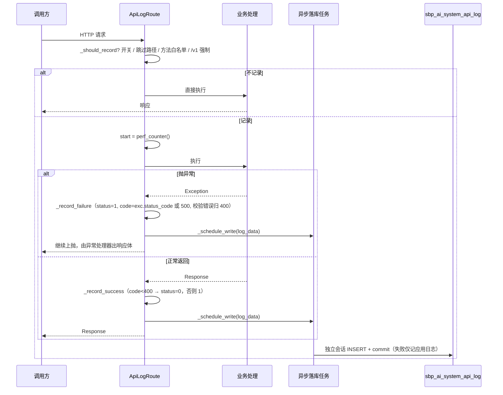
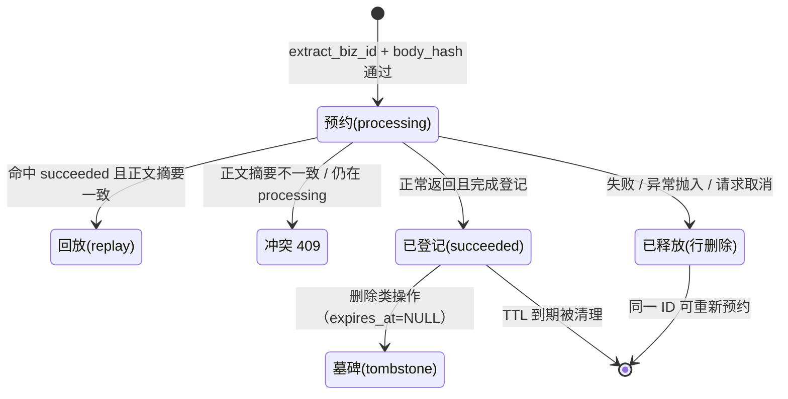

# 01 · 日志审计与接入追踪 · 业务功能说明

> 本文描述**行为**：谁在什么场景用它、一次请求如何被留痕、什么算成功/失败、数据留多久、当前做不到什么。
> 数据字段与表间引用见 [`02-数据模型与表关系.md`](02-数据模型与表关系.md)；接口参数见 [`03-接口清单.md`](03-接口清单.md)。

---

## 一、定位与边界

### 1.1 它回答哪三个现实问题

| 问题 | 没有这个模块时 | 有这个模块后 |
| --- | --- | --- |
| 「这条数据是谁在什么时候改的？」 | 只能翻应用日志（滚动丢失、无结构、无操作人） | 审计行含操作人、路径、方法、参数、响应码、耗时、IP，可按人/路径/时间检索 |
| 「GSI 说调我们失败了，是我们拒的还是他没发对？」 | 服务端只回一个 401，无从对账 | `security_check` 记录到达了哪些头、时钟偏差多少、nonce 是否重放、签名摘要，被拒也留痕 |
| 「同一个请求他重试了三次，为什么第二次就 409？」 | 只能猜测"重复提交" | 幂等台账显示是回放（返回首次结果）、异正文（真冲突）还是上次失败未释放（`processing`） |

### 1.2 上游与下游

| 方向 | 对象 | 交互 |
| --- | --- | --- |
| 上游（生产者） | `/api/v1` 管理台路由（JWT）、`/v1` 契约路由（HMAC） | 请求经过路由类时被动采集，业务代码零改动 |
| 上游（写入者） | `base/deps.py` 的验签依赖与幂等守卫 | 主动写 `nonce` / `idempotency` 台账，并回填 `security_check` |
| 下游（消费者） | 前端「日志审计」「接入调用追踪」两个页面；运维手工排查 | 只读，不写业务表 |
| 相邻模块 | 认证/授权（提供 `username`、`client_id`）、契约错误码表 `app/modules_api/base/errors.py` | 审计不校验权限，只记录结果 |

### 1.3 与相邻模块的职责切分

- **审计 vs 应用日志（loguru）**：应用日志给人看、会滚动丢失；审计行给机器查、入库、有保留期。二者不互相替代。
- **审计 vs 契约错误码**：错误码定义在 `app/modules_api/base/errors.py:34-49`（15 个码 + 状态映射），审计只**记录**结果码，不定义语义。
- **幂等台账 vs 结果台账**：幂等管"同 ID 重试返回首次结果"；结果台账管"超时后查询最终结果"（后者尚未接入，见 §八）。

---

## 二、角色与场景

| 角色 | 场景 | 入口 | 关心什么 |
| --- | --- | --- | --- |
| 运维 | 某天大量 401，怀疑对方时钟漂移 | 追踪页 → 概览「签名校验失败」→ 调用明细筛 `signature_result=failed` | `timestamp_deviation_ms` 是否超 300000 |
| 运维 | 清理三个月前的审计行，控制表体积 | 日志审计页 → 清理过期日志 | 清理条数与保留天数 |
| 开发 | 联调时确认自己发的 JSON 到服务端是什么样 | 日志审计页 → 详情 | `request_payload`（已脱敏、已截断） |
| 开发 | 复现"第二次提交报 409" | 追踪页 → 幂等台账筛 `biz_id` / 追踪页输入 `request_id` | `status`、`body_hash`、`expires_at` |
| GSI 对接方 | 收到 401 后确认是签名错还是 nonce 重放 | 调用明细筛 `nonce_state=reused` | `failure_code` |
| 安全/审计 | 追溯某次越权尝试的完整证据链 | 追踪页 → 输入 `request_id` | 四段记录是否齐全、`failure_code` |

---

## 三、功能清单

| 编号 | 功能 | 触发方式 | 前置条件 | 主要输出 | 端点 | 涉及表 |
| --- | --- | --- | --- | --- | --- | --- |
| F1 | 审计行分页查询 | 页面查询 / API | 应用启动、表已建 | 分页列表（不含大字段） | `GET /api-log/list` | `api_log` |
| F2 | 审计详情 | 点击行 | 同上 | 含 `request_payload`/`response_json` | `GET /api-log/detail/{id}` | `api_log` |
| F3 | 批量删除审计行 | 勾选后删除 | 同上 | 删除条数（无返回体） | `DELETE /api-log/delete` | `api_log` |
| F4 | 按保留天数清理 | 顶部按钮 / 定时调用 | `days` ∈ [1,3650] | 清理条数 | `POST /api-log/clean` | `api_log` |
| F5 | 近 N 小时概览 | 进入追踪页 | 同上 | 9 个计数 | `GET /access-trace/summary` | 四表 |
| F6 | 契约调用明细 | 追踪页「调用明细」标签 | 同上 | 分页列表（含 `security_check`） | `GET /access-trace/calls` | `api_log` |
| F7 | 调用详情 | 点击行 | 同上 | 含完整报文 | `GET /access-trace/calls/detail/{id}` | `api_log` |
| F8 | 防重放台账 | 「防重放」标签 | 同上 | nonce 首用记录 | `GET /access-trace/nonces` | `nonce` |
| F9 | 幂等台账 | 「幂等」标签 | 同上 | 幂等状态与结果摘要 | `GET /access-trace/idempotency` | `idempotency` |
| F10 | 结果台账 | 「结果」标签 | 同上 | 超时结果记录（当前为空） | `GET /access-trace/request-logs` | `request_log` |
| F11 | 四表时间线 | 输入 `request_id` 追踪 | `request_id` 非空 | 四类记录 + `found` | `GET /access-trace/timeline` | 四表 |

> 采集本身（不对外暴露端点）是 F1–F11 的数据来源，流程见 §四.1。

---

## 四、业务流程

### 4.1 审计采集：一次请求从进入到落库

采集由路由类完成：任何 `APIRouter(route_class=ApiLogRoute)` 的接口自动获得审计能力；`/v1` 用 `ContractApiRoute`（`app/modules_api/base/errors.py:251`）继承它，因此错误响应与审计一次性具备。

四个关键点：

1. **采集不阻塞响应**：`_schedule_write` 用 `asyncio.create_task` + 强引用集合（`_pending_tasks`），不用 `BackgroundTask`，避免覆盖业务自身的后台任务。关停时 `flush_pending_api_logs(timeout=5)` 等在途写入。
2. **独立会话**：响应发出时请求级事务已结束，审计必须自己开会话并立即 commit（`app/core/router_class.py::_write_api_log_async`）。
3. **失败也留痕**：`await handler()` 在 `try` 内，异常先记审计再上抛——这是与原基座实现最大的差别（原实现抛异常的请求一条都不落）。
4. **状态按响应码判定**：`<400 → 0`，`≥400 → 1`；参数校验异常（FastAPI 为 422）在审计里记 400，与 `/v1` 契约的错误体保持一致。

采集口径（是否记录）：

| 条件 | 结果 | 依据 |
| --- | --- | --- |
| `API_LOG_ENABLE=false` | 全部不记 | `setting.py:204` |
| 路径命中 `API_LOG_SKIP_PATHS`（`/docs`、`/redoc`、`/openapi.json`、`/ui`、`/static`） | 不记 | `setting.py:209` |
| 方法 ∈ `API_LOG_RECORD_METHOD`（默认 POST/PUT/PATCH/DELETE） | 记 | `setting.py:205` |
| 方法为 GET 但路径命中 `API_LOG_FORCE_PATHS`（默认 `/v1`） | 记 | `setting.py:213` |
| 其余（管理台 GET 列表/详情） | 不记 | 避免查询淹没写操作 |

### 4.2 契约请求的鉴权留痕：逐步回填，失败不丢进度

`/v1` 的验签依赖在**每一个失败点**都把已知信息写进 `request.state`，最后由路由类统一取用（`app/modules_api/base/deps.py::verified_signature`）：

| 步骤 | 动作 | 此时 `security_check` 的样子 |
| --- | --- | --- |
| 1 | 读原始 body，取 `request_id`/`user_id`；记录到达的签名头与时钟偏差 | `headers_present=[...]`、`timestamp_deviation_ms=812`、`nonce_state=not_checked`、`signature_result=skipped` |
| 2 | 共享密钥未配置 | `failure_code=AUTHORIZATION_UNAVAILABLE` → 503 |
| 3 | `verify_signature` 失败 | `signature_result=failed`、`failure_code=UNAUTHORIZED`（或更精确的码）→ 401 |
| 4 | 验签通过 | `signature_result=passed`、`signature_digest=前8+后4` |
| 5 | nonce 登记：首用 / 重复 | `nonce_state=first_use` / `reused`；重放 → 401 |
| 6 | 后续失败（幂等 409、参数校验、authorization 超时效） | `mark_failure` 补 `failure_code`，**只写第一次**（最靠前的失败点最接近根因） |

设计要点：**签名只存摘要**（前 8 + 后 4 位），不存原文——签名是"共享密钥 + 正文 + nonce"的函数，落原文等于给离线爆破送样本；摘要足够与调用方对账，又不足以复用。nonce 则全量留存（本就是随机串，且要用于重放取证）。

### 4.3 幂等预约：状态机与三个出口

- **缺幂等键**：写操作必须带 `job_id`/`request_id`/`event_id`，缺了直接 400 `INVALID_REQUEST`，不进入预约。
- **正文摘要**：`sort_keys` + 紧凑分隔符的规范 JSON 求 SHA-256，键序不同不算"不同正文"。
- **回放**：`is_replay=true` 时依赖**不释放**记录（否则首次结果被抹掉），路由直接返回 `result_ref` 里的首次回执。
- **失败释放**：三个出口——正常退出但 `contract_failed` 或无结果、异常抛进生成器（断连 `GeneratorExit` / 取消 `CancelledError` / 未捕获异常）、显式 release。异常出口用 `asyncio.shield` 保证取消时释放仍能完成。
- **提前登记**：路由成功时调用 `record_receipt` **立即提交**，避免调用方收到 202 马上重试时撞上"仍在处理中"的 409。

### 4.4 查询与追踪

**列表（F1/F6）**：默认 `id desc`；列表 schema 不含 `request_payload`/`response_json`（可达数 KB），只有详情才返回。

**调用明细的默认口径**：不传 `request_path` 时，服务端强制追加 `request_path LIKE '/v1/%'`，即"页面默认只看 GSI 契约调用"；显式传路径才能回溯管理台记录。

**JSONB 过滤**：`signature_result` / `nonce_state` 不是列，无法走 CRUD 的普通条件，由 service 拼 `security_check->>'x' = ?`（`app/modules/system/access_trace/service.py:87-95`）。

**时间线（F11）**：不是 SQL JOIN，而是**四次独立查询**后按 `request_id` 聚合成一个结构：

| 段 | 查询方式 | 上限 | 断链含义 |
| --- | --- | --- | --- |
| 调用 | `api_log.request_id = :rid` | 20 | 无 → 该 ID 从未到达服务端 |
| 防重放 | `nonce.request_id = :rid` | 20 | 无 → 签名未通过或为管理台请求 |
| 幂等 | `biz_id = :rid` **或** `biz_id LIKE 'rid-%'` | 20 | 无 → 该接口无幂等要求（GET 类） |
| 结果 | `request_log.request_id = :rid` | 20 | 无 → 结果台账未接入（当前恒无） |

`biz_id` 前缀匹配的原因：job/event 域的 `biz_id` 常见 `request_id-job_id` 形态，只等值查会漏。上限 20 是防"异常 ID 把库拖住"。

**概览（F5）**：固定窗口 1–168 小时，9 个计数全部在 SQL 侧完成（不是拉全量再算）：

| 计数 | 来源 | 条件 |
| --- | --- | --- |
| `call_total` | `api_log` | 窗口内 + `/v1/*` |
| `call_failed` | `api_log` | `status = 1` |
| `signature_failed` | `api_log` | `security_check->>'signature_result' = 'failed'` |
| `nonce_reused` | `api_log` | `security_check->>'nonce_state' = 'reused'` |
| `idempotency_conflict` | `api_log` | `response_code = 409` |
| `nonce_registered` | `nonce` | `created_time >= cutoff` |
| `request_running` | `request_log` | `status = 'running'`（**当前恒 0**） |
| `idempotency_processing` | `idempotency` | `status = 'processing'` |
| `idempotency_tombstone` | `idempotency` | `status = 'tombstone'` |

---

## 五、状态与判定（全目录唯一定义处）

### 5.1 审计行状态 `api_log.status`

| 值 | 含义 | 判定规则 | 备注 |
| --- | --- | --- | --- |
| `0` | 成功 | 响应码 < 400 | 3xx 也算成功 |
| `1` | 失败 | 响应码 ≥ 400，或走了异常路径 | 参数校验失败记为 400 |

`response_code` 与 `status` 必须自洽：写库时同源计算，不存在"200 但 status=1"的行。

### 5.2 契约错误码（审计里出现的码）

| 码 | HTTP | 典型触发 | 审计里的位置 |
| --- | --- | --- | --- |
| `INVALID_REQUEST` | 400 | 缺幂等键、字段缺失 | `security_check.failure_code` 或 `response_code` |
| `UNAUTHORIZED` | 401 | 验签失败、时钟越窗、nonce 重放 | `failure_code` + `security_check` 明细 |
| `CONTEXT_OUT_OF_SCOPE` / `GOVERNANCE_SCOPE_DENIED` | 403 | 越权 | `failure_code` |
| `NOT_FOUND` | 404 | 资源不存在 | `failure_code` |
| `IDEMPOTENCY_CONFLICT` / `STALE_REVISION` / `SOURCE_CHANGED` / `RESULT_EXPIRED` | 409 | 同 ID 异正文、版本过期等 | `failure_code` + `response_code=409` |
| `PAYLOAD_TOO_LARGE` | 413 | 正文超限 | `failure_code` |
| `RATE_LIMITED` | 429 | 限流 | `failure_code` |
| `AUTHORIZATION_UNAVAILABLE` | 503 | 台账不可用、密钥未配置 | `failure_code` |
| `INTERNAL_ERROR` | 500 | 未归类的服务端错误 | `failure_code` |

完整表与话术见 `app/modules_api/base/errors.py:34-104`；默认话术不回显期望值、密钥与受限内容。

### 5.3 `security_check` 六字段取值

| 键 | 取值 | 何时写 |
| --- | --- | --- |
| `headers_present` | 到达的签名头名列表 | 进入验签依赖即写 |
| `timestamp_deviation_ms` | 整数或 `null` | 能解析时间戳时 |
| `nonce_state` | `first_use` / `reused` / `not_checked` | 走到 nonce 登记才可能不是 `not_checked` |
| `signature_result` | `passed` / `failed` / `skipped` | 验签完成时 |
| `signature_digest` | 16 位摘要（前 8 + 后 4）或 `null` | 仅 `passed` |
| `failure_code` | 契约错误码或 `null` | 任一失败点；只写第一次 |

管理台（JWT）请求不写这些键以外的内容：`auth_mode` 为 `null`，`security_check` 为 `null`。

### 5.4 nonce 与幂等的状态

| 表 | 字段 | 取值 | 语义 |
| --- | --- | --- | --- |
| `nonce` | （无状态列） | 存在且未过期 = 首用已登记；不存在或已过期 = 可再首用 | 首用事实由唯一约束 `(client_id, nonce)` + `expires_at < now` 判定 |
| `idempotency` | `status` | `processing` | 已预约、业务未结束 |
| | | `succeeded` | 已登记首次结果，重试可回放 |
| | | `failed` | 预留（当前失败走"删除预约"而非置 failed） |
| | | `tombstone` | 删除类操作，`expires_at = NULL`，永不清 |

---

## 六、数据保留与清理

| 表 | 有效期 | 起算点 | 清理触发者 | 删除语义 | 例外 |
| --- | --- | --- | --- | --- | --- |
| `api_log` | 90 天（`API_LOG_RETENTION_DAYS`） | `created_time` | ① 启动 `SystemApiLogService.purge_expired()`；② 手动 `POST /api-log/clean` | **物理删除** | `API_LOG_ENABLE=false` 或保留天数 ≤0 时启动不清理 |
| `nonce` | 600 秒（`CONTRACT_NONCE_TTL_SECONDS`） | 首用时间 | 启动 `ensure_contract_store()` → `nonce_store.purge_expired()` | 物理删除 | 过期行可被同一 `(client_id, nonce)` 的新请求**接管**（续期） |
| `idempotency` | 90 天（`CONTRACT_IDEMPOTENCY_TTL_DAYS`） | 预约时间 | 同上 → `purge_expired()` | 物理删除 | 墓碑 `expires_at IS NULL` **永不清理** |
| `request_log` | 设计 24 小时 | `created_time` | **无**（未接入清理） | — | 无写入方，当前为空表 |

三点必须知道：

1. **审计行是物理删除**。基座自 v1.7 起不再提供软删（`is_deleted`/`deleted_time` 已从 16 张表移除，报告 P0-4），`delete()` 就是 `DELETE FROM`。这符合审计语义——回收站里的审计记录会让人误以为记录还在——代价是删除不可回滚，所以清理与批量删除都必须先确认。**不要再写 `is_deleted = false` 这类过滤**：列已不存在，写了会直接报错。
2. **不给人工删 nonce/幂等台账的入口**。删掉 nonce 会让窗口内重放立刻通过；删掉幂等键会让同一请求重复执行。这两张表只允许按 TTL 自动清理。
3. **清理失败不阻断启动**。清理异常只记 warning，残留数据下次启动继续清。

---

## 七、非功能约束

| 维度 | 约束 | 实现 |
| --- | --- | --- |
| 响应耗时 | 采集不增加接口耗时 | 落库在响应后异步任务；异常路径也先落任务再上抛 |
| 采集失败 | 不影响业务 | 采集/落库异常只记应用日志，绝不改变响应 |
| 敏感信息 | 不落明文 | 键名命中 16 个敏感键（password/token/secret 等）递归替换为 `******`；表单里的 `UploadFile` 直接丢弃；签名只存摘要 |
| 容量 | 单条审计有上限 | 请求/响应报文的**单个字符串字段**截断到 2000 字符（`API_LOG_MAX_PAYLOAD`），超出追加 `...(已截断, 原长 N 字符)`；字段多到仍压不进 2000 字符时退化为 `{_truncated, _original_length, preview}` 骨架 |
| 存储 | 载荷存结构化 JSON | `request_payload` / `response_json` 为 `JSONB`（v1.8）：库里是对象不是字符串，详情页直接展开；历史 TEXT 行启动期自动转换（非 JSON 串包成 `{"_raw": …}`） |
| 响应体 | 只记 JSON | `Content-Type` 非 `application/json` 或流式响应（无 `body` 属性）不记，避免整包进内存 |
| 并发 | 单个 `request_id` 追踪封顶 | 每类记录最多 20 条，四类共 80 条上限 |
| 一致性 | nonce 必须先于业务可见 | 独立会话 + 立即 commit，跨实例共享；台账不可用则 503 拒绝（绝不放行） |
| 关停 | 不丢在途日志 | `flush_pending_api_logs(timeout=5)` |
| 反向依赖 | 采集层不 import 业务模块 | `_write_api_log_async` 内延迟导入 `SystemApiLogModel` |

---

## 八、已知限制

> 区分"设计取舍"（不打算改）与"缺陷未修"（有报告编号）。未实现能力集中在此，不要写进功能清单。

| # | 限制 | 类型 | 影响 | 临时绕法 |
| --- | --- | --- | --- | --- |
| L1 | 管理台 GET 不记录（除 `/v1`） | 取舍 | 查不到"谁看过这条数据" | 需要时把方法加进 `API_LOG_RECORD_METHOD`，但会显著增加表体积 |
| L2 | 流式响应（SSE/文件下载）不记响应体 | 取舍 | 问答流、产物下载只有请求侧证据 | 查应用日志；或后续按帧采样 |
| L3 | 请求体已被下游流式消费时记为 `<请求体不可读>` | 取舍 | 上传类请求看不到参数 | 以 `request_query` 与路径参数为准 |
| L4 | **结果台账无写入方** | 缺陷未修 | 概览「在途请求」恒 0；「结果」标签页恒空 | 暂以幂等台账判断在途；#15 上线时补写入方 |
| L5 | 结果台账无清理任务 | 缺陷未修 | 一旦接入写入方，`expires_at` 过期行不会被清 | 接入写入方时一并补清理 |
| L6 | `nonce.request_id` 允许为空 | 取舍 | 验签早期失败（缺头）时追踪缺 nonce 段 | 以 `client_id + 时间窗` 反查 |
| L7 | JSONB 过滤原先无索引 | ✅ 已修（v1.6，P1-6） | 建的是**表达式 B-tree** 而非 GIN：查询是 `->>` 等值，GIN 只服务 `@>` 包含；实测走 `Bitmap Index Scan` | — |
| L8 | `nonce` / `idempotency` / `request_log` 三张表无 `updated_time` 列，但查询参数基类 `BaseQueryParam` 强制继承该字段 | ✅ 已修（v1.5，P1-6） | `_build_conditions` 对模型不存在的字段跳过并打 debug 日志，不再 500 | 前端台账页仍不必提供"更新时间"筛选（列本来就没有） |
| L9 | 旧迁移基线不含审计表创建语句 | 已随迁移工具移除关闭 | — | 表由启动期 `bootstrap` 建出（`API_LOG_AUTO_CREATE=true`） |
| L10 | `is_deleted` 列存在但语义未启用 | ✅ 已修（v1.7，P0-4 选择"删列"） | 软删从基座整体移除，列已不存在 | 见 §六 第 1 点 |
| L11 | 审计行只追加、不提供修改 | 取舍 | 无法订正错误留痕 | 追加一条说明行或用应用日志佐证 |
| L12 | 幂等台账不可用时返回 500 `INTERNAL_ERROR`（非 503） | 缺陷未修 | 调用方按 `retryable` 判断可重试，但状态码语义不精确 | 依赖 `retryable: true` 决策重试 |

---

## 九、变更记录

| 版本 | 日期 | 变更 |
| --- | --- | --- |
| v1.0 | 2026-11-02 | 首版：基于当前代码（`app/core/router_class.py`、`app/modules/system/{api_log,access_trace,nonce,idempotency,request_log}`、`app/modules_api/base/{deps,audit,idempotency,nonce}.py`）逐条核对 |
