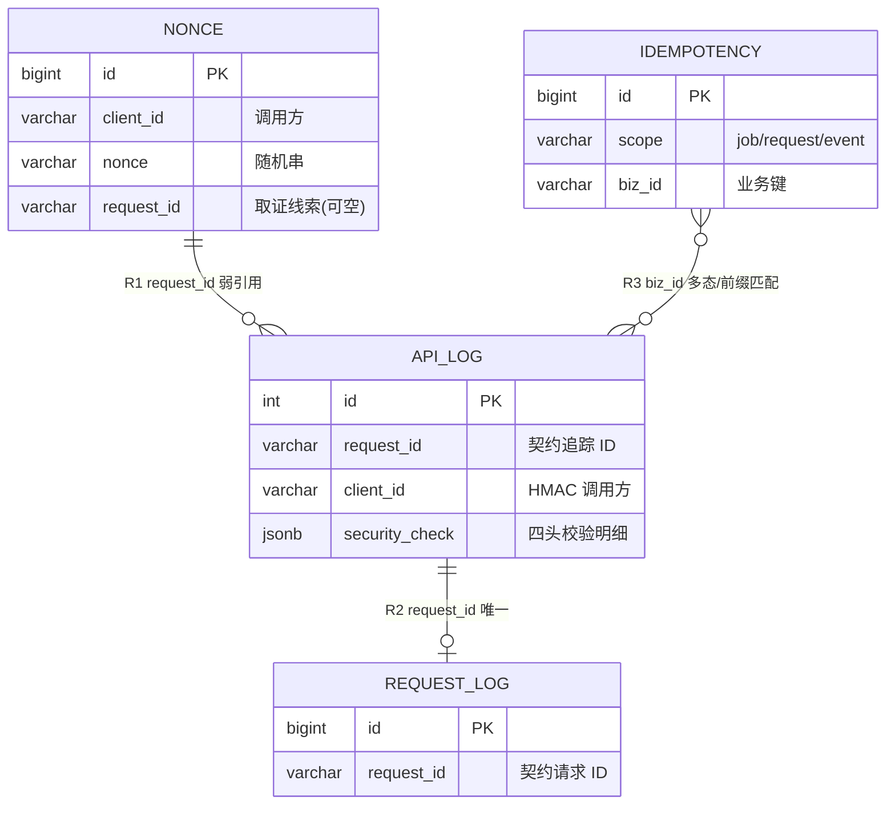
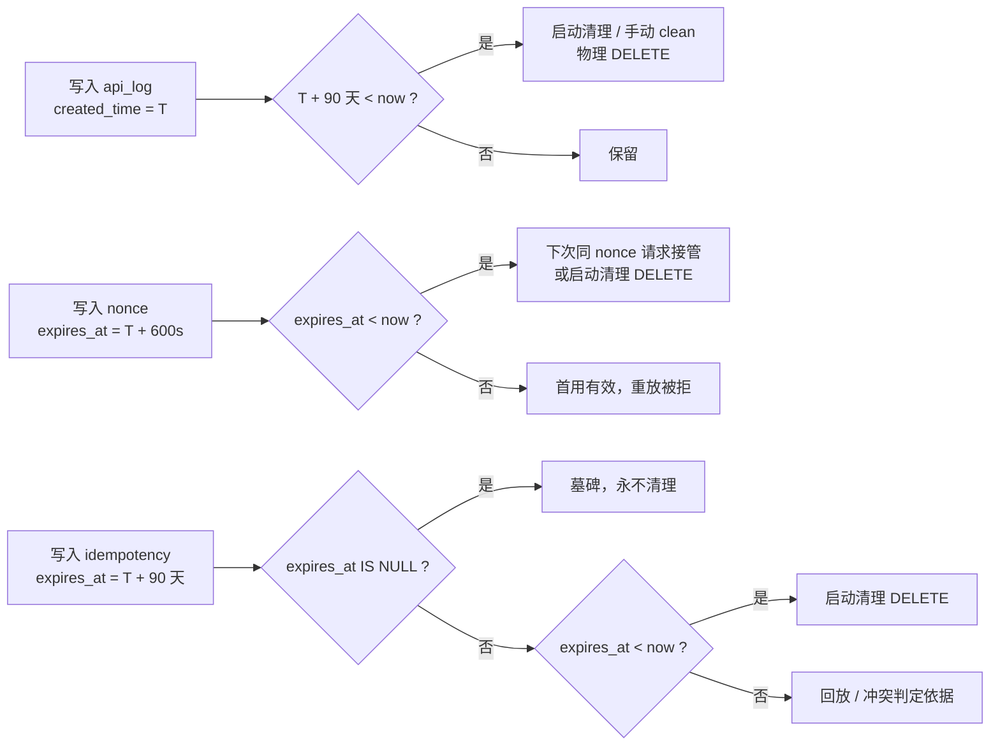

# 02 · 日志审计与接入追踪 · 数据模型与表关系

> 本文是**数据的唯一事实源**：每张表有哪些列、键和索引怎么建、表和表靠什么对上、谁写谁读、数据活多久。
> 行为与状态取值见 [`01-业务功能说明.md`](01-业务功能说明.md) §五；端点参数见 [`03-接口清单.md`](03-接口清单.md)。
> 核对基线：`backend/app/modules/system/` 五个模型文件（表结构以代码为准，由启动期 `bootstrap.py` 幂等建表）。

---

## 一、模型概览

### 1.1 四张表的角色

| 表名 | 中文名 | 角色 | 一句话职责 | 量级预估 |
| --- | --- | --- | --- | --- |
| `sbp_ai_system_api_log` | 接口审计日志 | 明细（只追加） | 一次 HTTP 请求一行，含被拒请求 | 高：与写请求量线性相关，90 天可达千万级 |
| `sbp_ai_system_nonce` | 防重放台账 | 台账（状态机） | 每个 `(client_id, nonce)` 一行，标记首用时间 | 低：仅 `/v1` 调用，10 分钟即过期 |
| `sbp_ai_system_idempotency` | 幂等台账 | 台账（状态机） | 每个 `(scope, biz_id)` 一行，记录处理状态与首次结果 | 中：写接口量级，90 天 |
| `sbp_ai_system_request_log` | 结果台账 | 台账（设计态） | 每个 `request_id` 一行，供超时后查最终结果 | 零：**无写入方** |

### 1.2 为什么分成"明细 + 三台账"

- **明细表**只回答"发生了什么"，只追加不更新，所以写入可以完全异步（不参与业务事务），保留策略也最简单（按时间物理删）。
- **三张台账**都是**状态机**，必须在业务处理前/后**同步**写入并立即提交，否则防重放与幂等会失效；因此它们各表体积小、有唯一约束、有 TTL。
- 两类表的**一致性要求完全不同**：审计行丢一条只影响取证完整性；nonce 丢一条等于放行一次重放。这决定了后面 §5 的写入矩阵与事务边界差异。

### 1.3 表分层与基类

| 基类 | 带来的列 | 使用本基类的表 | 后果 |
| --- | --- | --- | --- |
| `ModelMixin`（`app/core/base_model.py:44`） | `id` / `uuid` / `created_time` / `updated_time` | 仅 `api_log` | 无软删字段；`delete()` 与 `delete_by_conditions()` 都是物理删（§3.1.4） |
| `MappedBase`（`app/core/base_model.py:10`） | 仅自定义列 | `nonce` / `idempotency` / `request_log` | 无 `uuid`、无软删、**无 `updated_time`** —— 直接导致 §8 的 L2 问题 |

---

## 二、实体关系图



图里是**逻辑引用**，不是物理外键：四条表之间**没有任何 `ForeignKey` 约束**（全仓 `grep ForeignKey app/modules/system/` 为空）。原因与代价见 §4.3。

---

## 三、逐表说明

### 3.1 `sbp_ai_system_api_log`（接口审计日志）

**定位**：一次 HTTP 请求一行（含被拒），只追加不改写；由 `app/core/router_class.py::ApiLogRoute` 异步写入；被列表页、详情页、追踪页读取。

#### 3.1.1 主键与约束

| 类型 | 名称 | 列 | 说明 |
| --- | --- | --- | --- |
| 主键 | 库默认 | `id` | `integer` 自增 |
| 唯一 | 库自动命名（`..._uuid_key`） | `uuid` | 应用侧 `uuid4_str()` 生成，32 位去横线 |

> 约束名依赖数据库自动命名，因为项目未配置 `naming_convention`。排查时不要硬编码约束名。

#### 3.1.2 索引（共 11 个显式索引 + 主键）

| 索引名 | 列 | 服务的查询 | 是否被命中 |
| --- | --- | --- | --- |
| `ix_sbp_ai_system_api_log_created_time` | `created_time` | 列表页默认排序 + 清理按时间范围 | ✅（软删列移除后由 Mixin 单列索引承担，原先的 `(created_time, is_deleted)` 复合索引已删） |
| `ix_sbp_ai_system_api_log_path_created` | `request_path`, `created_time` | 按路径看最近 N 条（联调最高频） | ✅ |
| `ix_sbp_ai_system_api_log_username` | `username` | 按操作人筛 | ✅（`LIKE 'x%'` 可用；`LIKE '%x%'` 全扫） |
| `ix_sbp_ai_system_api_log_client_created` | `client_id`, `created_time` | 按调用方看最近调用 | ✅ |
| `ix_sbp_ai_system_api_log_request_id` | `request_id` | 时间线按 `request_id` 精确查 | ✅ |
| `ix_sbp_ai_system_api_log_sig_result` | `((security_check->>'signature_result'))` | 验签失败率统计（等值过滤） | ✅ 表达式 B-tree（`->>` 取出的是 text，等值过滤用不上 GIN） |
| `ix_sbp_ai_system_api_log_nonce_state` | `((security_check->>'nonce_state'))` | 重放拦截统计（等值过滤） | ✅ 同上 |
| `ix_sbp_ai_system_api_log_status` | `status` | 概览 `status = 1` 计数 | ⚠️ 选择性低（只有 0/1），单独用意义有限 |
| `ix_sbp_ai_system_api_log_request_ip` | `request_ip` | 按 IP 筛 | ⚠️ 页面无此过滤，当前未命中 |
| `ix_sbp_ai_system_api_log_uuid` | `uuid` | 唯一标识 | ✅（`unique` 隐含） |
| `ix_sbp_ai_system_api_log_id` | `id` | — | ❌ **与主键索引完全重复**，属基座模板残留（规范 D12 的存量整改项） |

**缺失**：`security_check` 的 JSONB 子字段无 GIN 索引（`signature_result` / `nonce_state` 过滤与概览计数均为全表扫），见 §8 L1。

#### 3.1.3 字段字典（22 列）

**继承自 `ModelMixin`（4 列）**

| 列名 | PG 类型 | 可空 | 默认 | 含义 | 取值 / 约束 |
| --- | --- | --- | --- | --- | --- |
| `id` | `integer` | 否 | 自增 | 主键 | 页面按此倒序 |
| `uuid` | `varchar(64)` | 否 | 应用侧 `uuid4_str()` | 全局唯一标识 | 唯一约束 |
| `created_time` | `timestamptz` | 否 | 应用侧 `now(UTC)` | 写入时间 | 排序与清理依据 |
| `updated_time` | `timestamptz` | 否 | 应用侧 `now(UTC)`，`onupdate` 同步 | 更新时间 | 审计行不更新，等于 `created_time` |

> `is_deleted` / `deleted_time` 已于 v1.7 从基座移除（报告 P0-4），审计表列数由 22 降到 20。

**业务列（16 列）**

| 列名 | PG 类型 | 可空 | 默认 | 含义 | 取值 / 约束 |
| --- | --- | --- | --- | --- | --- |
| `username` | `varchar(64)` | 否 | `'anonymous'` | 操作人 | 取 `request.state.audit_username` > `API_LOG_USER_HEADER` 头 > `anonymous`；HMAC 调用时填 `client_id` |
| `status` | `integer` | 否 | `0` | 操作状态 | `0` 成功 / `1` 失败，判定规则见 `01` §5.1 |
| `description` | `text` | 是 | `null` | 操作名称或异常摘要 | 正常取路由 `summary`；异常为「路由摘要 + 半角竖线 + 异常信息」，形如 `05-知识检测与确认 ｜ UNAUTHORIZED` |
| `request_path` | `varchar(255)` | 否 | — | 请求路径 | 不含 query，如 `/v1/knowledge/detect` |
| `request_method` | `varchar(10)` | 否 | — | 请求方法 | 大写 |
| `request_query` | `text` | 是 | `null` | 查询字符串（原始） | 截断到 2000 字符 |
| `request_payload` | `text`（MySQL 为 `LONGTEXT`） | 是 | `null` | 请求参数 | JSON 字符串 `{"body":…,"query":…,"path_params":…,"form":…}`；敏感键已脱敏；文件被丢弃；取不到记 `"<请求体不可读>"` |
| `response_code` | `integer` | 否 | `200` | 响应状态码 | 异常路径取 `exc.status_code`，缺省 500；参数校验统一记 400 |
| `response_json` | `text` | 是 | `null` | 响应体 | 仅 `application/json` 且非流式；异常路径为 `{"error": "…"}` |
| `process_time` | `varchar(20)` | 是 | `null` | 处理耗时 | **字符串**，形如 `"12.3ms"`；不能直接 `SUM`/`ORDER BY` 数值比较 |
| `request_ip` | `varchar(50)` | 是 | `null` | 来源 IP | `TRUSTED_PROXY_HOPS=0` 时只取 TCP 对端；>0 时按跳数取 `X-Forwarded-For` 倒数第 N 个 |
| `user_agent` | `varchar(255)` | 是 | `null` | 浏览器 UA | 原样存，超长由列宽截断 |
| `auth_mode` | `varchar(8)` | 是 | `null` | 鉴权方式 | `jwt`（管理台，当前未回填，实际为 `null`）/ `hmac`（`/v1`） |
| `client_id` | `varchar(64)` | 是 | `null` | HMAC 调用方标识 | 取自 `X-AI-Client-Id`，仅 `/v1` |
| `request_id` | `varchar(64)` | 是 | `null` | 契约追踪 ID | 取自请求体 `request_id`；管理台请求为 `null`；**表间关联的枢纽列** |
| `security_check` | `jsonb` | 是 | `null` | 四头校验明细 | 结构与取值见 §3.1.5；管理台请求为 `null` |

#### 3.1.4 删除是物理删（历史坑已消除）

v1.6 之前的坑：`ModelMixin` 给了 `is_deleted`，但 `CRUDBase._supports_soft_delete()` 要求 `is_deleted` + `deleted_time` + `deleted_id` **三列齐全**，而 `deleted_id` 全仓库都不存在 → 判定恒为 False，删除走 `DELETE FROM`。于是同一张表"看着有软删列、实际物理删"，查询时加不加 `is_deleted = false` 都不会报错，只会让人误判。

v1.7 起这个矛盾被彻底消除（报告 P0-4）：**基座不再提供软删**，`is_deleted` / `deleted_time` 已从 16 张表删除，`delete()` 就是物理删，没有第二套语义。

影响：

- 查询**不需要**、也**无法**再写 `is_deleted = false`——列已不存在，写了直接报错（这比"静默无效"好）。
- 清理（90 天）与批量删除会让行真正消失，审计不可回滚。删除前必须确认。

#### 3.1.5 `security_check` 的 JSONB 子结构

| 键 | 类型 | 是否必现 | 取值 | 说明 |
| --- | --- | --- | --- | --- |
| `headers_present` | `string[]` | 是（`/v1`） | 头名列表 | 缺失的头一眼可见；值本身不入库 |
| `timestamp_deviation_ms` | `int` / `null` | 是 | `-300000…300000` 为合法区间 | 服务端时间 − 请求时间戳；缺头时为 `null` |
| `nonce_state` | `string` | 是 | `first_use` / `reused` / `not_checked` | 只有签名通过后才会登记 nonce |
| `signature_result` | `string` | 是 | `passed` / `failed` / `skipped` | — |
| `signature_digest` | `string` / `null` | 是 | 16 字符（前 8 + 后 4） | 仅 `passed` 有值；**不存签名原文** |
| `failure_code` | `string` / `null` | 是 | 15 个契约码之一 | 只写第一次失败 |

设计约定：**键一定存在**（缺失写 `null` 而不省略），这样页面按列展示与 SQL 按 key 过滤都不用处理"缺键"分支。查询写法：`security_check->>'signature_result' = 'failed'`，注意这是 `text` 比较，不是布尔。

### 3.2 `sbp_ai_system_nonce`（防重放台账）

**定位**：每个 `(client_id, nonce)` 一行，记录首用时间与过期时间；写入方是 `contract/deps.py::verified_signature`（经 `SystemNonceService.register`）；读取方是追踪页与启动清理。

| 类型 | 名称 | 列 | 说明 |
| --- | --- | --- | --- |
| 主键 | 库默认 | `id` | `bigint` 自增 |
| 唯一 | `uq_sbp_ai_system_nonce_client_nonce` | `client_id`, `nonce` | **首用的唯一事实来源**；插入冲突即判重放 |
| 索引 | `ix_sbp_ai_system_nonce_expires` | `expires_at` | 过期清理 |

| 列名 | PG 类型 | 可空 | 默认 | 含义 | 取值 / 约束 |
| --- | --- | --- | --- | --- | --- |
| `id` | `bigint` | 否 | 自增 | 主键 | — |
| `client_id` | `varchar(64)` | 否 | — | 调用方标识 | 当前为 `gsi-service` |
| `nonce` | `varchar(128)` | 否 | — | nonce 原文 | 契约要求 16–128 位 `[A-Za-z0-9_-]`，**没有数据库层长度/字符校验**，由 `verify_signature` 保证 |
| `request_id` | `varchar(64)` | **是** | `null` | 关联请求（重放取证） | 无索引；验签早期失败时为空 |
| `created_time` | `timestamptz` | 否 | 应用侧 `now(UTC)` | 首用时间 | 过期接管时会被更新为新首用时间 |
| `expires_at` | `timestamptz` | 否 | — | 过期时间 | = 首用时间 + `CONTRACT_NONCE_TTL_SECONDS`（默认 600s） |

三条实现细节（决定了"一行"的含义）：

1. **一行不等于一次请求**：`INSERT … ON CONFLICT DO UPDATE … WHERE expires_at < now` 会**接管过期行**（续期并覆盖 `request_id`），所以同一 `(client_id, nonce)` 跨窗口复用时仍是同一行。
2. **重放不产生新行**：重放时 conflict 且 `expires_at >= now`，SQL 不更新也不返回 → 服务层判 `False`，重放证据只留在 `api_log.security_check.nonce_state='reused'`。
3. **`request_id` 可为空**：缺头/时间戳非法等早期失败不会走到登记；这类请求在追踪页的 nonce 段自然为空。

### 3.3 `sbp_ai_system_idempotency`（幂等台账）

**定位**：三类幂等域共用的状态机表；写入方是 `contract/deps.py::_idempotent_guard` → `SystemIdempotencyService`（预约/登记/释放/清理）；读取方是追踪页与概览。

| 类型 | 名称 | 列 | 说明 |
| --- | --- | --- | --- |
| 主键 | 库默认 | `id` | `bigint` 自增 |
| 唯一 | `uq_sbp_ai_system_idempotency_scope_biz` | `scope`, `biz_id` | 预约的原子性来源 |
| 索引 | `ix_sbp_ai_system_idempotency_expires` | `expires_at` | 过期清理 |

| 列名 | PG 类型 | 可空 | 默认 | 含义 | 取值 / 约束 |
| --- | --- | --- | --- | --- | --- |
| `id` | `bigint` | 否 | 自增 | 主键 | — |
| `scope` | `varchar(32)` | 否 | — | 幂等域 | `job` / `request` / `event`，由路由声明 |
| `biz_id` | `varchar(128)` | 否 | — | 幂等业务键 | 按域取 `job_id` / `request_id` / `event_id`；event 域缺 `event_id` 时退化为 `request_id`；**无独立索引** |
| `body_hash` | `varchar(64)` | 否 | — | 正文 SHA-256 | 规范 JSON（`sort_keys` + 紧凑分隔符）→ hex；**与签名摘要口径不同**（签名对原始字节） |
| `status` | `varchar(20)` | 否 | `'processing'` | 台账状态 | `processing` / `succeeded` / `failed` / `tombstone`，语义见 `01` §5.4 |
| `result_ref` | `jsonb` | 是 | `null` | 首次结果摘要 | 形如 `{"status_code": 200, "body": {…}}`；**只存摘要不存正文全文** |
| `created_time` | `timestamptz` | 否 | 应用侧 `now(UTC)` | 创建/最近预约时间 | 接管过期行时会被刷新 |
| `expires_at` | `timestamptz` | **是** | `null` | 保留到期 | `null` = 墓碑，永不清；非空则到期被清理 |

关键语义：

- **`expires_at IS NULL` 不是"脏数据"**，是删除类操作的墓碑（`status='tombstone'`），用于拒绝"删除后复活"。
- **`biz_id` 是多态键**：同一个 `request_id` 值可能出现在 `biz_id`，也可能以 `request_id-job_id` 形式出现，因此追踪页用"精确 + 前缀"双条件（§4.2 R3）。
- **`failed` 状态目前基本不会出现**：失败路径是直接 `DELETE` 预约行（`release`），而不是置 `failed`。看到 `failed` 应视为历史数据或人工写入。

### 3.4 `sbp_ai_system_request_log`（结果台账）

**定位**：#15「超时后查询最终结果」的承接表；**当前无任何写入方**，仅有模型、只读 CRUD 与页面标签页。

| 类型 | 名称 | 列 | 说明 |
| --- | --- | --- | --- |
| 主键 | 库默认 | `id` | `bigint` 自增 |
| 唯一 | `uq_sbp_ai_system_request_log_request_id` | `request_id` | 一个请求一条结果 |
| 索引 | `ix_sbp_ai_system_request_log_status_created` | `status`, `created_time` | 概览"在途"计数与按状态查 |

| 列名 | PG 类型 | 可空 | 默认 | 含义 | 取值 / 约束 |
| --- | --- | --- | --- | --- | --- |
| `id` | `bigint` | 否 | 自增 | 主键 | — |
| `request_id` | `varchar(64)` | 否 | — | 契约请求 ID | 唯一；与 `api_log.request_id` 逻辑对应（R2） |
| `operation` | `varchar(20)` | 否 | — | 操作类型 | `completion` / `mutation` / `delete` |
| `status` | `varchar(20)` | 否 | `'running'` | 结果状态 | `running` / `succeeded` / `failed` / `expired` |
| `result_visible` | `boolean` | 否 | `true` | 结果是否仍可返回 | 过期后置 `false`，查询回 `RESULT_EXPIRED` 而非 404 |
| `result_ref` | `jsonb` | 是 | `null` | 结果引用 | 具体形状未定（无写入方） |
| `error_code` | `varchar(64)` | 是 | `null` | 失败码 | 契约错误码 |
| `created_time` | `timestamptz` | 否 | 应用侧 `now(UTC)` | 创建时间 | — |
| `expires_at` | `timestamptz` | 否 | — | 可查询期限 | 设计 24 小时；**无索引、无清理任务** |

> 使用提示：这张表的字段是按设计意图建的，尚未被任何代码写入。基于它做容量规划或 SLA 统计都会得到 0。见 §8 L3。

---

## 四、关联关系

### 4.1 关联总表

| 编号 | 源（表.列） | 目标（表.列） | 关系语义 | 基数 | 约束方式 | 一致性保障 | 断链后果 |
| --- | --- | --- | --- | --- | --- | --- | --- |
| **R1** | `api_log.request_id` | `nonce.request_id` | 审计行 → 该请求的 nonce 首用登记 | `1:N`（一条 nonce 可对多条审计：首用 + 若干次重放） | 无（应用层约定） | 同一 `request_id` 由请求体携带，验签依赖一次读入并同时写入两处 | 追踪页 nonce 段为空。**多数正常**：管理台请求、验签早期失败、GET 类契约接口均无 nonce |
| **R2** | `api_log.request_id` | `request_log.request_id` | 调用 → 该请求的最终结果 | `1:0..1` | 唯一约束（在 `request_log` 侧） | `request_id` 唯一，同一请求只允许一条结果 | 结果段为空。**当前恒为空**（无写入方） |
| **R3** | `api_log.request_id` | `idempotency.biz_id` | 调用 → 该请求的幂等预约 | `1:0..N`（多态键） | 无（应用层约定 + 前缀匹配） | 契约层按域取 `job_id`/`request_id`/`event_id`；job/event 域常见 `request_id-<业务ID>` 形态 | 幂等段为空。常见于 GET 类接口（无幂等要求）或 `biz_id` 形态不含 `request_id` |
| **R4** | `api_log.client_id` | `nonce.client_id` | 同一调用方的审计与 nonce | `N:1` | 无（应用层约定） | 同取自 `X-AI-Client-Id`，值域由 `CONTRACT_V1_CLIENT_ID` 约束 | 按 client 归集时口径不一致（历史行 `client_id` 为空） |
| **R5** | `api_log.username` | `api_log.client_id` | 同一条审计内的冗余 | 同值 | 无（同列冗余） | HMAC 调用时 `username` 直接填 `client_id`（基座旧字段兼容） | 按 `username` 筛 `/v1` 调用等价于按 `client_id` 筛；改动其一要注意另一处 |
| **R6** | `api_log.security_check.nonce_state` | `nonce`（存在性） | 重放证据 vs 首用事实 | `N:1` 语义派生 | 无（冗余存储） | 登记成功 → `first_use`；判为重放 → `reused`；未校验 → `not_checked` | 重放被拒时 `nonce` 表**没有新行**，只看 nonce 表会误判"从未调用" |
| **R7** | `api_log.response_code` | `api_log.security_check.failure_code` | HTTP 状态 ↔ 契约错误码 | 派生 | 代码常量表 `ERROR_CODE_STATUS` | `failure_code` 决定状态码（`errors.py:52-70`）；反向仅能推出候选码集合 | 两者矛盾说明响应被外层改写（如网关），排障以 `response_code` 为准 |

### 4.2 逐条说明

#### R1 `api_log.request_id` → `nonce.request_id`（弱引用，1:N）

- **语义**：一条审计行对应一次 HTTP 到达；一条 nonce 记录对应"某个 nonce 的首次使用"。首用 + 之后窗口内的每次重放都会新增审计行，但 nonce 行不变，因此是 1:N。
- **实现**：`app/modules_api/contract/deps.py::_body_meta()` 从原始 body 取 `request_id`；`verified_signature` 在登记 nonce 时把它写入 `nonce.request_id`，同时通过 `set_audit_security` 写入 `request.state`，审计落库时取 `api_log.request_id`。
- **查询**：

```sql
-- 给一个 request_id，取它的 nonce 首用与全部审计行
SELECT n.nonce, n.created_time AS first_use, n.expires_at, a.id AS api_log_id, a.status, a.created_time AS seen_at
FROM sbp_ai_system_nonce n
LEFT JOIN sbp_ai_system_api_log a ON a.request_id = n.request_id
WHERE n.request_id = :rid
ORDER BY a.created_time;
```

- **边界**：`nonce.request_id` 允许为空（早期失败）；同一 `request_id` 理论上可对应多条 nonce（调用方复用了 `request_id` 但换了 nonce），此时 R1 变成 N:M —— 追踪页会出现多条 nonce 段，属调用方违约，不是数据错误。

#### R2 `api_log.request_id` → `request_log.request_id`（唯一）

- **语义**：生成类/写类请求在超时后，调用方拿 `request_id` 查最终结果；一个请求最多一条结果。
- **实现**：`request_log` 侧 `uq_sbp_ai_system_request_log_request_id` 保证唯一；`api_log` 侧 `ix_..._request_id` 保证可查。**当前没有写入方**，唯一性只是为将来准备。
- **查询**：

```sql
SELECT a.id, a.response_code, r.status, r.result_visible, r.result_ref, r.error_code
FROM sbp_ai_system_api_log a
LEFT JOIN sbp_ai_system_request_log r ON r.request_id = a.request_id
WHERE a.request_id = :rid;
```

- **边界**：`api_log.request_id` 为空（管理台请求）时永远对不上，这正常。

#### R3 `api_log.request_id` ↔ `idempotency.biz_id`（多态，需前缀匹配）

- **语义**：幂等台账的业务键按域取值，`request` 域等于 `request_id`，`job`/`event` 域常见 `request_id-job_id` / `request_id-event_id`。
- **实现**：`extract_biz_id()`（`app/modules_api/contract/idempotency.py`）按 `SCOPE_ID_KEYS` 取值；`SystemIdempotencyCRUD.get_by_request_id()` 用 `biz_id = :rid OR biz_id LIKE ':rid-%'` 补齐。
- **查询**（追踪页实际执行的等价 SQL）：

```sql
SELECT scope, biz_id, status, body_hash, result_ref, expires_at
FROM sbp_ai_system_idempotency
WHERE biz_id = :rid OR biz_id LIKE :rid || '-%'
ORDER BY id DESC
LIMIT 20;
```

- **边界**：`%` 前缀匹配走不了 `(scope, biz_id)` 复合索引（左前缀固定的是 `scope`，不是 `biz_id`），数据量大时是该查询的主要成本；同时**可能误伤**：`rid-abc` 恰好是另一个请求的 `biz_id` 前缀时会多返回行，需人工判断。

#### R4 `api_log.client_id` ↔ `nonce.client_id`（弱引用）

- **语义**：同一个调用方的两类记录，用于"按调用方归集"。
- **实现**：同取自 `X-AI-Client-Id`；`nonce.client_id` 参与唯一约束，`api_log.client_id` 只作查询维度。
- **边界**：历史行（T1.4 之前的审计）`client_id` 为空，按 client 统计时会出现 `null` 组。

#### R5 同表冗余：`username` = `client_id`

- **语义**：`/v1` 没有 JWT 用户，`username` 字段（基座遗留）只能填调用方标识。
- **影响**：按 `username` 与按 `client_id` 筛 `/v1` 调用结果一致；但管理台请求 `username` 是真人、`client_id` 为空，两者不可混用。
- **正确写法**：`WHERE COALESCE(client_id, username) = :who`，或按 `auth_mode` 分开统计。

#### R6 `api_log.security_check.nonce_state` ↔ `nonce` 表（语义派生）

- **语义**：这是**同一事实的两处记录**——首用事实在 `nonce` 表（有行且未过期），判定结果在 `api_log.security_check`。
- **为什么要冗余**：重放被拒的请求**不会**在 `nonce` 表新增行，如果只看 `nonce` 表就无法证明"这次到达被判为重放"。`api_log` 里的 `reused` 才是重放证据。
- **排查口诀**：查"这个 nonce 是否用过"→ 看 `nonce` 表；查"这次为什么被拒"→ 看 `api_log.security_check`。

#### R7 `api_log.response_code` ↔ `security_check.failure_code`（派生）

- **语义**：契约错误码 → HTTP 状态是**多对一**（如三种 409 码、两种 403 码）；反向只能推出候选集合。
- **实现**：`app/modules_api/contract/errors.py:52-70` 的 `ERROR_CODE_STATUS` 是唯一映射源；`mark_failure` 在出口补 `failure_code`。
- **排查**：`response_code` 是实际返回给调用方的值，`failure_code` 是服务端认定的原因；两者矛盾（如 500 配 `IDEMPOTENCY_CONFLICT`）说明有外层改写（网关/代理），以 `response_code` 为准并查应用日志。

### 4.3 为什么没有物理外键

四张表之间零 `ForeignKey`，这是**有意的技术选择**，不是遗漏：

| 原因 | 具体影响 |
| --- | --- |
| 写入必须异步/独立事务 | 审计行在响应后由后台任务写入，若加外键就必须等业务事务提交，反而引入耦合与锁等待 |
| 清理是物理删除且顺序不定 | 90 天清审计、600 秒清 nonce 是两条独立任务；有外键则必须先删子表，清理逻辑被迫排序 |
| 台账先于业务事实存在 | `nonce`/`idempotency` 在业务处理**之前**写入，此时被引用对象可能还不存在 |
| 多态键无法外键化 | `idempotency.biz_id` 指向三张不同业务表的不同列 |
| 跨模块/跨域 | 台账属 `system` 域，被 `contract` 域写入；外键会把域边界焊死 |

**代价与补偿**：

| 代价 | 补偿机制 |
| --- | --- |
| 可能产生孤儿行（审计引用了不存在的业务对象） | 审计只记录请求事实，不承诺业务对象存在；孤儿行本身是有效证据 |
| 断链无法由数据库发现 | 追踪页的 `found` 字段 + 各段为空的语义说明（§4.1 最后一列） |
| 唯一性必须由约束或应用保证 | `nonce`/`idempotency`/`request_log` 各自有唯一约束；`api_log` 允许重复（一次请求一行，不去重） |

**如果将来要加外键**：只有 R2（`api_log.request_id` → `request_log.request_id`）适合，因为两者都是"每请求一条"且同域；其余三条都不适合。加之前必须先把 `request_id` 的空值语义理清（管理台请求为 `NULL`，外键对 `NULL` 不校验，加了也拦不住）。

### 4.4 跨表聚合的真实实现

**追踪页不是一条 JOIN，而是四次查询 + 应用层聚合**（`app/modules/system/access_trace/service.py::timeline`）：

| 步骤 | 查询 | 条件 | 上限 |
| --- | --- | --- | --- |
| 1 | `api_log` | `request_id = :rid` | 20 |
| 2 | `nonce` | `request_id = :rid` | 20 |
| 3 | `idempotency` | `biz_id = :rid OR biz_id LIKE ':rid-%'` | 20 |
| 4 | `request_log` | `request_id = :rid` | 20 |

为什么不用 UNION ALL 一条 SQL：四段结构不同（列不齐），且任一段缺表/缺索引时不应拖垮整条查询；分开查还能在某一表不可用时降级返回其余段。代价是 4 次往返（本地库可忽略）。

聚合结果为 `TraceTimelineSchema`，`found = 四段任一非空`；四段都空不是错误，返回 `found=false` 让页面提示"未找到"，而不是 404。

---

## 五、写入与读取矩阵

| 表 | 写入方（模块.函数） | 事务边界 | 读取方 | 一致性要求 |
| --- | --- | --- | --- | --- |
| `api_log` | `core/router_class.py::_write_api_log_async`（`_schedule_write` 派发） | **响应后异步任务**，独立会话立即 commit；关停时 `flush_pending_api_logs` 兜底 | `api_log.service`（F1–F4）、`access_trace.service`（F5–F7、F11） | 最终一致：允许丢行（只记应用日志），不允许影响业务响应 |
| `nonce` | `contract/deps.py::verified_signature` → `SystemNonceService.register` | **业务处理前**，独立会话立即 commit（必须先于业务对其他实例可见） | `access_trace.service`（F8、F11）、启动清理 | 强一致：台账不可用时 503 拒绝，**绝不放行** |
| `idempotency` | `contract/deps.py::_idempotent_guard` / `record_receipt` → `contract/idempotency.py` → `SystemIdempotencyService` | 独立会话立即 commit；`record_receipt` 在响应前提前提交，依赖退出只做兜底 | `access_trace.service`（F9、F11）、启动清理 | 强一致：预约依赖唯一约束原子插入；失败必须释放 |
| `request_log` | **无** | — | `access_trace.service`（F10、F11、F5 的 `request_running`） | — |

三条必须知道的推论：

1. **审计行与业务数据不在同一事务**：业务回滚了，审计行照样记（记的是"请求到达并失败"这个事实）。这正是审计想要的语义。
2. **三张台账与业务也不同事务**：所以失败必须**显式释放**幂等预约，否则该 ID 会锁在 `processing` 直到 TTL 过期（这是 P0-2 修复的核心场景）。
3. **同一张表没有第二条写入路径**：`api_log` 只有路由类写（`access_trace` 不写）；`nonce`/`idempotency` 只有契约层写（管理台不写）。排查"数据不对"时先确认是不是手工 SQL 改的。

---

## 六、生命周期与清理

| 表 | 有效期 | 起算点 | 清理触发 | 删除语义 | 例外 |
| --- | --- | --- | --- | --- | --- |
| `api_log` | 90 天（`API_LOG_RETENTION_DAYS`） | `created_time` | ① 启动 `purge_expired()`；② 手动 `POST /api-log/clean`；③ 手动批量删除 | 物理 `DELETE` | 开关关闭或天数 ≤0 时启动不清理 |
| `nonce` | 600 秒（`CONTRACT_NONCE_TTL_SECONDS`） | `created_time`（首用） | 启动 `contract_store_ready()` | 物理 `DELETE` | 过期行在下次同 `(client_id, nonce)` 请求时被**接管续期**，可能长期存在 |
| `idempotency` | 90 天（`CONTRACT_IDEMPOTENCY_TTL_DAYS`） | `created_time` | 启动 `contract_store_ready()` | 物理 `DELETE` | 墓碑 `expires_at IS NULL` 永不清理 |
| `request_log` | 设计 24 小时 | `created_time` | **无** | — | 无写入方，当前无数据 |

清理任务全部是"启动时清一次"，**没有常驻调度器**。这意味着：进程连续运行 30 天不清一次，表会一直涨；需要定时清理时由运维用 `POST /api-log/clean` 外部触发（或加 cron）。



---

## 七、索引与查询模式对照

| 查询场景 | 实际条件 | 命中索引 | 备注 |
| --- | --- | --- | --- |
| 日志审计列表 | `ORDER BY id DESC` + `status`/`method`/`response_code` 等值 | 主键（排序）+ `ix_..._status` 等 | 大偏移量分页仍会慢，页面限制 `page_size ≤ 100` |
| 按操作人/路径模糊查 | `username LIKE '%x%'`、`request_path LIKE '%x%'` | `ix_..._username` / `ix_..._path_created` **仅前缀匹配可用** | 页面输入 `%x%` 会全表扫，属预期成本 |
| 按时间清理 | `created_time < :cutoff` | `ix_..._created` | — |
| 调用明细默认视图 | `request_path LIKE '/v1/%'` + 时间倒序 | `ix_..._path_created` | 前缀匹配命中 |
| 明细筛签名结果 | `security_check->>'signature_result' = ?` | **无** | 全表扫，见 §8 L1 |
| 概览计数（5 个） | 窗口内 + `/v1/%` + `status`/JSONB/`response_code` | 部分命中 `ix_..._path_created` | JSONB 条件全扫；`response_code=409` 无索引 |
| 时间线四段 | `request_id = :rid` / `biz_id` 等值或前缀 | `ix_..._request_id` ✅；`biz_id` 前缀 ❌ | 见 §4.2 R3 |
| nonce 过期清理 | `expires_at < now` | `ix_..._expires` | — |
| 幂等过期清理 | `expires_at IS NOT NULL AND expires_at < now` | `ix_..._expires` | 部分索引未做，`IS NOT NULL` 条件仍可用 |
| 结果台账按 `request_id` | `request_id = :rid` | 唯一约束索引 | — |
| 结果台账过期清理 | `expires_at < now` | **无**（该表未建 `expires_at` 索引） | 接入写入方时补 |

---

## 八、已知设计问题

> 编号 L 对应本模块；括注为 `04-服务大脑AI项目开发过程文档/03-代码评审与优化/01-backend代码优化建议报告.md` 的条目。

| # | 问题 | 影响 | 建议 | 报告条目 | 状态 |
| --- | --- | --- | --- | --- | --- |
| L1 | `security_check` 的 JSONB 子字段无索引 | 概览页 5 个计数中 2 个为全表扫；明细筛签名/nonce 也全扫 | 建 `GIN (security_check jsonb_path_ops)` 或对 `signature_result`/`nonce_state` 建 btree 表达式索引 | P1-6 | ✅ **已修（v1.6）**：实际建的是**表达式 B-tree**，不是 GIN——查询是 `->>` 等值，GIN 只服务 `@>` 包含查询。实测 `enable_seqscan=off` 两条查询均走 `Bitmap Index Scan` |
| L2 | `nonce`/`idempotency`/`request_log` 无 `updated_time` 列，但 `BaseQueryParam` 强制继承该字段 | 对这三张表传 `updated_time` 范围查询会 500 | `BaseQueryParam` 拆分：时间范围改为可选并按 `hasattr` 兜底 | P1-6 | ✅ **已修（v1.5）**：`_build_conditions` 对模型不存在的字段跳过并打 debug 日志 |
| L3 | `request_log` 无写入方、无清理 | 概览"在途"恒 0；表结构空转 | 接入 #15 时同步补索引与清理 | P0-8 相关 | ⏸ 索引已补（v1.6 `ix_..._expires`），**写入方仍待 #15 接入** |
| L4 | `api_log.is_deleted` 存在但不参与语义 | 误加过滤条件不会报错、也无效果 | 要么删列，要么在基类统一软删语义（全局决策） | P0-4 | ✅ **已修（v1.7）**：选择"删列"，软删从基座整体移除 |
| L5 | `idempotency.biz_id` 无独立索引 | 追踪页前缀查询全表扫 | 建 `(biz_id)` 索引 | P1-6 | ✅ **已修（v1.6）**：`ix_sbp_ai_system_idempotency_biz_id` |
| L6 | `nonce.request_id` 无索引 | 时间线 nonce 段全表扫 | 表量上来后加 | P1-6 | ✅ **已修（v1.6）**：`ix_sbp_ai_system_nonce_request_id` |
| L7 | `nonce.nonce` 无数据库层格式约束 | 非法 nonce 只能靠应用校验 | 契约校验已覆盖，DB 约束可选 | — | 保留（可选） |
| L8 | `idempotency.status='failed'` 从未被写入 | 看到该值只能来自人工或历史数据 | 要么实现"置 failed"，要么从枚举里删掉 | — | 保留 |
| L9 | 旧迁移基线不含审计表创建语句（只有加列） | 已随迁移工具移除关闭 | 表由启动期 `bootstrap` 建出（受 `API_LOG_AUTO_CREATE` 控制） | — | ✅ 已关闭 |
| L10 | 约束名依赖库自动命名（无 `naming_convention`） | 跨环境约束名可能不一致，手工 SQL 难维护 | 统一配置 `naming_convention` | 规范 D1 | 保留 |

---

## 九、变更记录

| 版本 | 日期 | 变更 |
| --- | --- | --- |
| v1.0 | 2026-11-02 | 首版：按 `app/modules/system/` 模型与 `20261029_5d5210a8fd5e` 迁移逐列核对；定义 R1–R7 关联与写入读取矩阵 |
