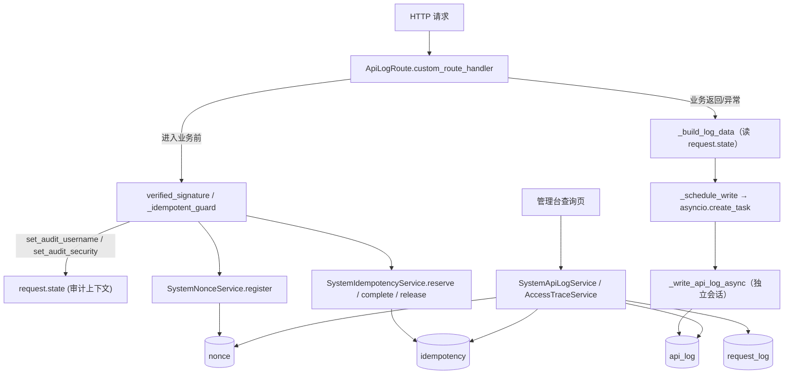

# 04 · 日志审计与接入追踪 · 实现与运维说明

> 本文回答：代码在哪、为什么这么写、配置怎么调、出问题按什么顺序查。
> 业务规则见 [`01-业务功能说明.md`](01-业务功能说明.md)；表与字段见 [`02-数据模型与表关系.md`](02-数据模型与表关系.md)。

---

## 一、代码地图

### 1.1 文件与职责

| 文件 | 职责 | 关键函数 / 类 |
| --- | --- | --- |
| `app/core/router_class.py` | **采集与落库核心**：路由类、脱敏、截断、IP 解析、异步写入、关停 flush | `ApiLogRoute`、`_should_record`、`_build_log_data`、`_schedule_write`、`_write_api_log_async`、`flush_pending_api_logs`、`set_audit_username`、`set_audit_security` |
| `app/modules/system/api_log/model.py` | 审计表模型（22 列、7 索引） | `SystemApiLogModel` |
| `app/modules/system/api_log/schema.py` | 写入模型、列表/详情出参、查询参数、清理参数 | `SystemApiLogCreateSchema`、`SystemApiLogOutSchema`、`SystemApiLogDetailOutSchema`、`SystemApiLogQueryParam` |
| `app/modules/system/api_log/crud.py` | 数据层（薄封装 `CRUDBase`） | `SystemApiLogCRUD` |
| `app/modules/system/api_log/service.py` | 分页/详情/删除/清理 + 启动清理 | `page`、`detail`、`delete`、`clean`、`purge_expired` |
| `app/modules/system/payload_filter.py` | 审计报文（JSONB）关键字过滤的共用口径：cast 成 text、空串处理 | `pop_like_keyword`、`jsonb_text_like`、`PAYLOAD_KEYWORD_MAX_LENGTH` |
| `app/modules/system/api_log/controller.py` | 4 个端点 | `SystemApiLogRouter`（`route_class=ApiLogRoute`） |
| `app/modules/system/access_trace/service.py` | 四表只读视图：分页、时间线、概览 | `page_calls`、`timeline`、`summary` |
| `app/modules/system/access_trace/crud.py` | 四个 CRUD 的集中导出（薄桥接，不自写 SQL） | re-export |
| `app/modules/system/access_trace/schema.py` | 四类出参 + 查询参数 + 时间线/概览结构 | `AccessTraceOutSchema`、`TraceTimelineSchema`、`TraceSummarySchema` |
| `app/modules/system/access_trace/controller.py` | 7 个端点 | `AccessTraceRouter` |
| `app/modules/system/nonce/{model,crud,service}.py` | 防重放台账：单条 upsert 登记 + 过期清理 | `SystemNonceCRUD.register`、`SystemNonceService.register` |
| `app/modules/system/idempotency/{model,crud,service}.py` | 幂等台账：预约/接管/登记/释放/清理 | `insert_reservation`、`take_over_expired`、`complete`、`release` |
| `app/modules/system/request_log/{model,crud}.py` | 结果台账（只读，无写入方） | `SystemRequestLogCRUD` |
| `app/modules_api/base/deps.py` | **业务写入时机**：验签逐步回填、幂等守卫三出口、启动清理 | `verified_signature`、`_idempotent_guard`、`record_receipt`、`contract_store_ready` |
| `app/modules_api/base/audit.py` | `security_check` 结构与取值常量 | `SecurityRecord`、`mark_failure` |
| `app/modules_api/base/idempotency.py` | 契约层适配：状态 → 契约错误码 | `reserve`、`complete`、`release`（正文摘要用 `app.utils.common_util.canonical_json_sha256`） |
| `app/modules_api/base/nonce.py` | 契约层适配：台账不可用 → 503 | `NonceStore` |
| `app/modules_api/base/errors.py` | 错误码全量表 + `ContractApiRoute`（继承 `ApiLogRoute`） | `ERROR_CODE_STATUS`、`ContractApiRoute` |
| `app/modules/system/bootstrap.py` | 建表清单（审计表受 `API_LOG_AUTO_CREATE` 控制） | `TABLES`、`ensure_tables` |
| `app/__init__.py`（lifespan） | 启动清理 + 关停 flush | — |
| `frontend/src/views/module_system/{log,trace}/` | 两个页面 | — |

### 1.2 调用关系（谁触发谁）



两条链路不要混：

- **写链路**（左）：请求经过 → 依赖写台账 + 回填 state → 路由类组装 → 后台任务写 `api_log`。
- **读链路**（右）：页面 → service → CRUD → 四张表；读链路不写任何表。

---

## 二、关键实现决策

| # | 决策 | 替代方案 | 为什么这样选 | 代价 |
| --- | --- | --- | --- | --- |
| D1 | 用 **`APIRoute` 子类**（`route_class=ApiLogRoute`）采集，不用全局中间件 | 中间件（`@app.middleware("http")`） | ① 能拿到 `request.scope["route"]` 的 `summary` 作操作名；② 可按路由分组决定是否审计；③ 不拦截静态资源与文档；④ `/v1` 用 `ContractApiRoute` 继承即可复用 | 忘记 `route_class` 的新路由不会被审计（新增模块时要检查） |
| D2 | 落库用**独立 `asyncio` 任务**，不用 `BackgroundTask` | `response.background = BackgroundTask(...)` | ① 会覆盖业务自身的后台任务；② SQLite 单写者下"请求事务待提交 + 后台任务等写锁"会互等；③ `create_task` 可统一 flush | 需要自己持有强引用（`_pending_tasks`）防 GC；关停要主动 flush |
| D3 | 审计写库**独立会话立即 commit** | 复用请求级 `db_getter` 会话 | 响应发出时请求事务已结束，复用会写入失败或写入未提交的事务 | 每次请求多一次连接获取（连接池压力，见 P1-1） |
| D4 | nonce 用**单条 `INSERT … ON CONFLICT DO UPDATE … WHERE expires_at < now`** | 先 `SELECT` 再 `INSERT` | "先查后插"在并发重放下两个请求会同时通过；唯一约束才是首用的唯一事实来源 | SQL 绑定 PostgreSQL 方言（`pg_insert`），sqlite 无法直接测 |
| D5 | 幂等预约**独立事务**，失败必须显式 `release` | 与业务同事务 | 台账要在业务处理前对其他实例可见（避免并发重复执行），不能等业务事务提交 | 失败释放成为强依赖，异常路径必须覆盖（三出口 + `shield`，见 D6） |
| D6 | 依赖退出用 `try/except BaseException/else` 三出口 + `asyncio.shield` | 只在 `yield` 后写收尾代码 | 客户端断连（`GeneratorExit`）、请求取消（`CancelledError`）、未捕获异常都不会执行 `yield` 之后的代码 → 幂等键永久锁死 | `shield` 的释放若失败只能记日志（锁到 TTL 才解） |
| D7 | `security_check` 存 **JSONB 单列**，不拆 6 个列 | 拆成 `signature_result`/`nonce_state`/… 列 | 字段还会演进；页面按标签展示，不需要全部建索引 | 过滤走 `->>`，无索引时全表扫（L1）；无法用普通列约束 |
| D8 | 时间线用**四次查询 + 应用层聚合**，不用 JOIN/UNION | 一条多表 JOIN | 四段结构不同；某段缺表/缺索引时不拖垮整条查询；可在单段失败时降级 | 4 次往返；上限各 20 条 |
| D9 | 签名只存**前 8 + 后 4 摘要** | 存签名原文 | 签名是"密钥 + 正文 + nonce"的函数，原文泄露可被离线爆破；摘要足够对账 | 无法用摘要直接复算签名，需双方按同算法自查 |
| D10 | 三张台账**不提供删除接口** | 提供"清空"按钮 | 删 nonce 会让重放立刻通过；删幂等键会让同一请求重复执行 | 脏数据只能靠 TTL 或人工 SQL（需审批） |
| D11 | 请求/响应载荷存 **JSONB 对象**（v1.8） | 继续存序列化后的 TEXT | 页面要展开的就是结构本身；存字符串意味着前端要 `JSON.parse`、库里也没法按字段取证。截断口径随之改为"按字符串字段"，否则半截 JSON 存不进 JSONB | 存量库需一次 `ALTER … TYPE`（启动期自动做，会短暂锁表，大表见 §6） |
| D12 | 报文模糊查询用 **`cast(col as text) ILIKE`**，不建 `pg_trgm` 索引 | 建表达式 GIN（`(col::text) gin_trgm_ops`）或拆出常用字段做等值列 | 用户直觉是"看到什么就能搜什么"，cast 后连字段名也能命中；审计表有保留期、查询通常还会带时间/路径条件，先保证语义正确 | 纯关键字查询是整表扫描（`01` §八 L13）；真成瓶颈时再上扩展与表达式索引，而不是提前拆字段 |

补充两条容易踩的：

- `_write_api_log_async` 内**延迟 import** `SystemApiLogModel`，因为 `core` 层不允许反向依赖业务模块（规范 R6）。改动时不要把这行 import 提到文件头。
- 载荷列的写入类型与数据库列类型必须一致：模型声明 `JSONB` 而库里还是 `TEXT` 时写入直接失败（`_write_api_log_async` 只记日志，表现为"审计莫名其妙没有新行"）。`system/bootstrap.py` 的 `_ensure_json_payload_columns()` 就是为防止这个而存在。

---

## 三、配置项

全部在 `app/config/setting.py`，改后需重启（`Settings` 在启动时实例化）。

| 配置项 | 默认值 | 作用 | 调错的后果 |
| --- | --- | --- | --- |
| `API_LOG_ENABLE` | `true` | 审计总开关 | `false`：一条审计都不落，且启动不清理；排查历史问题时无从取证 |
| `API_LOG_RECORD_METHOD` | `["POST","PUT","PATCH","DELETE"]` | 记录哪些方法 | 加 `GET`：表体积暴涨（列表页每次刷新一行） |
| `API_LOG_SKIP_PATHS` | `["/docs","/redoc","/openapi.json","/ui","/static"]` | 不审计的路径前缀 | 漏配 `/static`：前端静态资源把表写满 |
| `API_LOG_FORCE_PATHS` | `["/v1"]` | 命中即忽略方法白名单 | 删掉 `/v1`：契约的 GET 轮询（#02）不再留痕，M1 验收会失败 |
| `API_LOG_MAX_PAYLOAD` | `2000` | 请求/响应报文入库字符上限（**按单个字符串字段**计） | 调大：单行可达 MB，列表/详情查询变慢；调小：报文无法定位问题 |
| `TIMEZONE` | `Asia/Shanghai` | 接口时间输出/入参解析的业务时区（全局配置，不只影响本模块） | 留错（如 `Asia/Shangai`）：启动后首次时间输出直接抛 `ZoneInfoNotFoundError`；填 `UTC`：页面又回到"早 8 小时" |
| `API_LOG_USER_HEADER` | `""`（空） | 从哪个请求头取操作人 | 配成 `X-User` 等可伪造头：**任何人都能伪造操作人**，审计失去意义 |
| `API_LOG_AUTO_CREATE` | `true` | 启动时建审计表 | `false` 且未手工建表：所有写请求的审计落库全部失败（只留应用日志） |
| `API_LOG_RETENTION_DAYS` | `90` | 保留天数，启动清理用 | `<=0`：启动不清理，表无限增长 |
| `TRUSTED_PROXY_HOPS` | `0` | 可信代理跳数 | 配大于实际跳数：`request_ip` 取到伪造值；配 0 而前面有代理：全记成网关 IP |
| `CONTRACT_V1_ENABLE` | `true` | 是否挂载 `/v1` | `false`：`/v1` 全部 404，台账也不清理 |
| `CONTRACT_V1_CLIENT_ID` | `gsi-service` | 认可的调用方 | 与对方不一致：全部 401 |
| `CONTRACT_V1_SHARED_SECRET` | `""`（空） | HMAC 密钥 | `""`：`/v1` 全部 503 `AUTHORIZATION_UNAVAILABLE`（**故意不能放行**） |
| `CONTRACT_CLOCK_SKEW_MS` | `300000` | 时间戳容许窗口（±5 分钟） | 调小：对方时钟稍偏就 401；调大：重放窗口变大 |
| `CONTRACT_NONCE_TTL_SECONDS` | `600` | nonce 保留时长 | 小于 `2×时钟窗口`：窗口内重放可能漏判（启动会告警） |
| `CONTRACT_IDEMPOTENCY_TTL_DAYS` | `90` | 幂等台账保留天数 | 调小：调用方超期重试会被当新请求重复执行 |
| `CONTRACT_AUTHORIZATION_MAX_TTL_MS` | `120000` | authorization 签发-过期最大跨度 | 与业务约定不一致：合法请求被拒 |

---

## 四、生命周期

### 4.1 启动（`app/__init__.py` lifespan，按序）

| 步骤 | 动作 | 失败时 |
| --- | --- | --- |
| 1 | `ensure_all_tables()` → system 域建 5 张台账 + 审计表（若 `API_LOG_AUTO_CREATE`），并把审计表载荷列校正为 `JSONB`（v1.8） | 单域失败只告警；后续查询会 500 |
| 2 | `SystemApiLogService.purge_expired()` 按 `API_LOG_RETENTION_DAYS` 清审计 | 只 warning，下次启动再清 |
| 3 | `ensure_contract_store()` → `contract_store_ready()` 清过期 nonce + 过期幂等 | 只 warning；台账仍可工作，只是历史未清 |

注意顺序：**建表在清理之前**，否则首次启动会因为"表不存在"清理失败（日志里能看到对应 warning，属正常）。

### 4.2 关停

| 步骤 | 动作 | 目的 |
| --- | --- | --- |
| 1 | `flush_pending_api_logs(timeout=5)` | 等在途审计写入完成，再释放连接池，避免丢最后几条 |
| 2 | `async_engine.dispose()` | 释放连接 |

没有常驻清理任务，因此**进程长跑不清表**：需要时用 `POST /api-log/clean` 外部触发。

---

## 五、排障手册

按症状查，每条都给可执行动作。

| # | 症状 | 排查顺序 | 可能原因 | 处置 |
| --- | --- | --- | --- | --- |
| S1 | 审计行 `username` 全是 `anonymous` | ① 看 `auth_mode`：`hmac` 时应有 `client_id`；② 确认认证依赖是否调 `set_audit_username`；③ `API_LOG_USER_HEADER` 是否为空 | 认证链路没回填；或该路由不走认证 | 在认证依赖里补 `set_audit_username(request, user.username)` |
| S2 | 一条审计都没有 | ① `API_LOG_ENABLE`；② 请求方法是否在白名单；③ 路径是否命中 `API_LOG_SKIP_PATHS`；④ 路由 `route_class` 是否为 `ApiLogRoute`；⑤ 应用日志搜 `接口审计日志写入失败` | ⑤ 有 → 表不存在或 DB 不可用；④ 无 → 该路由从未被审计 | 补 `route_class`；表缺失则启动一次应用或手工建表 |
| S3 | `request_ip` 全是网关地址 | `TRUSTED_PROXY_HOPS` 是否为 0；网关是否透传 `X-Forwarded-For` | 未配置可信跳数 | 按实际代理层数设置（1 层 Nginx → `1`） |
| S4 | 401 但 `security_check` 为 `null` | 看该路由 `dependencies` 是否含 `verified_signature`；`/v1` 是否挂载 | 依赖没挂 → 请求没验签就进业务（**安全问题**） | 立即检查 `app/modules_api/router.py` 的 `dependencies` |
| S5 | `nonce_state` 恒为 `not_checked` | 看同一行 `signature_result` | `failed` → 签名就没过，属正常；`passed` 但 `not_checked` → nonce 步骤异常 | 后者查 `base/deps.py` 中登记段是否被跳过 |
| S6 | 调用方持续收到 409 `IDEMPOTENCY_CONFLICT` | 查 `idempotency`：`status`、`body_hash`、`expires_at` | `processing` 且长时间不变 → 上次未释放（进程崩溃/异常路径未覆盖）；`succeeded` 且 hash 不同 → 真·异正文 | 前者等 TTL 或人工删该行（需审批）；后者让调用方换 `request_id` |
| S7 | 追踪页 `found=false`，但调用方坚持调过 | ① 对方传的 `request_id` 是否在 **body** 里（不是 header/query）；② 是否走的 `/api/v1` 而非 `/v1`；③ 时间是否在审计保留期内 | 管理台请求没有 `request_id`；或审计已过期清理 | 按 IP + 时间窗在 F1 里反查 |
| S8 | 概览数字与列表总数不一致 | 确认列表是否显式传了 `request_path` | 概览固定只统计 `/v1/%`；列表默认也是 `/v1/%`，但显式传路径会变 | 统一口径再看 |
| S9 | 清理后表文件没变小 | `SELECT pg_size_pretty(pg_total_relation_size('sbp_ai_system_api_log'))` | PG 的 `DELETE` 只标记死元组，空间留给后续写入复用 | 确实需要缩容再 `VACUUM FULL`（会锁表，避开高峰期） |
| S10 | 启动日志出现"接口审计日志过期清理失败" | 表是否存在：`\dt sbp_ai_system_api_log` | 应用启动时未建表（`API_LOG_AUTO_CREATE` 关闭或 bootstrap 失败，见 L9） | 启动一次应用建表，或手工执行 DDL |
| S11 | `response_json` 为 `null` 但接口明明返回了数据 | 看响应 `Content-Type`；是否流式/文件下载 | 非 JSON 或 `StreamingResponse`（无 `body` 属性）不记录 | 属预期；查应用日志或业务表 |
| S12 | 台账页传时间范围报 500 | 报错堆栈是否 `AttributeError: updated_time` | 给 `nonce`/`idempotency`/`request_log` 传了 `updated_time`（表无该列，L2） | 前端去掉"更新时间"筛选项 |
| S13 | trace 页"签名失败"很多但业务正常 | 抽查 `security_check.headers_present` 与 `timestamp_deviation_ms` | 对方时钟漂移；或某段时间密钥不一致 | 与对方核对时间同步（NTP）与密钥版本 |

**通用排查 SQL**

```sql
-- 最近 20 条契约调用（含被拒）
SELECT id, created_time, request_path, response_code, status,
       security_check->>'signature_result' AS sig,
       security_check->>'nonce_state'      AS nonce,
       security_check->>'failure_code'     AS fail
FROM sbp_ai_system_api_log
WHERE request_path LIKE '/v1/%'
ORDER BY id DESC LIMIT 20;

-- 某 request_id 的四段证据（与时间线接口等价）
SELECT 'call' AS seg, id::text, status AS state, created_time FROM sbp_ai_system_api_log WHERE request_id = :rid
UNION ALL SELECT 'nonce', id::text, nonce, created_time FROM sbp_ai_system_nonce WHERE request_id = :rid
UNION ALL SELECT 'idem', id::text, status, created_time FROM sbp_ai_system_idempotency WHERE biz_id = :rid OR biz_id LIKE :rid || '-%'
UNION ALL SELECT 'result', id::text, status, created_time FROM sbp_ai_system_request_log WHERE request_id = :rid
ORDER BY 4;

-- 卡在 processing 的幂等预约（重点看 created_time）
SELECT scope, biz_id, created_time, expires_at
FROM sbp_ai_system_idempotency
WHERE status = 'processing' AND created_time < now() - interval '10 minutes';
```

---

## 六、运维操作

| 操作 | 步骤 | 注意 |
| --- | --- | --- |
| 临时关闭审计 | 设 `API_LOG_ENABLE=false` → 重启 | 关闭期间无审计，取证断层；不建议在生产长期关闭 |
| 缩短保留期 | 改 `API_LOG_RETENTION_DAYS` → 重启（启动时清一次）；或直接 `POST /api-log/clean` | 清理是物理删除，且**不释放磁盘**（S9） |
| 清理指定路径的历史数据 | 暂不支持按路径清理；用 SQL：`DELETE FROM sbp_ai_system_api_log WHERE request_path = '...' AND created_time < ...` | 手工 SQL 不受应用约束，**先 `SELECT count(*)` 确认**，并留执行记录 |
| 补建审计表 | 启动一次应用（`API_LOG_AUTO_CREATE=true`），或执行 `SystemApiLogModel.__table__.create` 等价 DDL | 项目不使用迁移，无需额外迁移步骤 |
| 存量库载荷列转 JSONB | 重启即可：`system/bootstrap.py::_ensure_json_payload_columns()` 幂等转换（非 JSON 老值包成 `{"_raw": …}`）；表很大时改在低峰期手工执行 §6.1 的 ALTER 语句 | `ALTER … TYPE` 取 `ACCESS EXCLUSIVE` 锁，会短暂阻塞审计写入；转换期间**旧进程**以 TEXT 写 JSONB 列会失败（只记日志，不影响接口） |
| 轮换 HMAC 密钥 | 双方同时改 `CONTRACT_V1_SHARED_SECRET` → 滚动重启 | 不同步期间全部 401；建议先灰度一个实例验证 |
| 处理卡死的幂等键 | 确认 `status=processing` 且超时 → `DELETE FROM sbp_ai_system_idempotency WHERE scope=... AND biz_id=...` | 删除后该 ID 可重新执行；若原请求其实已成功，会造成重复执行，需业务侧确认 |
| 关闭 `/v1` | `CONTRACT_V1_ENABLE=false` → 重启 | 全部 404；台账不再清理 |

### 6.1 大表载荷列转 JSONB（`request_payload` / `response_json`）

表不大时不用管：启动期 `_ensure_json_payload_columns()` 已幂等转换。表很大时 `ALTER … TYPE` 会取 `ACCESS EXCLUSIVE` 锁阻塞审计写入，需在低峰期手工执行（原 `sql/v1.8_api_log_json_payload.sql` 已内联至此并清理）：

```sql
-- 容错转换：非法 JSON 返回 NULL 而不是让整列转换失败
CREATE OR REPLACE FUNCTION pg_temp.try_jsonb(raw text) RETURNS jsonb
LANGUAGE plpgsql AS $$
BEGIN
    RETURN raw::jsonb;
EXCEPTION WHEN others THEN
    RETURN NULL;
END;
$$;

ALTER TABLE sbp_ai_system_api_log
    ALTER COLUMN request_payload TYPE JSONB
    USING CASE
              WHEN request_payload IS NULL THEN NULL
              ELSE COALESCE(pg_temp.try_jsonb(request_payload), jsonb_build_object('_raw', request_payload))
          END;

ALTER TABLE sbp_ai_system_api_log
    ALTER COLUMN response_json TYPE JSONB
    USING CASE
              WHEN response_json IS NULL THEN NULL
              ELSE COALESCE(pg_temp.try_jsonb(response_json), jsonb_build_object('_raw', response_json))
          END;
```

回滚（新写入的结构化 JSON 会退回文本存放）：`ALTER TABLE … ALTER COLUMN … TYPE TEXT USING …::text;`

---

## 七、测试覆盖

| 测试文件 | 覆盖 | 未覆盖 |
| --- | --- | --- |
| `tests/modules/system/test_access_trace.py`（8 用例） | 7 个只读路由已注册；查询参数里 JSONB 字段保持原始类型；`signature_result` 过滤；默认只查 `/v1`；四表时间线（含 `biz_id` 前缀）；未知 ID 返回空时间线；概览能统计到造的调用；详情缺失抛业务异常 | 概览 9 个计数的逐项边界；分页 `has_next`；排序注入防护 |
| `tests/core/test_db_getter.py`（3 用例） | `db_getter` 的提交/回滚口径（间接保障审计侧请求事务正确性） | — |
| `tests/core/test_audit_payload.py`（4 用例） | `_limit_json`：不超限保留结构；超长按字段截断且仍是合法 JSON；字段过多退化为 preview 骨架；`limit<=0` 不限制 | 未覆盖真实 HTTP 请求的采集链路 |
| `tests/core/test_time_util.py`（5 用例） | 时间口径：UTC→业务时区、naive 按 UTC、入参同口径、往返一致、`DateTimeStr` 序列化 | 非 `Asia/Shanghai` 时区的回归（靠 `TIMEZONE` 配置覆盖） |

`tests/contract/` 下**已无 pytest 用例**，只保留 `run_parse_tests.py` / `run_knowledge_tests.py` / `run_search_tests.py` 三份出入参回归脚本：它们对**已启动的真实服务**发签名请求，结果回写 `06-服务大脑AI项目测试用例与结果文档/test-data/responses/`。因此验签时序、幂等三出口、审计 `security_check` 落库、错误码映射这些断言只能靠脚本回归与联调覆盖，改 `deps.py` / `router_class.py` / `errors.py` 时需手工验证。

DB 相关用例在数据库不可达时**自动 skip**（`db_reachable()`），CI 不配 PG 时这些用例"永远绿"——看 CI 结果时要确认 skip 数。

**明确未覆盖的高风险行为**：`ApiLogRoute` 端到端（真落库、真 flush）、审计清理（`purge_expired`）、`TRUSTED_PROXY_HOPS` 的 IP 解析、`_schedule_write` 在关停时的 flush。改动这些代码时建议补用例。

---

## 八、已知问题与演进

| 问题 | 现状 | 计划 | 报告条目 |
| --- | --- | --- | --- |
| JSONB 无索引 | ✅ 已修（v1.6）：建了两条表达式 B-tree，`->>` 等值过滤走 `Bitmap Index Scan` | 若将来出现 `@>` 包含查询再补 GIN | P1-6 |
| 三张台账缺 `updated_time` | ✅ 已修（v1.5）：`_build_conditions` 按 `hasattr` 跳过不存在的字段 | 前端台账页仍不必提供"更新时间"筛选 | P1-6 |
| 结果台账无写入方 | `expires_at` 索引已补（v1.6）；页面"结果"标签仍恒空、概览"在途"恒 0 | #15 上线时补写入方 + 清理 | C-1 / P2 |
| `api_log.is_deleted` 空转 | ✅ 已修（v1.7）：P0-4 选择"删列"，软删从基座整体移除 | — | P0-4 |
| 审计表未随启动建出 | 已由 `API_LOG_AUTO_CREATE=true` + 启动期 bootstrap 解决 | 保持该配置 | L9 |
| 无命名约定 | 约束名由库自动生成，跨环境可能不一致 | 统一 `naming_convention` | 规范 D1 |
| 业务异常返回 500 | ✅ 已修（v1.5）：`CustomException` 默认 400、`get_or_404` 显式 404 | — | P0-5 |
| 每请求新建 DB 会话写审计 | 仍在（审计异步独立会话） | 批量缓冲写入（队列 + 定时 flush） | P1-1 |
| 无告警规则 | 只能人看页面 | 概览接口可接监控（`signature_failed`/`nonce_reused` 阈值） | — |

---

## 九、变更记录

| 版本 | 日期 | 变更 |
| --- | --- | --- |
| v1.0 | 2026-11-02 | 首版：代码地图、10 条实现决策、16 项配置、启动/关停顺序、13 条排障、测试覆盖盘点 |
| v1.1 | 2026-11-04 | 删除 `tests/contract/` 下 6 个 pytest 用例文件，§七 测试覆盖改为只列保留用例与回归脚本 |
| v1.2 | 2026-11-04 | `request_payload` / `response_json` 改 `JSONB` 并结构化采集（D11，§二/§三/§四/§六）；页面时间口径改为按 `TIMEZONE` 换算输出 |
| v1.3 | 2026-11-06 | 新增 `payload_filter.py` 与 D12：日志审计 / 调用明细支持请求体、响应体关键字模糊查询（`cast(col as text) ILIKE`）；§1.1 补文件行 |
