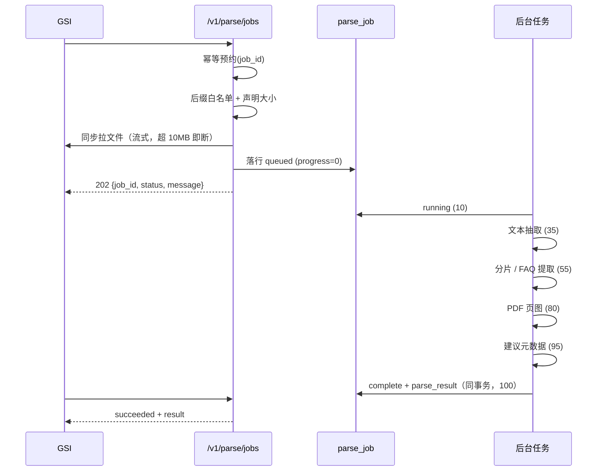
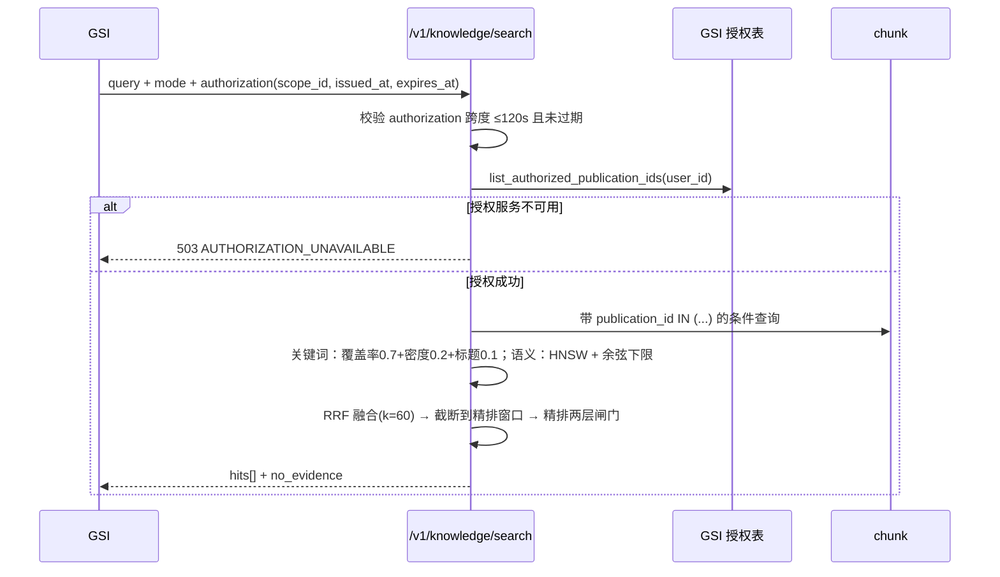

# 01 · 知识平台 · 业务功能说明

> 本文件回答「谁在什么场景用它、做了什么、什么算成功」。枚举取值的**唯一定义处**是本文件 §五，
> 其它文档只引用不重复定义。版本 v1.1（2026-11-05）

---

## 一、定位与边界

### 1.1 业务价值

服务大脑的座席在回答用户问题时，需要「有依据」而不是靠模型记忆。本模块提供四件事：

1. **把 GSI 已审批的文档变成可检索的切片**：解析 → 分片 → 审批后写入 → 向量化，一条链路走完。
2. **答得有出处**：检索返回 chunk 级命中，问答返回引用（发布单元 / 快照 / 版本 / 切片 / 原文引句）与来源快照。
3. **答得有时效**：引用的知识被新版本替换或停用后，旧回答整条隐藏，不拿过期知识继续作答。
4. **不在库里制造重复**：保存前查重、重复分组治理、合并预览，让「同一份知识被录两遍」在入库前被发现。

### 1.2 上下游

| 方向 | 系统/模块 | 交互 |
| --- | --- | --- |
| 上游 | GSI 知识管理（`sbp_km_doc_*`） | 下发解析任务（#01）、下发审批通过的切片（03.1/03.3）、下发删除与停用（03.4/#20）、提供授权范围（`list_authorized_publication_ids`） |
| 上游 | GSI 文件存储 | #01 的 `file_url` 由本侧同步拉取（10MB 上限、类型白名单） |
| 下游 | GSI 坐席工作台 | 检索（#07）与问答（#14）的契约调用方 |
| 下游 | 模型服务 | 向量化（bge-m3，`EMBEDDING_*`）、精排（bge-reranker，`RERANK_*`）、Chat（`LLM_*`） |
| 相邻模块 | `05-02/日志审计与接入追踪` | `/v1` 每次调用（含被拒）都落审计行；幂等/nonce 台账复用 system 域三张表 |
| 相邻模块 | `system` 域 | #15 的结果查询读 `sbp_ai_system_request_log` |

### 1.3 与相邻模块的职责切分

- **知识从哪来** 归 GSI；**知识怎么切开、怎么召回、怎么作答** 归本模块。
- **调用是否可信**（验签/防重放/幂等）归 `05-05` 契约接入层；本模块只管「业务上该不该做、做了什么」。
- **审计行怎么写** 归 `05-02`；本模块只在 `request.state` 上留下 `request_id` / `user_id` 供其回填。

---

## 二、角色与场景

| 角色 | 场景 | 触发入口 |
| --- | --- | --- |
| GSI 后端（系统集成） | 用户上传文档后提交解析，稍后轮询结果 | `POST /v1/parse/jobs` → `GET /v1/parse/jobs/{job_id}` |
| GSI 编辑人员 | 审批通过后把切片集合写入本侧；修订；删除；停用 | `/v1/knowledge/entries*` |
| GSI 后端 | 编辑页打开时读回已批准基线，做「改动前对照」 | `POST /v1/knowledge/entries/{publication_id}/query` |
| GSI 后端 | 保存前查重，避免重复录入 | `POST /v1/duplicates/check` |
| GSI 后端 | 打开重复治理清单、看分组详情、做合并预览 | `/v1/duplicates/groups*`、`/merge-preview` |
| GSI 座席 | 问问题，拿带引用的回答 | `POST /v1/chat/completions`（非流式） |
| GSI 座席 | 生成超时后用新 `request_id` 回查原操作结果 | `POST /v1/chat/requests/{target_request_id}/query` |
| 平台运维 | 打开管理台看解析任务、发布单元、切片、治理分组、会话记录；补录/修订知识正文、停用失效知识 | `/api/v1/kb/*` |
| 平台运维 / 算法 | 用检索调试台验证「某个用户能看到什么、召回什么」 | `POST /api/v1/kb/retrieval/search` |
| 平台运维 | 在页面上调 SSE 流式问答，观察首 token 与帧序列 | `POST /api/v1/kb/chat/ask/stream` |

---

## 三、功能清单

| # | 功能 | 触发方式 | 前置条件 | 主要输出 | 对应端点 | 对应表 |
| --- | --- | --- | --- | --- | --- | --- |
| F1 | 提交解析任务 | GSI 调 #01 | `job_id` 未用过；文件可读且 ≤10MB；后缀在白名单 | 202 受理回执（`job_id`/`status`/`message`） | `POST /v1/parse/jobs` | `parse_job` |
| F2 | 查询解析进度与产物 | GSI 调 #02 | 任务存在 | 四态 + 进度 + `result`（成功）或 `error_code`（失败） | `GET /v1/parse/jobs/{job_id}` | `parse_job` / `parse_result` |
| F3 | 新增知识（03.1） | GSI 调 03.1 | `content_hash` 与切片集合一致；`publication_id` 未存在 | 201 + 回执（`record_id`/`revision`/`accepted_chunk_count`/`searchable`） | `POST /v1/knowledge/entries` | `publication` / `revision` / `chunk` |
| F4 | 修订知识（03.3） | GSI 调 03.3 | `base_record_id` 必填且等于当前指针；`revision` > 当前值 | 200 + 回执 | `PUT /v1/knowledge/entries/{publication_id}` | 同上 |
| F5 | 删除知识（03.4） | GSI 调 03.4 | `revision` > 当前值 | 200 + `deleted` / `deleted_chunk_count` / `searchable=false` | `DELETE /v1/knowledge/entries/{publication_id}` | 同上 |
| F6 | 停用知识（#20） | GSI 调 #20 | `revision` > 当前值 | 200 + `deactivated=true` / `searchable=false` | `POST /v1/knowledge/entries/{publication_id}/deactivate` | 同上 |
| F7 | 读取已批准基线（03.2） | GSI 调 03.2 / 管理台 | 发布单元存在且快照未被删 | 元数据 + 切片分页 + `next_cursor` | `POST /v1/knowledge/entries/{id}/query`、`GET /api/v1/kb/publication/baseline/{id}` | `revision` / `chunk` |
| F8 | 关键词 / 自然语言检索 | 契约 #07 / 管理台 | 用户有授权范围 | `hits[]` + `no_evidence` + `authorized_publication_count`（管理台） | `POST /v1/knowledge/search`、`POST /api/v1/kb/retrieval/search` | `chunk` / `publication` |
| F9 | 会话管理 | 契约 #08–#13 / 管理台 | 契约侧必须 `session_id + user_id` 同时匹配 | 会话字段、历史消息分页、删除/清空回执 | `/v1/chat/sessions*`、`/api/v1/kb/chat-session/*` | `chat_session` / `chat_message` |
| F10 | 非流式问答 | 契约 #14 | 会话存在且属于该用户；`stream=false`；`model_key=default` | 回答 + 引用 + 来源快照 + `finish_reason` | `POST /v1/chat/completions` | `chat_session` / `chat_message` / `request_log` |
| F11 | 超时结果回查 | 契约 #15 | 原 `request_id` 在台账里 | `operation` / `status` / `result` / `error` | `POST /v1/chat/requests/{target_request_id}/query` | `sbp_ai_system_request_log` |
| F12 | 保存前查重（D01） | GSI 调 D01 | `scope` 与候选内容必填；范围 ≤1000 项 | `is_duplicate` / `similarity` / `matches[]` | `POST /v1/duplicates/check` | 只读；不写表 |
| F13 | 重复分组清单与详情（D02/D03） | GSI 调 D02/D03 | 首查带 `scope`；翻页带 `result_id` + 新 scope | 分组分页 + `coverage`；详情带 `full_text` 与 `evidence[]` | `/v1/duplicates/groups*` | `dup_result` / `dup_group` |
| F14 | 合并预览（D04） | GSI 调 D04 | 分组在快照内；`actions` 每个成员恰好一条 | `preview_id` / `preview_hash` / `answer_html` / `conflicts` | `POST /v1/duplicates/merge-preview` | `dup_result` / `dup_group` |
| F15 | 管理台维护 | 管理台页面 | 已登录 | 发布单元/版本/切片/任务/治理分组/会话消息的查询与状态标记；发布单元删除为**逻辑删**；正文写入/修订/停用归档与 03.1/03.3/#20 同引擎 | `/api/v1/kb/*` | 全部九张 |
| F16 | SSE 流式问答 | 管理台页面 | 会话属于该用户或自动新建 | 七类事件帧（meta/stage/ping/delta/citations/done/error） | `POST /api/v1/kb/chat/ask/stream` | `chat_session` / `chat_message` |
| F17 | 管理台自助解析提交 | 管理台页面 | 文件非空、后缀在白名单、≤`PARSE_MAX_FILE_BYTES` | 受理回执（服务端生成 `job_id`，`file_meta.submitted_by=admin`），解析在响应后执行 | `POST /api/v1/kb/parse-jobs/upload` | `parse_job` / `parse_result` |
| F18 | 管理台主动治理 | 管理台页面 | 范围内至少一个生效发布单元；预览需 30 分钟内的检测快照 | 检测分组（物化到 `dup_group`）、查重命中、合并预览（写回 `merged_preview`） | `POST /api/v1/kb/dup-groups/{detect,check,preview}` | `dup_result` / `dup_group` |
| F19 | 管理台写入正文（= 03.1） | 管理台页面 | 标题与正文非空；`publication_id` 不存在先建，存在但仍是空壳（无生效快照）则补录首版 | 切片数 + `content_hash` + `revision` + `searchable`；已生效再写入回 409 | `POST /api/v1/kb/publication/entry` | `publication` / `revision` / `chunk` |
| F20 | 管理台修订正文（= 03.3） | 管理台页面 | 已有生效快照且未停用/删除；`base_record_id` 必须等于当前指针 | 同上（`revision` 递增，旧快照与旧切片保留 online） | `PUT /api/v1/kb/publication/entry/{publication_id}` | 同上 |
| F21 | 管理台停用归档（= #20） | 管理台页面 | 已有生效快照；`inactive` / `deleted` 拒绝重复停用 | `deactivated=true`、`searchable=false`、`status=inactive` | `POST /api/v1/kb/publication/deactivate/{publication_id}` | 同上 |
| F22 | 管理台单篇切片查重（D06 等价） | 管理台页面 | 选定发布单元后载入其已批准基线切片；仍走 `candidate.chunks[]` | 命中列表带 `chunk_id` / `source_seq`；相同 `resource_id` 不命中自己 | `POST /api/v1/kb/dup-groups/check` | 只读；不写表 |
| F23 | 来源与关联溯源 | 管理台页面 | 发布单元存在 | 写入渠道（`admin`/`contract`/`pending`）+ 按 `file_meta.doc_id` 反查的解析任务（线索）；反向可用 `resource_id` 过滤发布单元 | `GET /api/v1/kb/publication/source/{publication_id}` | 只读；`publication` 与 `parse_job` 无列级外键 |

---

## 四、业务流程

### 4.1 解析（F1 → F2）

**失败路径**：任一步抛异常 → `fail(PARSE_FAILED)`，任务 `status=failed`、`progress=100`、写 `error_code/error_message`；#02 仍返回 **HTTP 200**，只是带 `error_code`（「任务失败 ≠ 请求失败」）。

**并发路径**：同一 `job_id` 重复提交 → 幂等台账回放首次的 202，不重复拉文件、不重复排队。服务重启时 `reset_unfinished` 把遗留 `queued/running` 改判 `failed`，避免永远转圈。

### 4.2 写入（F3 / F4 / F5 / F6）

**F3 新增（201）**

1. 校验 `content_hash` = 对 `chunks` 重算的摘要（`seq/heading/content/page_from/page_to`，**不含 `chunk_id`**）；不一致 409 `STALE_REVISION`。
2. 校验路径 `publication_id` 与正文一致；`publication` 行不存在则创建（`title` 从 `knowledge_no` 派生）。
3. 已存在且已有 `current_record_id` → 409（首发防覆盖）。
4. **先向量化**（按 `EMBEDDING_BATCH_SIZE` 分批并发），再在事务里整批写 `chunk`、写 `revision`、CAS 推进 `publication.current_record_id/current_revision`。
5. 向量化失败不写任何行，返回 500 `INTERNAL_ERROR`（不降级为「无向量入库」，否则该条永远检索不到）。

**F4 修订（200）**

1. `base_record_id` 必填（缺失 400）。
2. `revision` 必须严格大于 `publication.current_revision`；`base_record_id` 必须等于当前指针，否则 409 `STALE_REVISION`（并发覆盖的唯一防线）。
3. 旧版本切片**全量替换**：新切片整批写入新 `record_id`，旧切片归档为 `archived`（不删，供 03.2 回看历史）。
4. 指针切换与写 revision 同事务，任何一步失败都不留半套数据。

**F5 删除（200）**

1. `revision` 必须大于当前值，否则 409。
2. 物理删除该 `record_id` 的全部切片（软删的向量仍会被召回，必须真删）。
3. 该 `record_id` 的 revision 置 `archived` + `content_hash=NULL`（墓碑），再写一条墓碑 revision 占住 `revision` 号，防止旧请求复活。
4. 若删的是当前生效快照 → `publication.status='deleted'`；删历史快照则保留当前指针，只推进版本号。
5. 幂等台账留**墓碑**（`expires_at=NULL`），同一 `request_id` 永不回放，避免「删除后重发把内容复活」。

**F6 停用（200）**

- 与删除的差别：切片归档（`archived`，正文保留）、revision 归档、`searchable=false`，`publication.current_record_id` **保留**（可追溯最后一版），`publication.status='inactive'`。
- 停用后不再参与检索与引用；恢复只能重新写一版（03.1/03.3 或管理台「写入/修订正文」），不能靠「上线」把归档切片捞回来。

### 4.3 检索（F8）

- **授权先于召回**：没有授权集合就不查库，避免「先查全库再过滤」造成越权与性能问题。
- **两条通道共用**同一个授权集合与同一套投影；`mode=natural_language` 时向量化不可用 → 500 `INTERNAL_ERROR`（明确失败，不偷偷降级成关键词）。
- **精排不可用**（`RERANK_BASE_URL` 为空或超时）→ 按 RRF 融合序返回，闸门跳过，响应头不带标记（可通过 `GET /kb/retrieval/config` 的 `rerank_ready` 判断）。
- **`no_evidence`** 只在一条都没召回时为 `true`；有命中但分低不算无证据（阈值由调用方判断）。

### 4.4 问答（F10 / F16）

**非流式（#14）**

1. 校验：`stream=true` → 400 `UNSUPPORTED_STREAM`；`model_key` 不在 `{"default"}` → 400。
2. **归属先于一切**：`session_id + user_id` 同时匹配才继续，否则 404 `NOT_FOUND`（他人会话与不存在同一出口，避免探测）。
3. 检索（自然语言通道，`KB_RERANK_TOP_N` 条）→ 判证据（`KB_GRADE_MIN_CHUNKS`）→ 拼上下文（`KB_CONTEXT_MAX_CHARS`，带最近 `KB_HISTORY_TURNS` 条历史）。
4. 无证据 → 不调模型，`answer` 为固定拒答文案、`citations=[]`、`no_evidence=true`、`finish_reason=no_evidence`，**仍写两行消息**。
5. 调模型 → 校验引用（`quote` 必须是切片正文的逐字子串，不可验证的引用整条不返回）→ 写 user + assistant 两行 → 记 `request_log` 台账。
6. 返回 `request_id` / 两个 `message_id` / `answer` / `citations` / `source_snapshots` / `authorization_scope_id` / `finish_reason`。

**SSE 流式（F16，仅管理台）**

帧序：`meta`（`session_id`/`request_id`）→ `stage`（`retrieving`/`generating`）→ 若干 `delta`（正文增量，期间每 15 秒一次 `ping`）→ `citations` → `done`（或任意时刻 `error`）。

- 会话不存在时自动新建（首轮提问不必先点「新建对话」）。
- 首 token 超过 `KB_LLM_FIRST_TOKEN_TIMEOUT` → `error` 帧 `TIMEOUT`；两片之间超过 `KB_CHAT_STREAM_IDLE_TIMEOUT` 同样判超时。
- 客户端断连（`is_disconnected`）→ 停止生成，不写半截回答。

**并发路径（迟到丢弃）**：生成期间若会话被删除或清空，写回前用行锁 + 状态快照比对 → 判定 `TURN_DISCARDED`，不写任何行、不把会话写活。这是「删除后仍收到旧回答」的唯一防线。

### 4.5 重复治理（F12 / F13 / F14）

1. **D01 保存前查重**：候选内容 vs 授权范围，只报命中，**不写任何表、不阻止保存**。`is_duplicate` 由最高相似度是否 ≥0.65 决定。
2. **D02 分组查询**：首查（无 `result_id`）→ 全量检测 → 落 30 分钟只读快照 + 物化 `dup_group` → 返回第一页；翻页必须带 `result_id` + 新签发的同等 scope（`scope_digest` 比对，不含 `scope_id` 与时间戳）。
3. **D03 分组详情**：快照分组 + 实时回读来源补 `full_text` 与 `evidence[]`；成员内容已被修订 → 409 `SOURCE_CHANGED`（不回旧缓存正文）。
4. **D04 合并预览**：按 `keep_hit_id` + 每个成员的 `action`（`keep/drop/discard/merge_answer`）产出草稿态预览，**不落正式库**；结果写进 `dup_group.merged_preview` 供管理台查看。

失败路径：范围超 1000 项 → 413 `PAYLOAD_TOO_LARGE`（绝不截断，截断等于少比了内容还报成功）；`score_profile` ≠ `gsi-duplicate-v1` → 400（不同策略的相似度不可比较）；治理权限不符 → 403 `GOVERNANCE_SCOPE_DENIED`；结果过期 → 409 `RESULT_EXPIRED`。

**管理端入口（无 GSI 参与，F18）**：管理台没有 GSI 签发的 `scope`，所以 `POST /kb/dup-groups/detect` / `/check` 用 `publication_ids` 表达范围（留空=全部生效发布单元），由 `dup_result.scope.build_scope_from_store` 反查 `record_id`/`content_hash` 后走**同一条**检测链路；`POST /kb/dup-groups/preview/{group_id}` 取分组行里的 `result_id` 与 `scope`，不与请求重比。范围为空或含不存在的发布单元一律 400，不静默少比。动作约束与 #19 一致：每个成员恰好一条，`keep` 只能给主项，`merge_answer` 仅限 FAQ 组。

---

## 五、状态与判定（枚举唯一定义处）

### 5.1 解析任务 `parse_job.status`

| 取值 | 含义 | 谁写入 | 变更时机 |
| --- | --- | --- | --- |
| `queued` | 已受理、未开始 | `KbParseJobService.create_job` | #01 落行时 |
| `running` | 解析中 | `start`（后台任务第一步） | 后台任务启动 |
| `succeeded` | 成功，产物已落库 | `complete` | 与 `parse_result` 同事务 |
| `failed` | 失败 | `fail`；启动期 `reset_unfinished` | 异常、或服务重启时未完成 |

互斥：四态单向推进，不回退。`failed` 时 `error_code` 必有值（当前固定 `PARSE_FAILED`）。

### 5.2 解析进度 `parse_job.progress`

| 取值 | 含义 |
| --- | --- |
| `0` | 已受理 |
| `10` | 后台任务开始 |
| `35` | 文本抽取完成 |
| `55` | 分片完成 / FAQ 提取完成 |
| `80` | PDF 页图渲染与上传完成（或降级结束） |
| `95` | 建议元数据生成完成 |
| `100` | 成功或失败终态（两者都是 100，用 `status` 区分） |

### 5.3 发布单元 `publication.status`

| 取值 | 含义 | 谁写入 | 可检索 |
| --- | --- | --- | --- |
| `active` | 生效中 | 03.1 首发、管理台状态变更 | 是（还需 revision `searchable=true`） |
| `inactive` | 已停用（#20） | `KbEntryService.deactivate` | 否（切片已归档） |
| `deleted` | 已删除（03.4 删的是当前快照，或管理台整单删除） | `KbEntryService.delete`（契约）、`KbPublicationService.delete`（管理台逻辑删，幂等） | 否 |

### 5.4 版本 `revision.status` / `searchable`

| 取值 | 含义 |
| --- | --- |
| `online` + `searchable=true` | 当前生效版本，参与检索 |
| `online` + `searchable=false` | 已写入但未完成可检索标记（正常不会长期停留） |
| `archived` + `searchable=false` | 被新版本替换、被停用、或被删除；`content_hash` 为空即**墓碑**（删除事件） |

### 5.5 重复治理 `kinds`（五类）

| 取值 | 含义 | 检测方法 |
| --- | --- | --- |
| `doc_exact` | 文档级完全重复 | 标题/正文精确比对 |
| `doc_similar` | 文档级高度相似 | 标题相似度（`title_exact_v1` / 相似度方法） |
| `chunk` | 切片级重复 | 切片正文比对（比较长度 2000 字符） |
| `faq_ai` | AI 录入的 FAQ 重复 | 问答对相似度（`entry_mode=ai`） |
| `faq_manual` | 人工录入的 FAQ 重复 | 问答对相似度（`entry_mode=manual`） |

请求 `kinds=[]` 解释为「五类全查」；快照里不会出现空数组。

### 5.6 治理分组 `dup_group.status`

| 取值 | 含义 | 谁写入 |
| --- | --- | --- |
| `active` | 待处理（新检测出来、或预览后仍是草稿） | `_materialize`、`_save_preview` |
| `merged` | 已合并 | 管理台 `PATCH /kb/dup-groups/status/{group_id}` |
| `dismissed` | 判定为不重复/不处理 | 同上 |

### 5.7 会话 `chat_session.status`

| 取值 | 含义 | 谁写入 | 契约可见性 |
| --- | --- | --- | --- |
| `active` | 正常 | 创建、改名、新消息写回 | 可见 |
| `cleared` | 历史被清空（会话壳保留） | `_clear` | 可见（历史为空） |
| `deleted` | 已删除（软删） | `_delete` | 不可见（404） |

### 5.8 消息 `chat_message.status`

| 取值 | 含义 | 谁写入 | 可见性 |
| --- | --- | --- | --- |
| `active` | 正常 | `_persist` | 参与上下文与展示 |
| `hidden` | 整条下架 | **当前无写入方** | 预留：依赖失效是**读时**判定，不落库 |
| `deleted` | 已清空/随会话删除 | `mark_session_deleted` | 不展示；#15 仍可查到「当时是否成功」 |

### 5.9 消息角色 `chat_message.role`

`user`（提问）/ `assistant`（回答）。一次问答固定写两行。

### 5.10 检索通道 `mode`

`keyword`（关键词，无向量依赖）/ `natural_language`（语义，需向量化服务）。

### 5.11 切片 `chunk.status`

| 取值 | 含义 | 谁写入 | 检索是否可见 |
| --- | --- | --- | --- |
| `online` | 正常切片 | `KbChunkCRUD.insert_many`（写入默认值） | 可见（还要满足「快照是当前指针」） |
| `archived` | 已停用：正文与向量保留供审计，停止检索与引用 | `KbChunkCRUD.archive_by_record`（仅 #20 停用调用，`publication/service.py:390`） | 不可见（检索硬过滤 `status='online'`） |

**没有 `deleted` 取值**：删除走 `delete_by_record` **物理删行**（`#06` 要求删后不可召回，而软删的向量仍会被召回到）；切片状态与「快照是否仍是当前指针」是两道独立闸门，任一变化都能阻断召回。

---

## 六、数据保留与清理

| 表 | 保留期 | 清理触发 | 删除语义 |
| --- | --- | --- | --- |
| `publication` / `revision` / `chunk` | 永久 | 无定时清理 | 契约删除 = 切片物理删 + 版本墓碑 + 状态标记；停用 = 归档；管理台整单删除 = **逻辑删**（行、版本、切片全保留，只置 `status=deleted`），物理级联删仅限内部脚本 |
| `parse_job` | 永久 | 无 | 不删除；失败只改状态 |
| `parse_result` | 设计 90 天 | **无实现** | 不删除 |
| `dup_result` | 30 分钟 | **无实现**（`purge_expired` 无调用方） | 过期只判不删（409 `RESULT_EXPIRED`） |
| `dup_group` | 永久 | 无 | 用 `status` 表达结论，不删行 |
| `chat_session` / `chat_message` | 永久 | 无 | 软删（`status`），行保留 |

**为什么聊天记录不物理删**：#15 的查询可能在清空之后才到，没有行就回答不了「这次请求当时是否成功」；也因为 GSI 侧可能要求「已删除会话仍可审计」。

---

## 七、非功能约束

| 维度 | 约束 | 出处 |
| --- | --- | --- |
| 请求阻塞 | #01 只在受理前同步拉文件（≤10MB）；解析全部在后台；#14 是非流式同步等待（受 `KB_LLM_TIMEOUT=90s` 约束） | `kb/parse/service.py`、`kb/chat/service.py` |
| 批量上限 | 解析文件 10MB、类型白名单（pdf/docx/txt/md 等）；FAQ 正文 30000 字符；PDF 页图 50 页；治理范围 1000 项；03.2 每页 500 切片 | `PARSE_MAX_FILE_BYTES`、`PARSE_FAQ_MAX_CHARS`、`DUP_MAX_SCOPE_ITEMS` |
| 检索预算 | 关键词/向量候选各 200；精排窗口 6 条、8 秒尾段预算，超时降级为融合序 | `SEARCH_*` |
| 生成预算 | 单轮总预算 90s、首 token 15s、SSE 空闲 30s、心跳 15s | `KB_LLM_*`、`KB_CHAT_STREAM_*` |
| 安全：不落明文 | 审计只存签名摘要与五头存在性；向量化/重排密钥只在环境变量；页图 URL 带签名与过期时间 | `base/audit.py`、`parse_result/preview.py` |
| 安全：不越权 | 检索先算授权；问答归属先于检索；他人会话按 404 隐藏；治理按 `scope` 校验 | `retrieval/service.py`、`chat/service.py` |
| 容量：截断即告警 | FAQ 正文超限截断写 `warnings`；页图超页数写 `warnings`；范围超限**报错不截断** | `kb/parse_job/pipeline.py`、`kb/dup_result/schema.py` |
| 幂等 | 解析 `job_id`；写操作 `request_id`；删除类留墓碑 | `base/idempotency.py` |

---

## 八、已知限制

| # | 限制 | 影响 | 临时绕法 |
| --- | --- | --- | --- |
| L1 | **D06 单篇知识切片查重无独立契约路由（`chunk-check` 未实现）** | GSI 无法按 v3 手册的路径调「单篇已有知识再查重」；管理台已有等价入口（载入发布单元切片后走 `dup-groups/check`） | 契约侧用 `/v1/duplicates/check` 带 `candidate.chunks[]`；若必须对齐路径，新增路由转调同一检测器即可 |
| L2 | 契约不支持流式 | GSI 无法通过 `/v1/chat/completions` 拿到增量输出，`stream=true` 直接 400 | 由 GSI 侧承担「先拿全文再展示」；流式仅供管理台自测 |
| L3 | `dup_result` 过期快照不清理 | 表持续增长，30 分钟后全是死数据，长期需人工清 | 见 `04` §六 运维 SQL |
| L4 | `parse_result` 90 天保留未实现 | 解析产物（含页图 JSON）永久累积 | 人工按 `created_time` 清理 |
| L5 | Office/图片无页图预览 | 非 PDF 文档编辑页看不到原页对照 | 前端回源 GSI 文件预览 |
| L6 | `chat_message.status='hidden'` 无写入方 | 依赖失效是读时判定，历史回答**不会**被落库隐藏；知识恢复后会重新可见 | 这是设计取舍（避免写死状态导致恢复后永久不可见），不是缺陷 |
| L7 | 管理端问答不校验会话归属 | 管理台改一个 `user_id` 就能看别人的会话 | 管理台本就是运维视角，按权限控制登录；契约链路严格校验 |
| L8 | `views/module_kb/knowledge/` 是空目录残留 | 不影响路由与构建，但容易误导后续开发以为有「知识」页面 | 新页面请沿用 `publication/`，或清理该目录 |