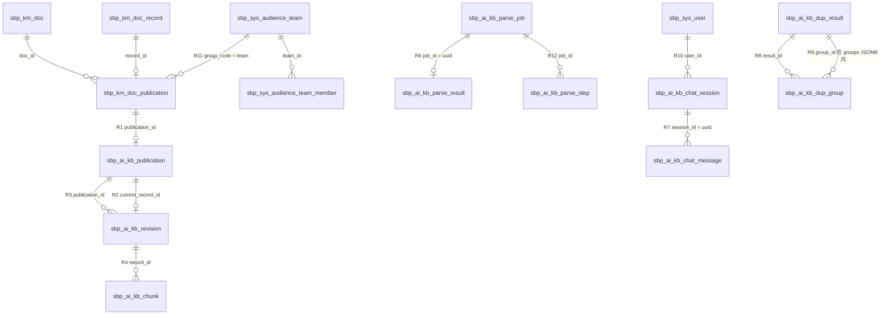

# 02 · 知识平台 · 数据模型与表关系

> 本文件回答「知识在库里长什么样、十张自有表与 GSI 的十一张共享表怎么对上、删一条知识后行还在不在」。
> 枚举取值的唯一定义在 [`01-业务功能说明.md`](01-业务功能说明.md) §五，本文件只标注列名与约束。
> GSI 共享表（只读）见 §九，依据契约 [`01-知识平台与AI接口对接说明-v3.md`](../../01-服务大脑AI项目需求与架构文档/05-接口契约与数据基线/01-知识平台与AI接口对接说明-v3.md) §四 与 [`02-服务大脑GSI业务系统表结构.sql`](../../01-服务大脑AI项目需求与架构文档/05-接口契约与数据基线/02-服务大脑GSI业务系统表结构.sql)。
> 版本 v1.3（2026-11-05）· 对应代码 `app/modules/kb/*/model.py`、`app/modules_gsi/**/model.py`（新增 `sbp_ai_kb_parse_step`、`parse_job.attempt`、`parse_result.artifacts`）

---

## 一、模型概览

### 1.1 十张自有表 + 十一张 GSI 只读表的角色

| 层次 | 表 | 角色 | 一句话 |
| --- | --- | --- | --- |
| 内容层（知识本体） | `sbp_ai_kb_publication` | 台账 | 一条知识的容器：当前指针、状态、展示归类信息 |
| | `sbp_ai_kb_revision` | 台账（墓碑） | 每次审批通过对应一行版本快照，版本号单调 |
| | `sbp_ai_kb_chunk` | 明细（含向量） | 最小检索单元，向量列 + HNSW 索引都在这里 |
| 解析层（作业） | `sbp_ai_kb_parse_job` | 台账（状态机） | #01/#02 的任务载体，四态 + 进度 |
| | `sbp_ai_kb_parse_result` | 明细（不可变） | #02 返回的完整产物，一任务一行，不含向量 |
| | `sbp_ai_kb_parse_step` | 明细（台账） | 一轮执行一步一行：状态、耗时、失败原因与续跑快照；`attempt` 兼做乐观锁 |
| 治理层 | `sbp_ai_kb_dup_result` | 缓存（30 分钟） | 一次检测的只读结果快照，自包含全部分组 |
| | `sbp_ai_kb_dup_group` | 台账（治理物化） | 同一条重复只留一行，人工结论按 `group_key` 跟踪 |
| 问答层 | `sbp_ai_kb_chat_session` | 台账（软删） | 会话壳，`user_id` 决定归属 |
| | `sbp_ai_kb_chat_message` | 明细（软删） | 一问一答两行，带引用与知识依赖 |

上表十张由本模块**建表、写入、清理**（`app/bootstrap.py` 的 `MODULE_BOOTSTRAPS` 只遍历 kb / system / voice）。另有十一张 GSI 业务表以**只读**方式参与判定——三张直接决定「谁能看到哪条知识」，其余只服务「GSI 业务数据」核对菜单；本侧不建表、不写入、不清理，字段与用途见 §九。

### 1.2 为什么分成这三层

- **内容与作业分离**：解析产物（`parse_result`）是「AI 看到什么」，知识内容（`chunk`）是「GSI 审批后确认什么」。两者字段相似但**生命周期与所有权完全不同**：解析产物永不被检索，知识切片永不被重解析。合并成一张表会让「谁有权改」无法回答。两表之间也**没有列级关联**：唯一能核对的是查询层把 `publication.resource_id` 与 `parse_job.file_meta->>'doc_id'`（契约 #01 的 `doc_id` 存在 JSONB 里）做比对，即管理端 `GET /api/v1/kb/publication/source/{id}` 的只读溯源，不构成强关联。
- **治理与内容分离**：重复结论不能挂在 `chunk` 上——切片是版本级对象，下一版就换了一批 ID；治理结论要跨版本延续，所以用 `group_key`（成员身份摘要）做稳定键，物化到独立表。
- **问答与内容分离**：`chat_message` 只存**引用快照**（当时引了哪些切片）与**依赖快照**（当时依据哪版知识），不存知识正文。知识被删后历史回答靠依赖判定隐藏，而不是靠级联删除。

### 1.3 基类与继承差异（影响字段与删除语义）

| 表 | 基类 | 带来的公共列 | 是否软删 |
| --- | --- | --- | --- |
| 除 `parse_result` / `parse_step` 外 8 张 | `ModelMixin` | `id` / `uuid` / `created_time` / `updated_time` | **基座不提供软删**；需要「保留痕迹」时由各表用 `status` 自己表达 |
| `sbp_ai_kb_parse_result` | `MappedBase` | 仅 `id` + 自定义 `created_time` | 不适用（产物按 `job_id` 覆盖写，无软删） |
| `sbp_ai_kb_parse_step` | `MappedBase` | 仅 `id` + 自定义 `started_time` / `finished_time` | 不适用（只追加，重跑增行不删行） |

`app/core/base_model.py:44-119` 明确了「基座无 `is_deleted`」这一改动：`CRUDBase.delete()` 一律物理删除，`restore()` 已移除。因此本模块的删除语义必须逐表看 §六，**不能假设「删了还在」或「删了就没了」**。

GSI 共享表不继承上表任一基类：它们用 `app/modules_gsi/base.py::SbpBase`（独立 `MetaData`），只声明契约 §四 指定的列；读取基类 `SbpReadCRUD` 没有任何写方法，见 §9.5。

---

## 二、实体关系图



图中 `sbp_km_*` / `sbp_sys_*` 是 **GSI 侧的表**（本侧只读，见 §九），其余是本侧 `ai_knowledge` schema 的十张自有表。GSI 内部那四条边（`doc → publication`、`record → publication`、`team → member`、`team → publication`）来自 DDL 的主键与唯一索引，GSI 侧同样**不建物理外键**。

所有边均为**逻辑引用**，库内**没有一条物理外键**（见 §4.3）。

---

## 三、逐表说明

### 3.1 `sbp_ai_kb_publication`（发布单元）

**定位**：一条知识的主表，同时承载契约指针（状态、当前版本、资源归属）与管理端展示字段。写入方是 `KbEntryService`（契约）与 `KbPublicationService`（管理端），读取方是管理台列表/详情、检索的授权过滤、问答的依赖判定。量级与 GSI 发布单元数同级（万级）。

本表在 v1.4（2026-11-03）合并了原 `sbp_ai_kb_entry_meta`，因此「标题/分类/标签/维护人」与「契约指针」在同一行，不再需要 JOIN。

#### 主键与约束

| 类型 | 名称 | 列 | 说明 |
| --- | --- | --- | --- |
| 主键 | `sbp_ai_kb_publication_pkey` | `id` | 自增 |
| 唯一约束 | `uq_sbp_ai_kb_publication_pid` | `publication_id` | GSI 侧的发布单元 ID 唯一 |
| 唯一索引 | `sbp_ai_kb_publication_uuid_key` | `uuid` | `ModelMixin` 生成 |
| CHECK | `ck_sbp_ai_kb_publication_resource_type` | `resource_type` | 只允许 `document` / `faq` |
| CHECK | `ck_sbp_ai_kb_publication_status` | `status` | 只允许 `active` / `inactive` / `deleted` |
| CHECK | `ck_sbp_ai_kb_publication_revision_non_negative` | `current_revision` | `>= 0` |

#### 索引

| 名称 | 列 | 用途 | 是否被查询命中 |
| --- | --- | --- | --- |
| `ix_sbp_ai_kb_publication_status_created` | `status, created_time` | 管理台按状态筛 + 时间排序 | 命中（列表页） |
| `ix_sbp_ai_kb_publication_tenant_resource` | `tenant_id, resource_type, resource_id` | 契约写入时的归属三元组校验 | 命中（`_assert_scope`） |
| `ix_sbp_ai_kb_publication_category` | `category` | 管理台按分类筛 | 命中（分类筛选） |
| `sbp_ai_kb_publication_created_time_idx` | `created_time` | 时间排序 | 命中（默认排序） |

#### 字段字典（17 列）

| 列名 | PG 类型 | 可空 | 默认 | 含义 | 取值 / 约束 |
| --- | --- | --- | --- | --- | --- |
| `id` | `integer` | 否 | 自增 | 主键 | 不得对外暴露 |
| `uuid` | `varchar(64)` | 否 | 应用侧 `uuid4_str()` | 行 UUID | 全局唯一，管理端响应里的 `uuid` |
| `created_time` | `timestamptz` | 否 | 应用侧 `now()` / 库默认 `now()` | 创建时间 | 索引列 |
| `updated_time` | `timestamptz` | 否 | 同上 + `onupdate` | 更新时间 | 每次 flush 变更 |
| `publication_id` | `varchar(64)` | 否 | 无 | GSI `sbp_km_doc_publication.id` | 契约主键，唯一 |
| `tenant_id` | `varchar(64)` | 是 | `NULL` | 契约租户 | 迁移期前写入的行可为 `NULL`，新写入必填 |
| `resource_id` | `varchar(64)` | 是 | `NULL` | 契约原始资源 ID | 与 `resource_type`、`tenant_id` 组成归属三元组 |
| `resource_type` | `varchar(20)` | 否 | 无 | 知识类型 | `document` / `faq`（DDL 白名单） |
| `current_record_id` | `varchar(64)` | 是 | `NULL` | 当前生效快照 ID | 指向 `revision.record_id`；停用后**不清空**（见 §六） |
| `current_revision` | `bigint` | 否 | 应用侧 `0` | 当前版本号 | 单调递增；修订/删除必须严格大于它 |
| `last_synced_at` | `timestamptz` | 是 | `NULL` | 指针同步时间 | 仅供展示，不参与判定 |
| `status` | `varchar(20)` | 否 | 应用侧 `active` | 发布单元状态 | `active` / `inactive` / `deleted`（DDL 白名单，语义见 `01` §5.3） |
| `title` | `varchar(200)` | 否 | 无 | 条目标题 | 契约首发时从 `knowledge_no` 派生，管理端可改 |
| `category` | `varchar(64)` | 是 | `NULL` | 知识分类 | 管理端维护 |
| `summary` | `text` | 是 | `NULL` | 内容摘要 | 管理端维护 |
| `tags` | `jsonb` | 否 | 应用侧 `list` / 库默认 `'[]'::jsonb`（v1.4 迁移 SQL 建） | 标签数组 | 见 §3.1.1 |
| `owner` | `varchar(64)` | 是 | `NULL` | 维护人 | 管理端维护 |

#### 3.1.1 `tags` 的 JSONB 子结构

| key | 类型 | 取值域 | 是否必现 |
| --- | --- | --- | --- |
| （数组元素） | `string` | 自由文本标签 | 数组本身必现，可为空数组 |

`tags` 是整个数组，不是对象；缺键在应用侧等价于 `[]`（`default=list`）。空数组与 `NULL` 在语义上等价于「没有标签」，但本列 `NOT NULL`，库内不会出现 `NULL`。

---

### 3.2 `sbp_ai_kb_revision`（版本快照）

**定位**：每次 03.1/03.3/#20/03.4 写操作推进一行。写入方 `KbEntryService.revise/delete/deactivate`；读取方 03.2 基线读取、管理台版本列表/详情、检索回填 `version_id`/`knowledge_no`。

#### 主键与约束

| 类型 | 名称 | 列 | 说明 |
| --- | --- | --- | --- |
| 主键 | `sbp_ai_kb_revision_pkey` | `id` | 自增 |
| 唯一约束 | `uq_sbp_ai_kb_revision_pub_rev` | `publication_id, revision` | 同一发布单元内版本号唯一——这是防并发覆盖的第一道闸门 |
| CHECK | `ck_sbp_ai_kb_revision_status` | `status` | `online` / `archived` |
| CHECK | `ck_sbp_ai_kb_revision_non_negative` | `revision` | `>= 0` |
| CHECK | `ck_sbp_ai_kb_revision_chunk_count_non_negative` | `chunk_count` | `>= 0` |

#### 索引

| 名称 | 列 | 用途 | 是否被查询命中 |
| --- | --- | --- | --- |
| `ix_sbp_ai_kb_revision_status_created` | `status, created_time` | 按状态筛 + 时间排序 | 命中（管理台版本列表） |
| `ix_sbp_ai_kb_revision_record` | `record_id` | 按快照 ID 精确定位 | 命中（03.2 / 03.4 / 依赖判定） |
| `ix_sbp_ai_kb_revision_version_id` | `version_id` | 契约 `version_id` 回查（不是主键别名） | 命中（按版本精读） |

#### 字段字典（15 列）

| 列名 | PG 类型 | 可空 | 默认 | 含义 | 取值 / 约束 |
| --- | --- | --- | --- | --- | --- |
| `id` | `integer` | 否 | 自增 | 主键 | 管理端版本详情用它的路径参数 |
| `uuid` | `varchar(64)` | 否 | 应用侧 | 行 UUID | 唯一 |
| `created_time` | `timestamptz` | 否 | 应用侧 + 库默认 | 创建时间 | — |
| `updated_time` | `timestamptz` | 否 | 同上 | 更新时间 | — |
| `publication_id` | `varchar(64)` | 否 | 无 | 归属发布单元 | 逻辑引用 R3 |
| `record_id` | `varchar(64)` | 否 | 无 | 本版本内容记录（GSI `sbp_km_doc_record.id`） | 逻辑引用 R2/R4 |
| `version_id` | `varchar(64)` | 是 | `NULL` | 契约版本标识 | 存量行可为 `NULL`，检索命中会回填 |
| `knowledge_no` | `varchar(64)` | 是 | `NULL` | 对外可读知识编号 | 存量行可为 `NULL` |
| `metadata` | `jsonb` | 是 | `NULL` | 契约透传元数据 | 原样保存，不参与业务判定（列名即契约字段，ORM 属性叫 `metadata_`） |
| `base_record_id` | `varchar(64)` | 是 | `NULL` | 进入修订时的基线快照 | 用于「基线冲突 → 409 `STALE_REVISION`」 |
| `revision` | `bigint` | 否 | 无 | 版本号 | `(publication_id, revision)` 唯一 |
| `content_hash` | `varchar(64)` | 是 | `NULL` | 内容指纹（去掉 `sha256:` 前缀存储） | **墓碑行此处为空** |
| `chunk_count` | `integer` | 否 | 应用侧 `0` | 本版切片数 | 删快照后保留原值 |
| `searchable` | `boolean` | 否 | 应用侧 `false` | 是否已可检索 | 写入切片后置 `true`；归档置 `false` |
| `status` | `varchar(20)` | 否 | 应用侧 `online` | 版本状态 | `online` / `archived`（DDL 白名单，语义见 `01` §5.4） |

---

### 3.3 `sbp_ai_kb_chunk`（知识切片）★ 核心表

**定位**：检索的唯一数据源。写入方 `KbEntryService._build_chunk_rows`（先向量化再建行）；读取方检索、03.2 基线、管理台切片列表、重复治理的候选比对。

`uuid` 是行主键；`chunk_id` 是**契约切片 ID**，v3 起由本侧分配为 `f"{record_id}:{seq}"`。两者不可互换：管理端路径 `/chunks/detail/{chunk_id}` 用的是**主键 `id`**（见 `03-接口清单.md` §3.7 的坑位说明），检索响应里的 `chunk_id` 才是契约值。

#### 主键与约束

| 类型 | 名称 | 列 | 说明 |
| --- | --- | --- | --- |
| 主键 | `sbp_ai_kb_chunk_pkey` | `id` | 自增 |
| 唯一约束 | `uq_sbp_ai_kb_chunk_rec_seq` | `record_id, seq` | 同一快照内序号唯一 |
| 唯一约束 | `uq_sbp_ai_kb_chunk_rec_chunk` | `record_id, chunk_id` | 同一快照内 `chunk_id` 唯一；跨快照可重名 |
| CHECK | `ck_sbp_ai_kb_chunk_status` | `status` | `online` / `archived` |
| CHECK | `ck_sbp_ai_kb_chunk_seq_non_negative` | `seq` | `>= 0` |
| CHECK | `ck_sbp_ai_kb_chunk_revision_non_negative` | `revision` | `>= 0` |

#### 索引

| 名称 | 列 | 用途 | 是否被查询命中 |
| --- | --- | --- | --- |
| `ix_sbp_ai_kb_chunk_status_created` | `status, created_time` | 状态筛 + 时间排序 | 命中（管理台切片列表） |
| `ix_sbp_ai_kb_chunk_pub_rev` | `publication_id, revision` | 按版本取切片 | 命中（检索授权/版本过滤） |
| `ix_sbp_ai_kb_chunk_embedding_hnsw` | `embedding`（HNSW, `vector_cosine_ops`） | 向量近邻 | 命中（自然语言通道） |
| `ix_sbp_ai_kb_chunk_content_trgm` | `content`（`gin_trgm_ops`） | 中文关键词 `ILIKE` | 命中（关键词通道）；**不在模型里声明**，由 `app/core/table_bootstrap.ensure_keyword_index()` 启动期幂等补建 |

关键词 GIN 索引刻意不写进 `__table_args__`：`create_missing_tables` 对已存在的表一律跳过，声明了也只对新库生效，而索引建不出来会把整张表的 DDL 一起带崩。存量库走 `sql/v1.6_keyword_search_index.sql`（`CONCURRENTLY` 人工建）。

#### 字段字典（17 列）

| 列名 | PG 类型 | 可空 | 默认 | 含义 | 取值 / 约束 |
| --- | --- | --- | --- | --- | --- |
| `id` | `integer` | 否 | 自增 | 主键 | 管理台切片详情路径参数 |
| `uuid` | `varchar(64)` | 否 | 应用侧 | 行 UUID | 唯一 |
| `created_time` | `timestamptz` | 否 | 应用侧 + 库默认 | 创建时间 | — |
| `updated_time` | `timestamptz` | 否 | 同上 | 更新时间 | — |
| `publication_id` | `varchar(64)` | 否 | 无 | 发布单元 | 冗余列，与 `revision.publication_id` 同源 |
| `record_id` | `varchar(64)` | 否 | 无 | 版本记录 | 逻辑引用 R4 |
| `revision` | `bigint` | 否 | 无 | 版本号 | 冗余列，与 `revision.revision` 同源 |
| `chunk_id` | `varchar(64)` | 是 | `NULL` | 契约切片 ID | 新写入为 `f"{record_id}:{seq}"`；迁移期前的行 `NULL` |
| `seq` | `integer` | 否 | 无 | 切片序号 | 从 1 起；唯一约束的一半 |
| `heading` | `varchar(500)` | 是 | `NULL` | 所属标题路径 | 来自解析产物的 `heading` |
| `content` | `text` | 否 | 无 | 切片正文 | 引用原文来源，不截断 |
| `page_from` | `integer` | 是 | `NULL` | 起始页 | 1 起；无页码信息为 `NULL` |
| `page_to` | `integer` | 是 | `NULL` | 结束页 | 同上 |
| `source_type` | `varchar(20)` | 是 | `NULL` | 切片来源类型 | 解析产物固定写 `text` |
| `content_hash` | `varchar(64)` | 否 | 无 | 切片指纹 | 由 `seq/heading/content/page_from/page_to` 计算 |
| `embedding` | `vector(1024)` | 是 | `NULL` | 向量 | 维度取 `VECTOR_DIM`（默认 1024，bge-m3）；向量化失败不写行 |
| `status` | `varchar(20)` | 否 | 应用侧 `online` | 切片状态 | `online` / `archived`（语义见 `01` §5.11） |

---

### 3.4 `sbp_ai_kb_parse_job`（解析任务）

**定位**：#01 受理后先落这一行（`uuid` = 契约 `job_id`），后台任务推进 `status`/`progress`，成功时同事务写 `parse_result`。写入方 `kb.parse.service.create_parse_job_record` → `KbParseJobService.create_job/start/update_progress/complete/fail`；读取方 #02、管理台任务列表/详情。

#### 主键与约束

| 类型 | 名称 | 列 | 说明 |
| --- | --- | --- | --- |
| 主键 | `sbp_ai_kb_parse_job_pkey` | `id` | 自增 |
| 唯一索引 | `sbp_ai_kb_parse_job_uuid_key` | `uuid` | 幂等的落点：同一 `job_id` 只有一行 |
| CHECK | `ck_sbp_ai_kb_parse_job_status` | `status` | `queued` / `running` / `succeeded` / `failed` |
| CHECK | `ck_sbp_ai_kb_parse_job_progress_range` | `progress` | `0–100` |

#### 索引

| 名称 | 列 | 用途 | 是否被查询命中 |
| --- | --- | --- | --- |
| `ix_sbp_ai_kb_parse_job_status_created` | `status, created_time` | 按状态筛 + 时间排序 | 命中（管理台列表） |

#### 字段字典（11 列）

| 列名 | PG 类型 | 可空 | 默认 | 含义 | 取值 / 约束 |
| --- | --- | --- | --- | --- | --- |
| `id` | `integer` | 否 | 自增 | 主键 | — |
| `uuid` | `varchar(64)` | 否 | 应用侧（由 `job_id` 传入） | 契约 `job_id` | 唯一 |
| `attempt` | `integer` | 否 | `1` | 执行轮次（重跑 +1） | 乐观锁：状态与产物写入均带 `WHERE uuid=? AND attempt=?` |
| `created_time` | `timestamptz` | 否 | 应用侧 + 库默认 | 受理时间 | — |
| `updated_time` | `timestamptz` | 否 | 同上 | 最后推进时间 | — |
| `resource_type` | `varchar(20)` | 否 | 无 | 解析类型 | `document` / `faq` |
| `file_meta` | `jsonb` | 否 | 应用侧 `{}` | 原始请求快照 | 见 §3.4.1 |
| `progress` | `integer` | 否 | 应用侧 `0` | 进度百分比 | 按步骤台账推进：`0 / 10 / 35 / 45 / 55 / 80 / 95 / 100`（见 §3.6 `STEP_PROGRESS`） |
| `error_code` | `varchar(64)` | 是 | `NULL` | 任务态失败码 | `PARSE_FAILED`；`PARSE_STALLED`（步骤卡死被惰性看门狗改判） |
| `error_message` | `text` | 是 | `NULL` | 失败说明 | 可读文案，不透出堆栈 |
| `status` | `varchar(20)` | 否 | 应用侧 `queued` | 任务状态 | 四态（DDL 白名单，语义见 `01` §5.1） |

#### 3.4.1 `file_meta` 的 JSONB 子结构

| key | 类型 | 取值域 | 是否必现 |
| --- | --- | --- | --- |
| `doc_id` | `string` | GSI 业务资源 ID | 必现 |
| `version_id` | `string` | 业务版本标识（字符串，不按数字比较） | 必现 |
| `file_url` | `string` | `http/https` | 必现 |
| `file_name` | `string` | 带扩展名 | 必现 |
| `file_id` | `string` | GSI 文件标识 | 可选 |
| `file_size` | `number` | 声明字节数 | 可选 |
| `tenant_id` | `string` | 租户 | 必现 |
| `metadata` | `object` | 页面已保存的元数据快照 | 必现（可为空对象） |
| `options` | `object` | `{chunk: bool, language: string}` | 必现 |
| `prompt_text` / `model_key` | `string` | FAQ 提取用 | `resource_type=faq` 时必现 |

缺键与 `null` 的区别：`_request_payload` 在写入时按请求体逐字段落，缺键说明调用方没传（可选字段），`null` 说明传了空值；`#02` 的 `result.file_name` 依赖 `file_name` 非空，缺失时该字段整体省略而不是回空串。

---

### 3.5 `sbp_ai_kb_parse_result`（解析产物）

**定位**：一任务一行的产物快照。**不继承 `ModelMixin`**：没有 `uuid`、没有 `updated_time`，也不参与软删；契约里的 `job_id` 就是 `parse_job.uuid`。重跑成功时由 `KbParseResultService.save` 按 `job_id` **整份 upsert 覆盖**（内容列全新写，`publication_id` / `published_time` 保留）；除此之外只有两类管理端变更：切片人工修正（`chunks[].edited`）、写回执（产物直接写入知识平台）。

#### 主键与约束

| 类型 | 名称 | 列 | 说明 |
| --- | --- | --- | --- |
| 主键 | `sbp_ai_kb_parse_result_pkey` | `id` | 自增 |
| 唯一约束 | `uq_sbp_ai_kb_parse_result_job` | `job_id` | 一任务一产物；重跑时按 `job_id` upsert 覆盖（不新增行、不清 `publication_id`） |

索引：除主键与上述唯一约束外没有其它索引（`created_time` 也不是索引列），因为唯一查询入口就是 `WHERE job_id = ?`。`v1.9` 手工脚本额外建了 `ix_sbp_ai_kb_parse_result_publication_id`（`publication_id IS NOT NULL` 偏索引），用于「某发布单元由哪次解析生成」反查；ORM 与启动期补列都不建它。

#### 字段字典（12 列）

| 列名 | PG 类型 | 可空 | 默认 | 含义 | 取值 / 约束 |
| --- | --- | --- | --- | --- | --- |
| `id` | `bigint` | 否 | 自增 | 主键 | — |
| `job_id` | `varchar(64)` | 否 | 无 | `parse_job.uuid` | 唯一 |
| `chunks` | `jsonb` | 否 | 应用侧 `[]` | 切片数组（无向量） | 见 §3.5.1 |
| `pages` | `jsonb` | 否 | 应用侧 `[]` | 页图预览数组 | 见 §3.5.2 |
| `suggested` | `jsonb` | 是 | `NULL` | 建议元数据 | 见 §3.5.3 |
| `suggested_doc_type` | `varchar(64)` | 是 | `NULL` | 建议文档分类 | 仅建议，不改变任何业务状态 |
| `warnings` | `jsonb` | 否 | 应用侧 `[]` | 非致命告警 | 字符串数组；FAQ 截断、页图渲染失败、产物归档失败等 |
| `artifacts` | `jsonb` | 是 | `NULL` | MinerU 产物在对象存储的键 | 见 §3.5.4；对象存储未启用或未走 MinerU 时为 `NULL`，读取时由 `presign_artifacts` 重签成下载地址 |
| `content_hash` | `varchar(64)` | 否 | 无 | 产物整体哈希 | 对解析后的纯文本取 `sha256`；切片人工编辑后**不重算** |
| `publication_id` | `varchar(64)` | 是 | `NULL` | 写入知识平台后的发布单元 ID | 产物直接写成知识（= 03.1）时回填；非空即「已写入」，重复写入 409 |
| `published_time` | `timestamptz` | 是 | `NULL` | 最近一次写入知识平台的时间 | 与 `publication_id` 同时回填 |
| `created_time` | `timestamptz` | 否 | 应用侧 `now()` / 库默认 `now()` | 写入时间 | 无索引 |

#### 3.5.1 `chunks` 的 JSONB 子结构

| key | 类型 | 取值域 | 是否必现 |
| --- | --- | --- | --- |
| `seq` | `number` | 从 1 起连续 | 必现 |
| `content` | `string` | 切片正文 | 必现 |
| `source_type` | `string` | 固定 `text` | 必现 |
| `page_from` / `page_to` | `number` | `>= 1` | 可缺（无页码信息时整对省略） |
| `heading` | `string` | 小节标题 | 可缺（解析不到标题时省略） |
| `edited` | `boolean` | 固定 `true` | 可缺（仅人工编辑过的切片才有） |
| `edited_time` | `string` | ISO 8601 秒精度 | 与 `edited` 同进退 |

**注意**：`chunks[].chunk_id` 在产物里**不存在**。v3 起切片 ID 由本侧在 03.1/03.3 写入时分配为 `"{record_id}:{seq}"`，解析阶段没有 `record_id`（那是审批后才有的），所以产物只能给 `seq`。曾经的设计是解析阶段就生成 `chunk_id`，正是 v3 反转为「AI 分配」的原因。

#### 3.5.2 `pages` 的 JSONB 子结构

| key | 类型 | 取值域 | 是否必现 |
| --- | --- | --- | --- |
| `page_no` | `number` | `>= 1` | 必现 |
| `width` / `height` | `number` | 像素 | 必现 |
| `image_url` | `string` | 对象存储的预签名 GET URL（S3 风格，带 `X-Amz-*` 查询参数与有效期） | 必现 |

只有 PDF 且 `PARSE_PREVIEW_ENABLE=true`、`S3_ENABLE=true` 才非空；渲染失败、上传失败或非 PDF 一律 `[]` + 一条 `warnings`。页图存在对象存储的 `parse-previews/<job_id>/page-<n>.png`（再加 `S3_KEY_PREFIX`），库里另存一个内部字段 `object_key` 供读取时重签（对外投影会剔除）；URL 有效期 `PARSE_PREVIEW_TTL_SECONDS`（默认 604800 秒 = 7 天），过期后访问对象存储返回 403/404。

#### 3.5.3 `suggested` 的 JSONB 子结构

| key | 类型 | 取值域 | 是否必现 |
| --- | --- | --- | --- |
| `title` | `string` | 页面已填标题 → 首个标题行 → 文件名去扩展名 | 可缺（三者都空才缺） |
| `summary` | `string` | 页面已填摘要 → 正文前 200 字符 | 可缺 |
| `tags` | `array[string]` | 页面已填标签 | 可缺（空数组视为缺） |

`suggested` 整体为 `NULL` 表示三个 key 都推不出来（空文档）。它**不调用模型**，只做规则推导，因此不能当作「AI 分类结果」。

#### 3.5.4 `artifacts` 的 JSONB 子结构

| key | 类型 | 说明 |
| --- | --- | --- |
| `prefix` | `string` | 该任务的对象键前缀 `parse-artifacts/<job_id>`（不含全局 `S3_KEY_PREFIX`） |
| `markdown_key` | `string` | 解析正文 `parse-artifacts/<job_id>/full.md` |
| `content_list_key` | `string` / `null` | 版面块列表 `.../content_list.json`；MinerU flash 模式没有版面数据时为 `null` |
| `image_keys` | `array[string]` | 内嵌图片键 `.../images/001-<name>`（序号前缀防同名覆盖） |
| `image_count` | `number` | 图片张数 |
| `source_name` / `parser` | `string` | 原始文件名与解析器标识（排障用） |

为什么整份归档：`images/` 在 Markdown 里是相对路径，脱离这份快照就再也对不上；换提示词重跑 FAQ、调整分片粒度、按原图定位都要拿回当时的完整产物。归档是增强能力——对象存储未启用时该列为 `NULL`，上传失败只记一条 `warnings` 与步骤台账 `failed`（`fatal=false`），不拖垮解析。

---

### 3.6 `sbp_ai_kb_parse_step`（解析步骤台账）

**定位**：一轮执行一步一行（`attempt` + `step`），页面据此回答「这条任务每一步跑了多久、哪一步失败、为什么失败、能不能从那一步续跑」。写入方 `KbParseStepService.start/finish/fail/skip`（每步自开会话，后台任务不带请求事务）；读取方管理端详情与步骤台账、流水线自身的续跑判断（`completed_before` / `first_unfinished` / `stalled_step`）。

为什么不塞进 `parse_job` 的 JSONB：要按「状态 + 开始时间」扫卡住的步骤（超时改判失败）走不了 JSONB 索引；重跑要保留历史轮次；`output` 是几十 KB 的续跑快照，读路径与台账不同，台账投影一律不带。

#### 主键与约束

| 类型 | 名称 | 列 | 说明 |
| --- | --- | --- | --- |
| 主键 | `sbp_ai_kb_parse_step_pkey` | `id` | 自增（插入顺序即执行顺序） |
| CHECK | `ck_sbp_ai_kb_parse_step_status` | `status` | `running` / `succeeded` / `failed` / `skipped` |

#### 索引

| 名称 | 列 | 用途 | 是否被查询命中 |
| --- | --- | --- | --- |
| `ix_sbp_ai_kb_parse_step_job_attempt` | `job_id, attempt, id` | 按任务读整条时间线、判定前序是否走完 | 命中（管理端详情、续跑判断） |
| `ix_sbp_ai_kb_parse_step_status_started` | `status, started_time` | 找 `running` 且已超时的步骤 | 命中（惰性看门狗） |

#### 字段字典（12 列）

| 列名 | PG 类型 | 可空 | 默认 | 含义 | 取值 / 约束 |
| --- | --- | --- | --- | --- | --- |
| `id` | `bigint` | 否 | 自增 | 主键 | — |
| `job_id` | `varchar(64)` | 否 | 无 | `parse_job.uuid` | 逻辑引用 R12 |
| `attempt` | `integer` | 否 | `1` | 第几次执行 | 与任务行 `attempt` 对齐，重跑 +1 |
| `step` | `varchar(32)` | 否 | 无 | 步骤名 | `extract` / `artifacts` / `faq` / `chunk` / `pages` / `suggest` / `persist` |
| `status` | `varchar(16)` | 否 | 无 | 步骤状态 | 四态（DDL 白名单） |
| `fatal` | `boolean` | 否 | `true` | 失败是否中断任务 | `artifacts` / `pages` 为 `false`（只降级） |
| `started_time` | `timestamptz` | 否 | 应用侧 `now()` | 开始时间 | 看门狗按它算超时 |
| `finished_time` | `timestamptz` | 是 | `NULL` | 结束时间 | `running` 为 `NULL` |
| `duration_ms` | `integer` | 是 | `NULL` | 耗时（毫秒） | 结束时按 `started_time` 差算 |
| `error_code` | `varchar(64)` | 是 | `NULL` | 步骤失败码 | 步骤名大写 + 异常类名，如 `EXTRACT_Timeout` |
| `error_message` | `text` | 是 | `NULL` | 失败 / 跳过原因 | 可读文案（`CustomException.msg` 优先） |
| `detail` | `jsonb` | 否 | 应用侧 `{}` | 轻量元数据 | 解析器、页数、字数、切片数、图片数 |
| `output` | `jsonb` | 是 | `NULL` | 续跑快照 | 只有 `extract`（正文 / 页码 / 告警）与 `faq`、`chunk`（切片）有；台账投影**不返回** |

#### 3.6.1 步骤口径与续跑

- 顺序：`extract(35) → artifacts(45) → faq` 或 `chunk(55) → pages(80) → suggest(95) → persist(100)`；`faq` 与 `chunk` 按 `resource_type` 二选一，互斥。
- 续跑只看**上一轮**（`attempt - 1`）最近一批记录，`succeeded` 与 `skipped` 都算「走完」——非 PDF 任务的 `pages` 永远 `skipped`，当成未完成会让它永远只能全量重跑。
- `faq` 只需上轮的 `text` + `page_map`，可真正从失败点继续；`artifacts`（要图片字节）与 `chunk`（要分片列表）依赖解析器内存对象，续跑时强制回退到 `extract`。
- `attempt` 就是乐观锁：重跑把任务行 `attempt+1`，旧协程迟到的写入带 `WHERE uuid=? AND attempt=?` 落空即丢弃。
- 清场口径：本表只追加不删行（重跑增行），人工清理按 `job_id` 连同任务一起删。

---

### 3.7 `sbp_ai_kb_dup_result`（重复检测结果快照）

**定位**：D02/D03 首查时落一行，30 分钟内翻页/详情/预览都读同一份。`uuid` 即契约 `result_id`。写入方 `kb.dup_result.service._store`；读取方 `_load_result`（D02/D03/D04）。

#### 约束与索引

| 类型 | 名称 | 列 | 说明 |
| --- | --- | --- | --- |
| 主键 | `sbp_ai_kb_dup_result_pkey` | `id` | 自增 |
| 唯一索引 | `sbp_ai_kb_dup_result_uuid_key` | `uuid` | 契约 `result_id` 的落点 |
| CHECK | `ck_sbp_ai_kb_dup_result_total_non_negative` | `total_groups` | `>= 0` |
| 索引 | `ix_sbp_ai_kb_dup_result_tenant_created` | `tenant_id, created_time` | 按租户排查 | 命中（管理端排查） |
| 索引 | `ix_sbp_ai_kb_dup_result_expires` | `expires_at` | 过期清理 | **未命中：无清理任务**（`purge_expired` 无调用方） |

#### 字段字典（15 列）

| 列名 | PG 类型 | 可空 | 默认 | 含义 | 取值 / 约束 |
| --- | --- | --- | --- | --- | --- |
| `id` | `integer` | 否 | 自增 | 主键 | — |
| `uuid` | `varchar(64)` | 否 | 应用侧（前缀 `dup-result-`） | 契约 `result_id` | 唯一 |
| `created_time` | `timestamptz` | 否 | 应用侧 + 库默认 | 生成时间 | 过期时间的起算点 |
| `updated_time` | `timestamptz` | 否 | 同上 | 更新时间 | 快照基本不变更 |
| `tenant_id` | `varchar(64)` | 否 | 无 | 租户 | 结果只对本租户可见 |
| `user_id` | `varchar(64)` | 否 | 无 | 发起检测的用户主键（字符串） | 与签名身份比对，不符按不存在处理 |
| `score_profile` | `varchar(50)` | 否 | 无 | 检测策略标识 | 本期固定 `gsi-duplicate-v1` |
| `kinds` | `jsonb` | 否 | 应用侧 `[]` | 本次治理类型 | 五类枚举的子集，见 §3.7.1 |
| `scope` | `jsonb` | 是 | `NULL` | 授权范围快照（含 `scope_id`） | 见 §3.7.2 |
| `scope_digest` | `varchar(64)` | 否 | 无 | 范围 + 内容 + 策略摘要 | **不含 `scope_id` 与时间戳**，翻页对齐的依据 |
| `content_digest` | `varchar(64)` | 否 | 无 | 内容摘要 | 审计与排障用 |
| `groups` | `jsonb` | 否 | 应用侧 `[]` | 全部分组（契约投影） | 见 §3.7.3 |
| `coverage` | `jsonb` | 是 | `NULL` | 覆盖度 | `{requested_resources, evaluated_resources, complete}` |
| `total_groups` | `integer` | 否 | 应用侧 `0` | 全部分组数 | 分页总数来源 |
| `expires_at` | `timestamptz` | 否 | 无 | 到期时间 | 创建 + 30 分钟 |

#### 3.7.1 `kinds` 的取值

数组元素只能是 `doc_exact` / `doc_similar` / `chunk` / `faq_ai` / `faq_manual`（含义见 `01` §5.5）。请求传空数组时服务端展开为五类全查，因此库里**不会**出现空数组。

#### 3.7.2 `scope` 的 JSONB 子结构

| key | 类型 | 说明 |
| --- | --- | --- |
| `scope_id` | `string` | 本次授权追踪 ID |
| `resources` | `array[object]` | 授权治理内容清单（`resource_type/resource_id/record_id/content_hash/publication_ids/entry_mode`） |
| `drafts` | `array[object]` | 草稿快照（同上 + `title/summary/content/chunks`） |

`scope` 是**原样留档**，翻页校验用 `scope_digest` 而不是直接比 `scope`——重签的 scope 里 `scope_id` 与两个时间戳都变了。

#### 3.7.3 `groups` 的 JSONB 子结构

`groups[]` 是契约分组投影，每项：

| key | 类型 | 说明 |
| --- | --- | --- |
| `group_id` | `string` | 稳定分组标识（= `dup_group.group_key`） |
| `kind` | `string` | 五类之一 |
| `title` | `string` | 建议主项标题 |
| `similarity` | `number` | 组内最低相似度（0–1） |
| `score_method` | `string` | 得分方法版本 |
| `reason` | `string` | 人工可读判断依据 |
| `suggested_keep_id` | `string` | 建议保留项的 `hit_id` |
| `items` | `array[object]` | 成员：`hit_id/hit_kind/resource/title/snippet/similarity/reason`，可选 `chunk_id`、`source_seq`；**列表页不含 `full_text`** |

---

### 3.8 `sbp_ai_kb_dup_group`（重复分组）

**定位**：治理结论的物化层。与 30 分钟快照的分工是「这次看到了什么」vs「这条重复治理到什么程度」。键是 `tenant_id + group_key`（唯一索引），**不是** `result_id`——结果过期后人工结论仍要保留。

#### 约束与索引

| 类型 | 名称 | 列 | 说明 |
| --- | --- | --- | --- |
| 主键 | `sbp_ai_kb_dup_group_pkey` | `id` | 自增 |
| 唯一索引 | `uq_sbp_ai_kb_dup_group_tenant_key` | `tenant_id, group_key` | 同一租户同一条重复只有一行（`_materialize` 靠它 upsert） |
| CHECK | `ck_sbp_ai_kb_dup_group_status` | `status` | `active` / `merged` / `dismissed` |
| CHECK | `ck_sbp_ai_kb_dup_group_kind` | `kind` | 五类枚举白名单 |
| 索引 | `ix_sbp_ai_kb_dup_group_kind_status` | `kind, status` | 管理台按类型/状态筛 | 命中 |
| 索引 | `ix_sbp_ai_kb_dup_group_status_created` | `status, created_time` | 列表排序 | 命中 |

#### 字段字典（18 列）

| 列名 | PG 类型 | 可空 | 默认 | 含义 | 取值 / 约束 |
| --- | --- | --- | --- | --- | --- |
| `id` | `integer` | 否 | 自增 | 主键 | — |
| `uuid` | `varchar(64)` | 否 | 应用侧 | 行标识（管理台用） | 唯一；**不等于**契约 `group_id` |
| `created_time` | `timestamptz` | 否 | 应用侧 + 库默认 | 首次物化时间 | — |
| `updated_time` | `timestamptz` | 否 | 同上 | 最近一次物化时间 | — |
| `tenant_id` | `varchar(64)` | 否 | 应用侧 `""` / 库默认 `''` | 租户 | 分组只对本租户可见 |
| `group_key` | `varchar(64)` | 否 | 应用侧 `""` | 契约 `group_id` | 类型 + 排序后成员身份的摘要 |
| `kind` | `varchar(20)` | 否 | 应用侧 `doc_similar` | 治理类型 | 五类枚举（DDL 白名单，语义见 `01` §5.5） |
| `title` | `varchar(255)` | 否 | 应用侧 `""` | 分组标题 | 建议主项标题 |
| `score_method` | `varchar(50)` | 否 | 应用侧 `""` | 得分方法版本 | 与快照里的 `score_method` 同源 |
| `reason` | `varchar(500)` | 否 | 应用侧 `""` | 判断依据 | 人工可读 |
| `suggested_keep_id` | `varchar(64)` | 是 | `NULL` | 建议保留项 `hit_id` | — |
| `result_id` | `varchar(64)` | 是 | `NULL` | 最近一次产出该分组的 `result_id` | 逻辑引用 R8；结果过期后仍保留旧值 |
| `resource_type` | `varchar(20)` | 否 | 应用侧 `document` | 资源类型 | `document` / `faq` |
| `scope` | `jsonb` | 是 | `NULL` | 检测范围（最近一次） | 结构同 §3.7.2 |
| `members` | `jsonb` | 否 | 应用侧 `[]` | 组内条目 | 结构同 §3.7.3 的 `items[]` |
| `similarity` | `numeric(5,4)` | 是 | `NULL` | 组内最低相似度 | **十进制**（不是 `float`），写入时由 `float` 转换；区间 `0.0000–1.0000` |
| `merged_preview` | `jsonb` | 是 | `NULL` | 合并预览（草稿态） | `{preview_id, preview_hash, title, answer_html, summary, source_hit_ids, conflicts, warnings}` |
| `status` | `varchar(20)` | 否 | 应用侧 `active` | 治理状态 | `active` / `merged` / `dismissed`（语义见 `01` §5.6） |

---

### 3.9 `sbp_ai_kb_chat_session`（问答会话）

**定位**：会话壳。`uuid` 即契约 `session_id`；`user_id` 是归属判定的唯一依据（管理端不校验、契约链路必须匹配）。写入方 `KbChatSessionService`；读取方 #09–#13、管理台会话列表/详情、问答编排。

#### 索引

| 名称 | 列 | 用途 | 是否被查询命中 |
| --- | --- | --- | --- |
| 唯一索引 | `sbp_ai_kb_chat_session_uuid_key` | `uuid` | 按 `session_id` 定位 | 命中 |
| `ix_sbp_ai_kb_chat_session_status_created` | `status, created_time` | 管理台状态筛 + 排序 | 命中 |
| `ix_sbp_ai_kb_chat_session_user_active` | `user_id, last_active_at` | 契约「我的会话」分页（最近活跃优先） | 命中（#09） |

**本表没有 CHECK 约束**：`status` 的三态（`active`/`cleared`/`deleted`）只由应用层写入，裸 SQL 可以写进非法值。这是与内容层表的差别，排障时不要假设「库里的状态一定合法」。

#### 字段字典（9 列）

| 列名 | PG 类型 | 可空 | 默认 | 含义 | 取值 / 约束 |
| --- | --- | --- | --- | --- | --- |
| `id` | `integer` | 否 | 自增 | 主键 | — |
| `uuid` | `varchar(64)` | 否 | 应用侧 | 契约 `session_id` | 唯一；会话 ID 由本侧分配 |
| `created_time` | `timestamptz` | 否 | 应用侧 + 库默认 | 创建时间 | 契约 `created_at` 来源 |
| `updated_time` | `timestamptz` | 否 | 同上 | 更新时间 | 契约 `updated_at` 来源 |
| `user_id` | `bigint` | 否 | 无 | 归属用户（`sbp_sys_user.id`） | 逻辑引用 R10；由 `user_id` 数字字符串换算，非数字在入口就 400 |
| `title` | `varchar(200)` | 否 | 应用侧 `""` | 会话标题 | 缺省 `新对话`，首轮提问后可被改写 |
| `message_count` | `integer` | 否 | 应用侧 `0` | 消息数 | 清空时归零；**不保证等于实际可见行数**（见 §六） |
| `last_active_at` | `timestamptz` | 是 | `NULL` | 最近活跃 | #09 排序键 |
| `status` | `varchar(20)` | 否 | 应用侧 `active` | 会话状态 | `active` / `cleared` / `deleted`（应用层约定，无 DDL 约束，语义见 `01` §5.7） |

---

### 3.10 `sbp_ai_kb_chat_message`（会话消息）

**定位**：一问一答两行（`role=user` / `assistant`），`uuid` 即契约 `message_id`。写入方 `KbChatService._persist`（生成成功后同事务写两行）；读取方 #10 历史、#15 结果回补、管理台消息列表。

#### 索引

| 名称 | 列 | 用途 | 是否被查询命中 |
| --- | --- | --- | --- |
| 唯一索引 | `sbp_ai_kb_chat_message_uuid_key` | `uuid` | 按 `message_id` 定位 | 命中 |
| `ix_sbp_ai_kb_chat_message_status_created` | `status, created_time` | 状态筛 + 排序 | 命中（管理台列表） |
| `ix_sbp_ai_kb_chat_message_session_created` | `session_id, created_time` | 取某会话的历史（分页） | 命中（#10、#15） |

同样**没有 CHECK 约束**，`role` 与 `status` 全靠应用层写入。

#### 字段字典（10 列）

| 列名 | PG 类型 | 可空 | 默认 | 含义 | 取值 / 约束 |
| --- | --- | --- | --- | --- | --- |
| `id` | `integer` | 否 | 自增 | 主键 | — |
| `uuid` | `varchar(64)` | 否 | 应用侧 | 契约 `message_id` | 唯一 |
| `created_time` | `timestamptz` | 否 | 应用侧 + 库默认 | 创建时间 | 历史排序键 |
| `updated_time` | `timestamptz` | 否 | 同上 | 更新时间 | 软删时变更 |
| `session_id` | `varchar(64)` | 否 | 无 | 归属会话（`chat_session.uuid`） | 逻辑引用 R7 |
| `role` | `varchar(16)` | 否 | 无 | 消息角色 | `user` / `assistant`（应用层约定，语义见 `01` §5.9） |
| `content` | `text` | 否 | 无 | 消息正文 | 生成失败时写 `FALLBACK_ANSWER` 占位，不留空串 |
| `citations` | `jsonb` | 否 | 应用侧 `[]` | 引用数组 | 见 §3.10.1 |
| `knowledge_deps` | `jsonb` | 否 | 应用侧 `[]` | 知识依赖数组 | 见 §3.10.2 |
| `status` | `varchar(20)` | 否 | 应用侧 `active` | 消息状态 | `active` / `hidden` / `deleted`（`hidden` 当前无写入方，语义见 `01` §5.8） |

#### 3.10.1 `citations` 的 JSONB 子结构

| key | 类型 | 说明 |
| --- | --- | --- |
| `index` | `number` | 引用序号，从 1 起 |
| `citation_id` | `string` | 引用标识（契约回传用） |
| `resource_type` | `string` | `document` / `faq` |
| `resource_id` | `string` | GSI 原始资源 ID |
| `publication_id` | `string` | 发布单元 |
| `record_id` | `string` | 版本快照 |
| `version_id` | `string` | 契约版本标识 |
| `revision` | `number` | 版本号 |
| `chunk_id` | `string` | 切片 ID |
| `quote` | `string` | **必须是已授权切片正文的逐字子串**；不可验证的引用整条不返回 |

#### 3.10.2 `knowledge_deps` 的 JSONB 子结构

| key | 类型 | 说明 |
| --- | --- | --- |
| `publication_id` | `string` | 依赖的发布单元（判定入口） |
| `record_id` | `string` | 当时依据的快照 |
| `revision` | `number` | 当时依据的版本号 |

判定规则（`KbChatService.dependency_visibility`，`app/modules/kb/chat/service.py:319-360`）：`publication_id` 仍在授权范围内**且**当前生效快照仍是 `record_id` 那一版，才算有效；任一失效整条消息隐藏。依赖是**写入时的快照**，不是外键，所以知识恢复后历史回答会重新可见——这正是把 `hidden` 不做成落库状态的原因。

---

## 四、关联关系

### 4.1 关联总表

| 编号 | 源（表.列） | 目标（表.列） | 关系语义 | 基数 | 约束方式 | 一致性保障 | 断链后果 |
| --- | --- | --- | --- | --- | --- | --- | --- |
| R1 | `publication.publication_id` | GSI `sbp_km_doc_publication.id` | 本侧知识 ↔ GSI 发布单元 | 1:0..1 | 无（应用层约定） | 写入时校验归属三元组；授权时用 GSI 表反查 | 该行永远检索不到（授权集合里没有它）；管理台仍可见 |
| R2 | `publication.current_record_id` | `revision.record_id` | 当前生效快照指针 | 1:0..1 | 无（应用层约定） | `advance()` 在同事务内改指针 + 写 revision | 03.2 读基线 404；检索授权仍可通过但命中为空 |
| R3 | `revision.publication_id` | `publication.publication_id` | 版本 → 发布单元 | N:1 | 无（应用层约定） | 唯一约束 `(publication_id, revision)` | 版本行成为孤儿：管理台版本列表看不到，03.2 查不到 |
| R4 | `chunk.record_id` | `revision.record_id` | 切片 → 版本快照 | N:1 | 无（应用层约定） | 唯一约束 `(record_id, seq)`；写入时整批同 `record_id` | 切片无法回查版本与 `version_id`，命中缺字段 |
| R5 | `chunk.publication_id` / `chunk.revision` | `revision.publication_id` / `revision.revision` | 冗余列（与版本同源） | N:1 | 无（应用层约定） | 写入时由同一份参数赋值；删除按 `publication_id + record_id` 双条件 | 冗余列与版本不一致 → 检索按版本过滤会漏命中（当前无校验） |
| R6 | `parse_result.job_id` | `parse_job.uuid` | 产物 → 任务 | 1:0..1 | 唯一约束（`uq_sbp_ai_kb_parse_result_job`） | 产物与任务状态**同事务**写入 | #02 显示 `succeeded` 但 `result` 为空（实际不会发生，见 §4.4） |
| R7 | `chat_message.session_id` | `chat_session.uuid` | 消息 → 会话 | N:1 | 无（应用层约定） | 写入前 `lock_owned` 行锁重读会话；清空/删除先改消息再改会话 | 孤儿消息：管理台按会话筛不到，但 `chat-message/list` 仍能查到 |
| R8 | `dup_group.result_id` | `dup_result.uuid` | 治理行 → 最近一次检测结果 | N:1 | 无（应用层约定） | 物化时随分组一起写 | 结果过期（30 分钟）后按 `result_id` 查不到快照，这是**正常**的；`dup_group` 行仍可用 |
| R9 | `dup_group.group_key` | `dup_result.groups[].group_id` | 治理行 ↔ 快照内分组 | 1:1（同一结果内） | 无（应用层约定） | `build_group_key` 用「类型 + 排序后成员身份」确定性推导 | 快照里的分组在 `dup_group` 里找不到（说明该结果未物化）；反之会看到历史结论 |
| R10 | `chat_session.user_id` | `sbp_sys_user.id`（跨模块） | 会话归属 | N:1 | 无（应用层约定） | 契约链路每次按 `session_id + user_id` 双条件查 | 用户在 GSI 侧不存在 → 检索授权为空集，`no_evidence=true` 而非报错 |
| R11 | GSI `sbp_sys_audience_team_member.user_id` | `publication.publication_id`（经 `group_code = team`、`publication_id = id`） | 用户 ↔ 可检索知识（授权三跳） | N:N | 无（应用层 JOIN） | 每次请求实时 JOIN，不缓存：团队停用/撤权/改编码在下一请求生效 | 团队改编码或停用 → 授权集合少一条，该知识对该团队整体不可见（行仍在） |
| R12 | `parse_step.job_id` | `parse_job.uuid` | 步骤台账 → 任务 | N:1 | 无（应用层约定） | 每步自开会话写入，`attempt` 与任务行对齐；重跑只增行不回填旧行 | 任务行被人工删除后步骤行成孤儿：页面不再展示，但仍可按 `job_id` 查到历史执行记录 |

### 4.2 逐条说明

**R1 发布单元 ↔ GSI**
- 语义：本侧不创建知识，只记录 GSI 已存在的发布单元。
- 实现：`KbEntryService.create` 首次写入时插入本行；`_assert_scope` 比对 `tenant_id / resource_type / resource_id` 三元组，不符 403。
- 查询：`SELECT * FROM sbp_ai_kb_publication WHERE publication_id = $1;`；反向授权走 GSI：`SbpKmDocPublicationService.list_authorized_publication_ids(user_id)`。
- 边界：GSI 侧发布单元被删而本侧行仍在 → 检索永远不命中（授权集合里没有它），管理台仍显示。属预期，不是缺陷。

**R2 当前指针**
- 语义：`current_record_id` 指向「现在生效的那一版」，停用后**不清空**（保留可追溯的最后一版）。
- 实现：`KbPublicationCRUD.advance()` 用 CAS 更新（带 `current_revision` 条件），与写 revision 同事务。
- 查询：`SELECT r.* FROM sbp_ai_kb_revision r JOIN sbp_ai_kb_publication p ON p.publication_id = r.publication_id AND p.current_record_id = r.record_id;`
- 边界：停用（#20）后指针仍在，但 `revision.searchable=false` 且切片 `archived`，所以"指针指向"不等于"可检索"。

**R3 版本 → 发布单元**
- 语义：一条知识的所有历史版本。
- 查询：`SELECT * FROM sbp_ai_kb_revision WHERE publication_id = $1 ORDER BY revision DESC;`
- 边界：唯一约束挡住重复版本号，因此 R3 不会出现「同一版本两行」。

**R4/R5 切片 → 版本**
- 语义：R4 是契约级引用（`record_id` 是 GSI 的快照身份），R5 是两个冗余列。
- 实现：`_build_chunk_rows` 一次性给 `publication_id / record_id / revision / seq / chunk_id` 赋值，保证同批一致。
- 查询：`SELECT * FROM sbp_ai_kb_chunk WHERE record_id = $1 ORDER BY seq;`（03.2 基线）
- 边界：`chunk_id` 形如 `<record_id>:<seq>`，理论上解析一次即可反推 `record_id`（按最后一个 `:` 切），但**不要这样做**——`record_id` 本身可能含冒号；以列值为准。

**R6 产物 → 任务**
- 语义：一个解析任务最多一份产物。
- 实现：`KbParseJobService.complete` 在同一事务里写 `parse_result` + 把任务置 `succeeded` + `progress=100`。
- 查询：`SELECT * FROM sbp_ai_kb_parse_result WHERE job_id = $1;`
- 边界：`failed` 任务没有产物行，这是正常断链；`reset_unfinished` 改判的失败任务同样没有产物。

**R7 消息 → 会话**
- 语义：一条消息只属于一个会话。
- 实现：`_persist` 前先 `SELECT ... FOR UPDATE` 重读会话，确认未被删除/清空。
- 查询：`SELECT * FROM sbp_ai_kb_chat_message WHERE session_id = $1 AND status = 'active' ORDER BY created_time;`
- 边界：管理端删除会话时**先改消息再改会话**，所以「会话没了但消息 `active`」不会出现；反过来手动 `DELETE` 会话行会留下孤儿消息，管理台消息列表仍查得到。

**R8/R9 治理行 ↔ 快照**
- 语义：快照回答「这一次检测看到什么」，治理行回答「这条重复处理到哪一步」。
- 实现：`_materialize` 用 `(tenant_id, group_key)` upsert，把 `result_id` 更新为最新一次；`_save_preview` 只更新 `status='active'` 的分组。
- 查询：`SELECT * FROM sbp_ai_kb_dup_group WHERE tenant_id = $1 ORDER BY updated_time DESC;`
- 边界：`result_id` 指向的快照 30 分钟后过期（且当前不清理，行还在但 `_load_result` 判过期 → 409 `RESULT_EXPIRED`），因此不要把 R8 当成能力上的强引用。

**R10 会话 → 系统用户（跨模块）**
- 语义：会话归属人。
- 实现：契约 `_user_pk` 把 `user_id` 字符串转 `int` 写入；管理端 `ask` 同样走这个换算。
- 查询：`SELECT s.* FROM sbp_ai_kb_chat_session s JOIN sbp_sys_user u ON u.id = s.user_id;`
- 边界：跨模块引用，`sbp_sys_user` 侧删用户不会动会话；用户不存在时授权集合为空，问答返回 `no_evidence=true`。

**R11 授权三跳（用户 → 团队 → 发布单元）**
- 语义：本侧**没有**「知识对谁可见」的表，可见性是每次请求由 GSI 三张表实时算出来的集合（§9.2）。`sbp_sys_user` 只承担「这个 user_id 是不是一个真实账号」的锚点，不决定可见性。
- 实现：`SbpKmDocPublicationService.list_authorized_publication_ids` → `SbpKmDocPublicationCRUD.list_authorized_publication_ids`，一条 `DISTINCT` 三跳 JOIN；`user_id` 转不成数字主键直接返回空集（不报错、不放行）。
- 查询：见 §9.2 的 SQL；反向核对用 `GET /api/v1/gsi/sys/audience-team-member/user-teams?user_id=…`，一眼看出「这个成员到底在哪些团队里」。
- 边界：① 只比 `group_code`，不做 `group_name` / `audience_team` 兼容（`01` §八 L9）；② 空集是合法结果，不是故障；③ GSI 表不可读 → 503，**不降级全库**。

**R12 步骤台账 → 任务**
- 语义：一条任务有 N 条步骤记录（按 `attempt` 分轮次），是解析过程的审计与续跑依据。
- 实现：`KbParseStepService.start/finish` 每步自开会话独立提交（后台任务没有请求事务）；`attempt` 由任务行驱动，两表靠 `job_id + attempt` 对齐。
- 查询：`SELECT * FROM sbp_ai_kb_parse_step WHERE job_id = $1 ORDER BY attempt, id;`
- 边界：① 只追加不删行，重跑会看到多轮历史；② 步骤行存在但任务行被删 → 孤儿行，不影响解析；③ 不要把 `status=succeeded` 当作「产物已落库」，产物以 `parse_result` 为准。

### 4.3 为什么没有物理外键

1. **发布单元由 GSI 拥有**：`publication_id` 的权威在另一套库（`sbp_km_doc_publication`），本侧只是镜像，跨库外键不可行。
2. **删除顺序要可控**：03.4 要求「删切片 → 留版本墓碑 → 标记发布单元」，如果 `chunk` 对 `revision` 有外键，物理删切片以外的操作会被约束反噬；反过来 `revision` 的墓碑行也不该因切片消失而被禁止存在。
3. **快照类表必须自包含**：`dup_result.groups` 是 JSONB，里面的 `group_id` 无法建外键；`chat_message.knowledge_deps` 同理。既然这两处只能靠应用层，其余关系保持同一口径更不容易误判。

代价：所有断链都靠 `§4.1` 的「一致性保障」一列兜，**没有数据库兜底**。排障时按该列顺序查，而不是先怀疑约束。

### 4.4 跨表聚合的真实实现

| 场景 | 实现方式 | 位置 |
| --- | --- | --- |
| 管理台发布单元列表（含版本数/切片数） | 主表分页 + 两个 `COUNT` 子查询 | `KbPublicationCRUD.count_versions/count_chunks` |
| 管理台切片列表（跨版本） | 单表 + 可选 `record_id` 过滤 | `KbPublicationService.list_chunks` |
| 03.2 读基线 | revision 定位 → chunk 按 `record_id + seq` 游标分页，**两次查询** | `KbEntryService.read_baseline` |
| 检索命中回填标题/版本 | chunk 主查 + GSI 侧 `map_briefs` 补团队名（失败只降级 subtitle） | `retrieval/service.py`、`duplicate/service.py::_briefs` |
| 历史消息可见性 | 先把所有消息的 `knowledge_deps` 汇总成批，**一次**判授权，再逐条标记 | `KbChatService.dependency_visibility` |
| 重复分组详情补全文 | 快照分组 + 实时来源逐个回读（成员被修订 → 409 `SOURCE_CHANGED`） | `dup_result/service.py::group_detail` |
| 解析任务详情 | 任务行 + 产物行 + 步骤台账（按 `attempt` 分组），三次查询后拼装（无 JOIN） | `KbParseJobAdminService.detail`、`KbParseStepService.list_steps` |

---

## 五、写入与读取矩阵

| 表 | 写入方（模块.函数） | 事务边界 | 读取方 | 一致性要求 |
| --- | --- | --- | --- | --- |
| `publication` | `KbEntryService.create/revise/delete/deactivate`；`KbPublicationService.create/update/update_status/delete`，以及管理台正文入口 `write_entry/revise_entry/deactivate`（切片与向量也走 `KbEntryService`，只回写展示字段） | 契约：独立会话 + `async with session.begin()`；管理端：请求级事务 | 管理台列表/详情；检索授权过滤；`KbEntryService._assert_scope` | 指针与状态必须与 revision 同事务提交 |
| `revision` | `KbEntryService.revise/delete/deactivate`（写墓碑）；`KbPublicationService`（读为主；`revise_entry` 会先读当前快照元数据再交给 `KbEntryService.revise`） | 同上 | 03.2、管理台版本列表/详情、检索回填 | `(publication_id, revision)` 唯一；`base_record_id` 必须等于进入修订时的 `current_record_id` |
| `chunk` | `KbEntryService.create/revise`（`_build_chunk_rows` 先向量化；管理台正文先 `split_text` 再走同一入口）；`delete` 物理删；`deactivate` 归档 | 同上（向量化在事务**之前**完成） | 检索两条通道、03.2、管理台切片列表、重复治理候选 | 同一 `record_id` 的切片必须整批写入或整批删除（全量替换） |
| `parse_job` | `kb.parse.service.create_parse_job_record` → `KbParseJobService.create_job`；后台 `start/update_progress/complete/fail`；管理端重跑 `requeue`（`attempt+1`）；启动 `reset_unfinished` | 受理：请求级事务；推进：每次独立会话立即提交；状态类写入均带 `attempt` 条件 | #02、管理台列表/详情 | 状态只能四态单向推进；`succeeded` 必须与产物同事务；`attempt` 不匹配的迟到写入必须丢弃 |
| `parse_result` | `KbParseJobService.complete` → `KbParseResultService.save`（按 `job_id` upsert） | 与任务状态同一事务 | #02、管理台任务详情 | 一任务一行（唯一约束 `job_id`）；覆盖时保留 `publication_id` / `published_time` |
| `parse_step` | `KbParseStepService.start/finish/fail/skip`（流水线 `_track_step` 每步调一次） | 每步开独立会话立即提交（后台任务不带请求事务） | 管理台详情/步骤台账；`completed_before` / `first_unfinished` / `stalled_step` | 同一 `job_id + attempt` 内步骤顺序与执行顺序一致；`output` 只写成功步骤 |
| `dup_result` | `kb.dup_result.service._store` | 独立会话立即提交 | `_load_result`（D02/D03/D04） | 租户/用户/`scope_digest`/`kinds`/`score_profile` 五项必须同时匹配 |
| `dup_group` | `dup_result.service._materialize`、`_save_preview`；管理端 `KbDupGroupService.update_status` | 与快照写入同一事务（`_detect_and_store` 三步同事务） | 管理台分组列表/详情 | `(tenant_id, group_key)` upsert，不得每次插新行 |
| `chat_session` | `KbChatSessionService.create_owned/rename_owned/clear_owned/delete_owned`；管理端 `update/clear/delete` | 契约：独立会话；管理端：请求级事务；问答编排：`lock_owned` 行锁内 | #09–#13、管理台、问答编排 | 删除/清空必须先改消息再改会话；写回答前必须确认会话仍 `active` |
| `chat_message` | `KbChatService._persist`（写两行）；`KbChatMessageCRUD.mark_session_deleted`（批量软删） | 与回答写回同一事务 | #10、#15、管理台消息列表 | 一次问答必须 user + assistant 成对写入或都不写 |

**双写高发点**：`chat_message` 有两条写入路径（正常问答、清空软删），`chat_session` 有三条（创建、改名、清空/删除），管理端与契约链路各有一份入口但共用同一个 `KbChatSessionService`——改行为时只改一处即可，不要在两个 controller 里各写一份。

---

## 六、生命周期与清理

| 表 | 有效期 | 起算点 | 清理触发 | 删除语义 | 例外 |
| --- | --- | --- | --- | --- | --- |
| `publication` | 永久 | — | 无定时清理 | 契约 03.4：`status='deleted'`（**行保留**）；管理端整单删除：**逻辑删**（`status='deleted'`，行保留、幂等）；物理删仅内部脚本调 `delete_cascade` | 停用（#20）只改 `status='inactive'`，内容全留 |
| `revision` | 永久 | — | 无 | 03.4/停用：`status='archived'` + `searchable=false`，`content_hash` 置空成为墓碑；管理端整单删除：不动物理行（逻辑删） | 墓碑行本身就该被「删除事件」查到，**永不清理** |
| `chunk` | 永久 | — | 无 | 03.4：按 `publication_id + record_id` **物理删除**；停用：`status='archived'`（正文保留，不可召回） | 软删切片仍会被向量检索召回，所以删除必须物理删 |
| `parse_job` | 永久 | — | 无 | 不删除 | 启动期把 `queued/running` 改判 `failed`（不丢行）；管理端重跑只改 `status/progress/attempt` |
| `parse_result` | 设计 90 天 | `created_time` | **无实现** | 不删除，重跑时整份覆盖 | 表注释写了「只按 90 天清理」，代码里没有清理任务 |
| `parse_step` | 永久 | — | 无 | 只追加不删行 | 重跑增行；人工清理按 `job_id` 连同任务一起删 |
| `dup_result` | 30 分钟 | `created_time` | **无实现**（`purge_expired` 无调用方） | 过期只判不删：`expires_at < now` → 409 `RESULT_EXPIRED` | 行会持续累积，见 `04` §八 |
| `dup_group` | 永久 | — | 无 | 不删除；人工结论用 `status` 表达（`merged`/`dismissed`） | `result_id` 指向的快照过期不影响本行 |
| `chat_session` | 永久 | — | 无 | **软删**：删除 → `status='deleted'`；清空 → `status='cleared'` + `message_count=0` | 行永不物理删除，`session_id` 不可复用 |
| `chat_message` | 永久 | — | 无 | **软删**：清空/删除会话时 `status='deleted'` | 行保留是刚需：#15 的超时查询可能在清空之后才到 |

**回答三个必问**：

1. **删一条知识，行还在吗？** 分入口：契约 03.4 → `chunk` 没了（物理删），`revision` 还在（墓碑），`publication` 还在（`status=deleted`）；**管理台整单删除 → 三张表的行全在**，只改 `publication.status='deleted'`。所以「这条知识被删过」可以查到；契约删除后「原来的内容」查不到（只剩空 `content_hash` 标记），管理台逻辑删后内容仍可回读。
2. **删一个会话，消息还在吗？** 行都在，只是 `status='deleted'`。管理台消息列表不按会话状态过滤，仍能看到；契约 #10 不会返回。
3. **能恢复吗？** 停用可以恢复（把 `status` 改回 `active` 并重新发布）；**管理台逻辑删也可以**（切片与版本都在，改回状态并重新生效即可）；契约 03.4 不能（切片已物理删除，需要 GSI 重新下 03.1）。

---

## 七、索引与查询模式对照

| 查询模式 | 走的索引 | 表 |
| --- | --- | --- |
| 按 `publication_id` 取发布单元 | `uq_sbp_ai_kb_publication_pid` | `publication` |
| 授权三元组校验 | `ix_sbp_ai_kb_publication_tenant_resource` | `publication` |
| 管理台发布单元列表（状态 + 时间） | `ix_sbp_ai_kb_publication_status_created` | `publication` |
| 按 `(publication_id, revision)` 取版本 | `uq_sbp_ai_kb_revision_pub_rev` | `revision` |
| 按 `record_id` 取版本（03.2/依赖判定） | `ix_sbp_ai_kb_revision_record` | `revision` |
| 按 `version_id` 回查 | `ix_sbp_ai_kb_revision_version_id` | `revision` |
| 03.2 基线切片分页 | `uq_sbp_ai_kb_chunk_rec_seq`（`record_id, seq` 前缀） | `chunk` |
| 关键词检索 | `ix_sbp_ai_kb_chunk_content_trgm`（GIN trgm） | `chunk` |
| 语义检索 | `ix_sbp_ai_kb_chunk_embedding_hnsw` | `chunk` |
| 按 `job_id` 取任务/产物 | `sbp_ai_kb_parse_job_uuid_key` / `uq_sbp_ai_kb_parse_result_job` | `parse_job` / `parse_result` |
| 治理分组 upsert | `uq_sbp_ai_kb_dup_group_tenant_key` | `dup_group` |
| 管理台治理分组筛选 | `ix_sbp_ai_kb_dup_group_kind_status` | `dup_group` |
| 「我的会话」分页 | `ix_sbp_ai_kb_chat_session_user_active` | `chat_session` |
| 某会话历史 | `ix_sbp_ai_kb_chat_message_session_created` | `chat_message` |
| 过期快照扫描（假想） | `ix_sbp_ai_kb_dup_result_expires` | `dup_result`（**当前无调用方**） |
| 授权三跳：成员 → 团队 | `idx_sys_audience_member_user`（`user_id`）→ 主键取 `team` → `uk_sys_audience_code`（`group_code`） | GSI `audience_team_member` / `audience_team` |
| 授权右端：team → 发布单元 | **无单列索引**（`uk_km_doc_publication_team` 前导列是 `doc_id`） | GSI `km_doc_publication`（见 §9.2 索引事实） |

---

## 八、已知设计问题

| # | 问题 | 影响 | 当前绕法 |
| --- | --- | --- | --- |
| D1 | `chat_session` / `chat_message` 的 `status` / `role` 没有 DDL CHECK | 裸 SQL 或其它服务可写进非法枚举，读侧会把它当未知值处理 | 只允许通过应用层写入；排查脏数据时先跑 `SELECT DISTINCT status FROM ...` |
| D2 | `dup_result` 过期行不清理 | 表随治理调用线性增长，30 分钟后全是死数据 | 手工 `DELETE FROM sbp_ai_kb_dup_result WHERE expires_at < now() - interval '1 day';` |
| D3 | `parse_result` 的 90 天保留只有注释 | 解析产物永久累积（含 `pages` 里的大 JSON） | 手工按 `created_time` 清理；先确认对应任务已过审计期 |
| D4 | `chunk` 的冗余列 `publication_id`/`revision` 无一致性校验 | 手工改库后可能「切片在 A 版本、冗余列写 B 版本」，检索按版本过滤会漏命中 | 只走服务层写入；核对用 `SELECT c.record_id, c.revision, r.revision FROM sbp_ai_kb_chunk c LEFT JOIN sbp_ai_kb_revision r ON r.record_id = c.record_id WHERE r.revision IS DISTINCT FROM c.revision;` |
| D5 | `publication.current_record_id` 在 03.4 删除当前基线后仍指向被删快照 | 03.2 读基线会 404（墓碑行 `content_hash` 为空），而不是返回空集 | 契约层把 404 当「已删除」；管理台列表用 `status` 判断 |
| D6 | `parse_result.job_id` 无外键，任务行被手工删除后产物成孤儿 | `#02` 永远查不到该产物 | 不做物理删任务；清理只删产物不删任务 |
| D7 | GSI `snapshot_json` / `access_rules_json` 都是 `text` 而非 `jsonb` | 无法在 SQL 里用 `->>` 下推 `invisibleTeams` / `expireAt` 过滤，只能在应用层 `json.loads` 后再判；解析失败必须按拒绝处理 | 本期索性未实现该步（L10）；在实现前，`invisibleTeams` 只能靠 GSI 投递时收敛发布关系 |
| D8 | GSI 发布关系按 `(doc_id, team)` 唯一 → 一条知识多团队即多行 publication | 本侧 `sbp_ai_kb_publication` 随 `publication_id` 一行，同一条知识会出现多行、`resource_id` 相同；按「条」统计（治理、引用计数）会重复 | 需要按知识去重时用 `resource_type + resource_id`，不要用 `publication_id` |

---

## 九、GSI 业务系统共享表（只读）

> 依据：契约 §四「提供给 AI 的指定共享表与权限」（`01-知识平台与AI接口对接说明-v3.md:143-211`）。下文每条结论都能回指契约原文或 `02-服务大脑GSI业务系统表结构.sql` 的 DDL；本侧代码在 `app/modules_gsi/`。

### 9.1 十一张核心表清单

契约按「最小开通范围」划成 5 组共 11 张核心表；另有 1 张投递对账表与 3 张编辑态受众表**不参与授权**。

| 组 | 表 | 中文名 | 在本侧的角色 | 写入方 | 本侧读取点 |
| --- | --- | --- | --- | --- | --- |
| 组织 | `sbp_sys_org` | 组织架构 | 仅组织上下文，**不扩权** | GSI 组织管理 | `/gsi/sys/org/*`（核对菜单） |
| | `sbp_sys_org_member` | 组织成员 | 同上，不代替受众成员关系 | GSI | `/gsi/sys/org-member/*` |
| 受众 | `sbp_sys_audience_team` | 受众团队 | 授权链的团队主体 | GSI 权限治理 | 授权 SQL；`/gsi/sys/audience-team/*` |
| | `sbp_sys_audience_team_member` | 受众团队成员 | 授权链中段（`user_id → team_id`） | GSI | 授权 SQL；`/gsi/.../user-teams` |
| 用户 | `sbp_sys_user` | 用户有效性（限字段） | `chat_session.user_id` 的锚点（R10） | GSI 账号治理 | `/gsi/sys/user/*` |
| 文档 | `sbp_km_doc` | 文档主记录 | 资源元数据（`knowledge_no`/`status`/`deleted`） | GSI 知识管理 | `/gsi/km/doc/*` |
| | `sbp_km_doc_publication` | 文档按团队生效关系 | **授权右端**；`id` 即本侧 `publication_id`（R1） | GSI 审批发布 | 授权 SQL；`/gsi/km/doc-publication/*` |
| | `sbp_km_doc_record` | 文档生效快照 | `record_id` 指向；`snapshot_json` 含正文与 `invisibleTeams`/`expireAt` | GSI 审批流 | 不直接读，随契约 03.1 下发 |
| FAQ | `sbp_faq` | FAQ 主记录 | 资源元数据 | GSI | `/gsi/faq/*` |
| | `sbp_faq_publication` | FAQ 按团队生效关系 | 授权右端 + `access_rules_json` | GSI | `/gsi/faq/publication/*` |
| | `sbp_faq_record` | FAQ 生效快照 | 四阶段审批快照 | GSI | `/gsi/faq/record/*` |

**不参与授权、本侧也未映射的三类**：

| 表 | 契约定位 | 为什么不参与 |
| --- | --- | --- |
| `sbp_km_ai_delivery` | 投递对账（可选） | 契约：不以 `acknowledged` 单独授权；正式候选以发布指针为准 |
| `sbp_km_doc_audience` / `sbp_km_doc_invisible_team` | 文档编辑态受众 | 修改可能尚未生效，不能替代 `publication + record` |
| `sbp_faq_audience` | FAQ 编辑态受众 | 同上——契约原话「不能拿编辑表补权限」 |

### 9.2 授权链只有一条：三跳 JOIN

```
chat_session.user_id（= 签名 user_id，数字主键的字符串形式）
  → sbp_sys_audience_team_member.user_id
  → sbp_sys_audience_team.id（仅 status='1' AND deleted=0）
  → sbp_sys_audience_team.group_code
  =  sbp_km_doc_publication.team
  → sbp_km_doc_publication.id  ≡  sbp_ai_kb_publication.publication_id（R1）
```

本侧唯一实现（`app/modules_gsi/km/doc_publication/crud.py::list_authorized_publication_ids`），三个调用方共用：契约 #07 检索、管理端调试台、会话问答与历史可见性。

```sql
SELECT DISTINCT p.id
FROM sbp_km_doc_publication p
JOIN sbp_sys_audience_team t
  ON t.group_code = p.team
 AND t.status = '1'
 AND t.deleted = 0
JOIN sbp_sys_audience_team_member m ON m.team_id = t.id
WHERE m.user_id = :user_id;
```

四条硬口径：

- **只认 `group_code`**：契约允许 `group_code` / `group_name` / `audience_team` 三值兼容，本侧未做（`01` §八 L9）。DDL 里 `group_code` 有唯一索引 `uk_sys_audience_code`，`audience_team` 只有普通索引 `idx_sys_audience_team`，`group_name` 无索引。
- **空集即空结果**：`user_id` 不是数字主键、或没有任何有效团队 → 返回 `set()`，检索 `no_evidence=true`；**绝不等于全库**。
- **不缓存**：每次请求实时 JOIN，团队停用/撤权在下一请求生效（契约第 209 行要求）。
- **表不可读 → 503**：`SQLAlchemyError` 上抛为 `RetrievalAuthorizationUnavailable` → `AUTHORIZATION_UNAVAILABLE`（映射 503），**不降级成全库检索**。

**索引事实（排障用）**：`sbp_km_doc_publication` 只有 `uk_km_doc_publication_team(doc_id, team)`，`team` 不是前导列，`WHERE p.team = ...` 无法单独走索引；FAQ 侧同理（`uk_faq_publication_team(faq_id, team)`）。因此大表下这条 JOIN 由 `member.user_id`（`idx_sys_audience_member_user`）驱动后仍可能落到 publication 表扫描，慢查询先 `EXPLAIN`，再判断是否需要 `team` 单列索引。

### 9.3 本侧行与 GSI 行的对应

| 本侧（`ai_knowledge`） | GSI（`service_brain`） | 关系 | 说明 |
| --- | --- | --- | --- |
| `publication.publication_id` | `sbp_km_doc_publication.id` / `sbp_faq_publication.id` | 1:0..1（R1） | 本侧唯一约束 `uq_sbp_ai_kb_publication_pid`；`resource_type` 决定看哪张发布表 |
| `publication.resource_id` | `sbp_km_doc_publication.doc_id` / `sbp_faq_publication.faq_id` | N:1 | 本侧**没有 `doc_id` 列**，`resource_id` 承担这个角色 |
| `revision.record_id` | `sbp_km_doc_record.id` / `sbp_faq_record.id` | 1:1 语义 | 本侧不校验 GSI 侧是否存在该行（无外键，见 §4.3） |
| `chat_session.user_id` | `sbp_sys_user.id` | N:1（R10） | `bigint`；`password_hash` / 邮箱 / 手机号未映射 |
| `parse_job.file_meta->>'doc_id'` | `sbp_km_doc.id` | 弱引用 | 见 §1.2，仅管理端溯源用 |

**最容易被误读的一点**：GSI 发布关系按 `(doc_id, team)` 唯一 → 一条知识 × 一个团队 = 一条 publication，所以 `doc : publication = 1:N`，本侧 `sbp_ai_kb_publication` 也按 publication 一行。看到「同一条知识在表里三行、`resource_id` 相同」是正常现象，不是重复写入（§八 D8）。

### 9.4 生效快照与 FAQ 口径差异

| 维度 | 文档（`sbp_km_doc_*`） | FAQ（`sbp_faq_*`） | 对文档的影响 |
| --- | --- | --- | --- |
| `record.stage` | `save` / `owner` / `audience` | `version` / `owner` / `audience` / `owner_final` | FAQ 多一个**终审发布**阶段，不能套用文档的三阶段 |
| `record.status` | `saved` / `pending` / `approved` / `returned` / `cancelled` | 同 | 只有 `publication.record_id` 指向的那行是生效内容 |
| 生效指针 | `sbp_km_doc_publication.record_id` | `sbp_faq_publication.record_id` | 契约原话：「AI 仅核对内容归属和当前生效指针，不核验审批过程」 |
| 规则 JSON | `sbp_km_doc_record.snapshot_json`（`invisibleTeams`、`expireAt`） | `access_rules_json` 优先，缺失才回落 `record.snapshot_json` | FAQ 的优先级**不得跳过** |
| JSON 列类型 | `snapshot_json` 是 `text` | `access_rules_json` / `snapshot_json` 都是 `text` | 无法 `->>` 下推，只能应用层 `json.loads`；解析失败按**拒绝**处理 |
| `index_status` | `pending` / `succeeded` / `failed` | 默认 `pending`，DDL 未列枚举 | 两者都**不能单独作为授权依据** |
| 审批唯一性 | `uk_km_doc_active_owner`：同一 `doc_id` 只有一个 `stage='owner' AND status='pending'` | 无对应唯一索引 | 不能因为「有 pending 记录」就判定不可用 |
| 时间列 | `timestamp(6)`（无时区） | 同 | 见 §9.6，不做时区换算 |

`invisibleTeams` / `expireAt` 目前**只在 GSI 侧生效**：本侧没有解析这两个键（`01` §八 L10）。所以「GSI 已把某团队排除」的知识，本侧仍会按 team 授权召回——这是本期最大的口径缺口，需 GSI 在投递时把不可见团队从发布关系中摘掉。

### 9.5 为什么只读、且不建表

| 证据 | 位置 | 含义 |
| --- | --- | --- |
| 独立 `MetaData` | `app/modules_gsi/base.py::SbpBase` | 与 `MappedBase` 的 metadata 不共享，不会被 kb 建表流程带上 |
| 启动不遍历 GSI | `app/bootstrap.py::MODULE_BOOTSTRAPS`（仅 kb / system / voice） | 启动期不会 `CREATE TABLE` GSI 表 |
| 读基类无写方法 | `SbpReadCRUD` 只有 `get` / `get_or_404` / `get_list` / `count` / `exists` / `fetch_rows` / `page` | 写权限在类型层面收口，不靠约定 |
| 独立只读账号 | 契约第 145、166 行 | 数据库账户侧只授 `SELECT`，可按指定字段建只读视图 |

即便有人把 GSI 域加进 `MODULE_BOOTSTRAPS`，`create_missing_tables` 对已存在的表一律跳过，不会覆盖 GSI 的 DDL。

### 9.6 时间列口径：`timestamp(6)` 不做时区换算

GSI 的时间列是 `timestamp(6)`（无时区，落库即业务本地时间），本侧是 `timestamptz`。所以 `app/modules_gsi/base.py::format_gsi_datetime` 直接 `strftime("%Y-%m-%d %H:%M:%S")`，**不能**走 `app/core` 的 `format_datetime`——后者按 UTC → 本地换算，对 `timestamp` 列会凭空多出 8 小时（`04` §2.11）。

### 9.7 与契约「必须继续执行的判断」逐条对照

| 契约步骤 | 状态 | 落点 / 缺口 |
| --- | --- | --- |
| ① 验签、租户、用户身份 | 已实现 | `/v1` 统一验签（`03` §一）；GSI 表无 `tenant_id`，本期固定 `gsi-default` |
| ② 取有效团队，空集立即返回空命中 | 已实现 | `list_authorized_publication_ids`；空集 → `no_evidence=true` |
| ③ 匹配发布单元 + 拒绝逻辑删除/归档/下架 | **部分** | 匹配已实现；`sbp_km_doc.deleted` 与 `status NOT IN ('Archived','Unpublished')` **未过滤**（`01` §八 L11） |
| ④ 解析 `invisibleTeams` / `expireAt`（Asia/Shanghai） | **未实现** | `01` §八 L10；依赖 GSI 投递时收敛发布关系 |
| ⑤ 与本地索引对齐（六元组 + 就绪） | 已实现（按本侧口径） | `retrieval/crud.py`：`publication.status='active'` + `current_record_id IS NOT NULL` + `revision.searchable` + `chunk.status='online'` + `publication_id IN (授权集)` |
| ⑥ 本轮答案与历史依赖都可访问 | 已实现 | `KbChatService.dependency_visibility`：`publication_id` 仍授权 **且** `record_id` 仍是当前指针 |
| 权限表不可读 → 503，不降级全库 | 已实现 | `RetrievalAuthorizationUnavailable` → `AUTHORIZATION_UNAVAILABLE`（503） |

**闭环结论**：②⑥ 与 503 是硬约束，已落地；③ 缺「资源状态过滤」，④ 整步缺失；⑤ 用本侧索引状态替代 GSI 的 `index_status`（契约明确 `index_status` 不能单独授权，本侧也没用）。补 ③④ 的改动面在 `list_authorized_publication_ids` 的 SQL 与 `retrieval/crud.py`，**不需要动表结构**。